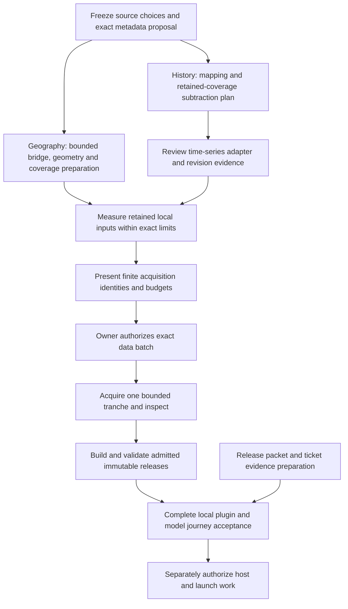

# Production data build decision — concrete preparation

Prepared 15 October 2026 against branch `codex/plugin-v1`, implementation baseline `c64d9fdd4504d9d83d4ed6492ee92ae39f55b0df`. **No acquisition, model testing, deployment or publication is authorized by this record.** This is the integrated result of the owner's three preparation lanes, not another implementation wave.

## Recommended decisions

| Area | Recommendation | What remains a decision / evidence gate |
| --- | --- | --- |
| Global observing candidates | Retain the eight dated Geofabrik OSM inputs already proposed, with strict source identity and a conservative extraction-coverage audit. Use geoBoundaries gbOpen for country/state enrichment. | Exact boundary commit/layer inventory, fresh source identities, actual geometry compatibility, extraction residuals, measured producer resource use and public derivative offer are not admitted. |
| Historical science | Retain ERA5 hourly total cloud cover and existing 1991–2020 dark-cloud method. Evaluate the documented point/time-series access route before assuming a huge legacy grouped-request schedule. | A different access identity requires source/revision/format admission and a reviewed adapter. Documentation availability is not a successful request. |
| Historical launch coverage | Present an explicitly covered-cell release as an incremental option for owner review, while keeping complete quarter-degree worldwide history an open delivery target. | **No scope reduction is accepted here.** An incremental release must say where historical context is unavailable. Global place resolution/planning and full historical-grid coverage are separate claims. |
| Build resources | Use one heavy build at a time on the current local machine, measure retained-input behavior first, preserve a shared free-space reserve. Keep bulk history/raw OSM off the small serving host. | Proposed ceilings are stop conditions, not measured fit, ETA, permission or actual Hetzner sizing. |
| Remaining tickets | Preserve the original acceptance ledger and stop treating held launch gates as missing generic software. | **12 Done / 9 Partial / 6 Not started** remains unchanged. Production data and host/client/public-release evidence are still missing. |

Owning packets: [geography source/build proposal](production-geography-build-proposal.md), [history coverage/build proposal](production-history-build-proposal.md), [remaining original tickets and complete-plugin checklist](v1-remaining-ticket-release-matrix.md). Existing [source decision record](production-data-decision.md) and source-specific contracts remain authoritative.

## What the research changes

The official current [ERA5 ARCO/time-series guide](https://confluence.ecmwf.int/spaces/CKB/pages/505390919/ERA5%2Bhourly%2BAnalysis%2BReady%2BCloud%2BOptimised%2BARCO%2Bdata%2Bon%2Bsingle%2Blevels%2Bfrom%2B1940%2Bto%2Bpresent%2BProduct%2BUser%2BGuide%2BPUG), checked 15 October 2026, lists total cloud cover and describes point/limited-area long time-series retrieval. This is promising for scattered destinations. Its format, final-revision assurance, access dependencies, actual transfer amplification and service continuity require admission; the guide warns that the time-series entry can be withdrawn or change format. No store metadata, data chunks or time-series requests were made.

The complete rectangular quarter-degree grid illustration is **1,038,240 source nodes**. At the existing padded 263,088 hourly instants, that is **273,148,485,120 scalar values**. Float32 values alone represent about **0.994 TiB uncompressed**; this is not a compressed download estimate or a requirement to retain that whole payload simultaneously. Current publication admits **10,000 explicit cell/timezone pairs**, not a million-node whole-world release. A complete build therefore needs both an appropriate streaming/retention design and a reviewed serving hierarchy or changed admission. File downloads alone cannot close that gap. Actual node/pole/seam conventions and multi-zone pair counts must come from admitted inputs.

## One shared local resource decision

Read-only observation **2026-10-15T15:00:59.4105410Z**: free physical memory 17,561,849,856 bytes (**16.36 GiB**), free C: disk 314,638,774,272 bytes (**293.03 GiB**), total RAM 66,094,223,360 bytes, 24 logical processors. This is the build machine snapshot only, not a reservation, throughput measurement or production-host observation.

| Proposed stage | Admission ceiling, not expected use | Scheduling rule |
| --- | --- | --- |
| Retained geography characterization | 4 GiB new writes, 4 GiB RSS / 8 GiB commit, 30 minutes, one supervised job | No downloads. Admit exact retained manifest and paths before running. Existing raw-producer measurements must not be confused with the older pilot parser. |
| First future OSM production tranche | Antarctica dated source, at most 64 MiB body transfer; 4 GiB scratch, 1 GiB output/reports; 4 GiB RSS / 8 GiB commit; two-hour build stop | Exact metadata, transfer controls, bridge configuration and source checks first; one tranche then inspect. This is a production cost/format check, not proof of global or dense-source fit. |
| Conditional complete geography allocation | 160 GiB additional allocation: 82 GiB sources, 48 GiB scratch, 12 GiB aggregate output/intermediates, 12 GiB newly retained prior edition, 6 GiB failures/reports | Keep 96 GiB free reserve; recorded snapshot leaves about 37.03 GiB unallocated. Actual global scratch/output needs remain unmeasured. The proposed 48-hour ceiling is raw production only; later stages have their own smaller limits. |
| First future history acceptance batch | One exact approved job, at most 32 MiB raw, 128 MiB new retained files, 512 MiB scratch, existing decoder controls, 30-minute batch stop | No concurrent heavy geography work. The geography 96 GiB reserve also governs while its files remain; the history packet's isolated 64 GiB floor never authorizes spending that reserve. |

Existing retained files are already reflected in observed free space. Count their future growth and every new raw/temporary/checkpoint/failure/output/rollback path; do not subtract existing bytes twice. Recheck physical free disk, memory and commit immediately before each stage. No automatic deletion or scope increase is approved. Historical continuation beyond its tiny acceptance batch needs a new cumulative envelope; these numbers do not admit a global historical build.

## Concrete sequence and parallel work

Geography and history preparation can run in parallel, alongside release documents. Heavy builds share the machine sequentially. Data acquisition and model/client actions remain held. The diagram describes future gates, not actions performed by this preparation wave.

| Next concrete local work | Original task mapping | Completion evidence required |
| --- | --- | --- |
| Explicit bridge limits/caller and partition/release plan | 0 / 8 | Current four-path bridge CLI uses defaults: 60 seconds, 128 MiB input/output/scratch, 100,000 rows. API hard ceilings are 30 minutes, 10 GiB each and 10 million rows. A reviewed configuration route and coherent partition design are prerequisites; the 12 GiB aggregate allocation does not raise any single-build cap. |
| Boundary normalization and coverage preparation for selected inputs | 8 | Provider metadata becomes strict RegionRef geometry with preserved holes/islands/dateline splits. Partitioning preserves global ambiguity. Conservative full-cell footprint construction retains residuals; administrative membership alone proves no extraction completeness. Implement only after its exact source/geometry contract is frozen. |
| Explicit mapping inventory and source-hour subtraction | 9 | Pin destination/grid/IANA provenance and union already completed cell/hour coverage before scheduling. Reuse existing March and monthly evidence; different job names never justify duplicate downloads. |
| Selected history access adapter and retained-input performance characterization | 0 / 9 | Evaluate parent versus documented time-series route; prove revision, units, dimensions, padding and lineage through existing aggregation without live data calls. Measure isolated decode and pair-hour work; do not extrapolate provider queue or unrelated test duration. |
| Full-grid serving architecture, if pursuing that release before launch | 9 / 14 | A reviewed bounded root/coverage design and measured artifact/cache footprint for more than current 10,000 pairs. Do not simply raise caps or silently replace quarter-degree coverage with a coarser grid. |
| Align release evidence and original ticket checklist | 12–15 | Exact future package/artifact/host/client evidence inventory; five workflows and fourteen tools. Settled owner facts stay recorded; missing verified identity/host facts remain pending. No repeated generic audits or new completion credit. |

These are conditional, input-specific tasks. This record does not instruct implementation of every possible global framework, pick a new scientific method or authorize another small-country pilot. Source-body metadata admission, acquisition and any new format dependencies must remain explicitly bounded.

## Release and remaining gates

The local code paths now exist for raw source production, strict membership enrichment, observation aggregation, immutable publication, lazy serving and release dependency checks. No generic current defect is established by this ticket audit. The remaining matrix distinguishes source/scale validation, events coverage, real baseline construction, exact host/identity/retention inputs, native intended-client acceptance, official review and public launch, real pilot outcomes, and the separately scoped website.

Full complete-plugin tests will use actual admitted release artifacts, all five workflows and fourteen tools, and label live versus fixture/unavailable providers. Existing Codex evidence is useful but not a fresh full-client acceptance matrix. Claude remains deferred; no authentication retries or model runs occurred here.

## Review and delivery record

This preparation changes documentation only. Arithmetic, link targets, original ticket reconciliation and interface/budget consistency are the applicable checks. Existing implementation and its passing CI are not new test evidence for these proposals. Independent integrated review and exact pushed-revision CI outcomes are recorded in the preparation ledger and delivery response after observation. No acquisition manifest is executable until its exact coordinates/files, identities, paths and finite allowance are supplied and approved.
