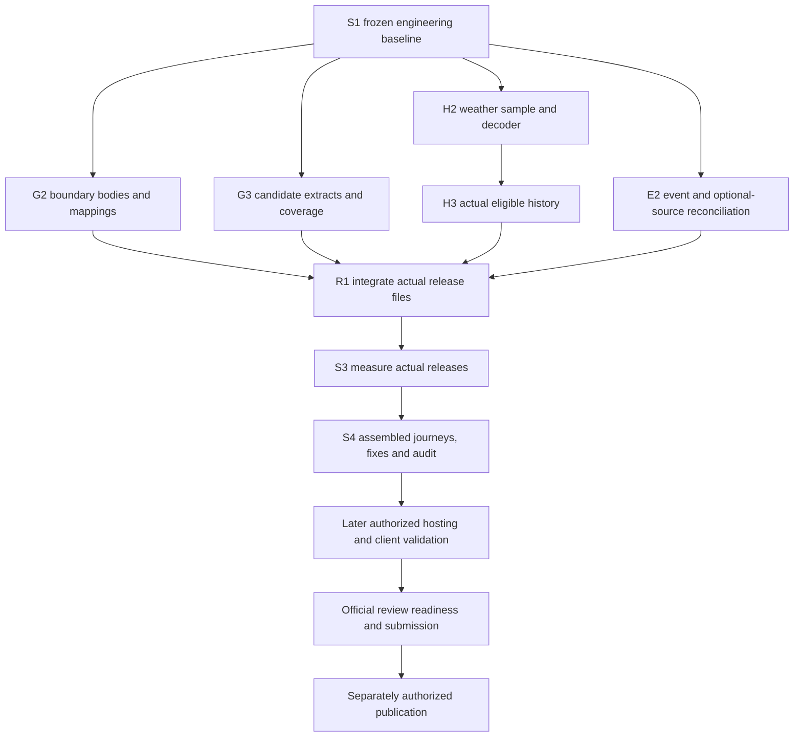

# V1 completion tracker

Updated: 16 October 2026. This is the single current progress tracker. Historical wave reports remain evidence, not replacement plans.

## Fixed scope and accounting

Keep the owner's [four-stage completion contract](v1-production-completion-goal.md). S1–S4 are permanent stage IDs, not new tickets. The [original 27-ticket matrix](v1-remaining-ticket-release-matrix.md) remains authoritative: **12 Done / 9 Partial / 6 Not started**. Completing a subtask does not automatically close a ticket.

Current reviewed engineering: `b80becb2c794251dbd77fb6cd2a9881f569b242f`, package 1.0.13, [six passing CI jobs](https://github.com/tandavkrishna27/nightsky.earth/actions/runs/38858820230). Preserve the earlier `c7e898c` comparison baseline.

Global, free product; shared MCP and five workflows; no database. Claude testing remains owner-deferred. This document authorizes no downloads, provider/model calls, deployment or publication.

## Stage dashboard

| Fixed stage | Status | Completed evidence | Remaining acceptance |
| --- | --- | --- | --- |
| S1 — Freeze local build | Complete for engineering baseline | Reviewed code/package; latest 849 Node passes, one existing skip; 89 ERA5 passes; types/build/packages/runtime checks; six green CI jobs. | Preserve baseline and record subsequent changes separately. No production readiness inferred. |
| S2 — Finalize production data | In progress | Retained regional inputs; producer/bridge optimization; bounded lineage; 2025–2027 peaks; verified request and offline adapters. | Actual intended global sources, geometry/mappings, historical baseline, supported events, rights and repeatable release files. |
| S3 — Measure actual releases locally | Pending actual release artifacts | Synthetic and retained-source measurements reusable within their scope. | Actual storage, peak memory, startup, response and refresh costs; current/rollback/scratch/reserve fit. |
| S4 — Test assembled product and final audit | Pending assembled release; earlier evidence retained | Journey fixtures, earlier native Codex evidence and package/runtime checks. | Actual-release journeys, permitted live conditions, owner questions, material fixes and final audit. Claude deferred. |

**One of four stages complete; S2 in progress; S3/S4 acceptance pending.** This is not a percentage of effort or a time estimate.

## S2 work register and parallel lanes

Row IDs stay fixed after completion. Root owns integration/docs. Heavy builds share one machine and resource envelope.

| ID | Lane / original tickets | Status and deliverable | Exit evidence / dependency |
| --- | --- | --- | --- |
| S2-G1 | Geography / 0, 8 | Complete as software preparation: producer/bridge, geometry preparation and pinned local ingestion. | [Producer evidence](local-engineering-acquisition-wave.md), [adapter evidence](offline-timeseries-boundaries-wave.md). No actual global coverage inferred. |
| S2-G2 | Geography / 0, 8 | Approved tranche attempted: first GET timed out, zero retained body bytes; second not attempted. [N4 results](n4-acquisition-results.md). Renewed allowance needed before another attempt. | Exact bodies/hashes, reviewed provider IDs, topology/membership tests and measured preparation resources. |
| S2-G3 | Geography / 0, 8 | Pending source acceptance: actual global candidate catalogue and extraction completeness. | Accepted extracts/footprints, coverage/residual manifest, reproducible catalogue and attribution/public offer where required. Boundaries alone prove neither extraction completeness nor access. |
| S2-H1 | History / 0, 9 | Complete as preparation: request syntax, bounded lineage and offline adapter. | [Time-series contract](era5-timeseries-adapter.md). Live execution/scientific acceptance not enabled. |
| S2-H2 | History / 0, 9 | Approved one-job attempt stopped `submission-uncertain`; no job ID/raw recorded. [N4 results](n4-acquisition-results.md). Diagnostics corrected offline; no resubmission. | Reconcile remote uncertainty; renewed finite authority before another attempt; actual format/point/time/units/missingness and decoder acceptance. |
| S2-H3 | History / 0, 9 | Pending H2: practical baseline acquisition and coverage. | Measured practical route/cost, explicit cell/timezone/1991–2020 coverage, approved finite continuation, eligible statistics and immutable release. Proposed millions of jobs are not demonstrated feasibility. |
| S2-E1 | Events / 0, 6 | Partial: peaks and supported calculations. | [Current event delivery](source-admission-three-lane-wave-20261016.md); supported years/types bounded explicitly. |
| S2-E2 | Events / 0, 6 | Reviewed [coverage/rights matrix](s2-events-coverage-matrix.md) prepared; specific season/method/source questions remain open. | Source/science dispositions and validated model/reference rights; matrix preparation alone does not close acceptance. |
| S2-R1 | Integration / 0, 8, 9 | Pending G3/H3/E2: assemble actual releases. | Source/dependency inventory, real coverage/quality checks, unavailable states and release digests. |

G2/G3, H2/H3 and E2 can advance independently where inputs exist. Do not reopen completed generic adapters without a concrete finding.

## Dependencies through completion

The arrows below are acceptance dependencies, not a ban on preparing later checklists early. Geography source/extract preparation can run alongside boundary work; final geographic membership joins both. Each lane may obtain its own bounded allowance without waiting for an unrelated lane.

| Stable row | Status | Concrete action and completion evidence |
| --- | --- | --- |
| S3-M1 | Pending R1 | Pin actual inputs/artifacts; measure supervised build/refresh duration, disk/scratch and peak memory. Retain reproducible commands, workload and results. |
| S3-M2 | Pending R1; final fit needs M1 | Measure startup, response latency, bounded concurrent workload and cache behavior; calculate serving/current/rollback/reserve totals against the proposed small-server envelope. This does not prove actual Hetzner fit. |
| S4-T1 | Pending R1; final acceptance after S3 | Assemble exact plugin/data tuple; verify five skills and fourteen tools; run the existing fifteen journeys and eight review cases, including negative/error/missing-data paths and permitted live APIs. Record actual native discovery/reference/tool use, not prompt-only substitution. |
| S4-T2 | Pending T1 and owner's session | Owner tries their questions. Retain versioned findings; no owner testing result may be invented or closed autonomously. Claude stays deferred. |
| S4-T3 | Pending M1/M2/T1/T2 | Fix material failures, rerun affected regressions, perform final requirement/security/source/privacy review and full release checks; freeze the reviewed package/data digests and exact-commit CI. Use the [existing acceptance checklist](v1-remaining-ticket-release-matrix.md#complete-local-testing-checklist-for-the-release-candidate). |

Later order: owner host/identity inputs and concrete deployment approval → staging HTTPS/TLS/proxy/retention/capacity/rollback (14), real connection/draft/location contract (3B/3C/4B), complete metadata/policies/native-client matrix and official review packet (12A/12B/13/15) → explicitly authorized submission (16) → review fixes → separately authorized publication (16). Tester pilot (17) can start after usable staging with invitation authorization; it need not wait for publication. Website (18) remains independent. These are existing ticket gates, not extra local stages.

If actual source feasibility fails, record the failure and a concrete alternative under its existing row. A coverage reduction requires an explicit owner decision; neither an unavailable answer nor a successful tiny sample closes promised global coverage. Early measurements and journeys may run on accepted subsets, but final S3/S4 evidence must use the intended actual release.

## Ordered next batch

- [x] N1: Prepare the geography acquisition packet: exact two pinned bodies totaling 54,014,085 bytes, scratch/time bounds and stop conditions; reuse retained licence/listing metadata. [Reviewed proposal](s2-geography-acquisition-proposal.md); no download.
- [x] N2: Prepare the weather sample execution contract and gated wrapper: fixed request, one job, byte/time/storage/poll bounds, hard containment, credentials isolation and quarantine. [Reviewed packet](s2-weather-sample-proposal.md); default remains offline, execution requires separate allowance.
- [x] N3: In parallel reconcile E2 using retained evidence; list genuine source questions without automatically fetching data. [Reviewed matrix](s2-events-coverage-matrix.md); science/source gates remain open.
- [ ] N4 (partial): Packets approved and bounded attempts executed; weather uncertain, first geography GET timed out. [Results and corrections](n4-acquisition-results.md). No actual dataset accepted; renewed finite allowance required for further remote actions. E2 source/science questions remain separate.
- [ ] N5: Use measured findings to complete G3/H3/R1, then S3 and S4. Corrections stay under the same stage IDs.

No dataset request is authorized by this tracking plan. Download-batch count and total ETA remain unknown until actual formats and throughput are measured.

## Every remaining original ticket

| Original heading(s) | Remaining acceptance location |
| --- | --- |
| 0, 6, 8, 9 | S2 data/source gates and S3 measurements; 0/8/9 also require later host acceptance. |
| 12B | S4 local native evidence; hosted ChatGPT/Gemini evidence later as applicable. Claude deferred, not passed. |
| 12A, 13, 14, 15 | Local preparation during S2–S4; final identity/URLs, hosted privacy/capacity and official validator/reviewer gates later. |
| 3B, 3C, 4B | Later actual staging/account/identity/draft and intended-client gates. Local tests cannot close these. |
| 16 | Later authorized submission, review and separately authorized publication. |
| 17 | Later authorized pilot and observed real-user outcomes. |
| 18 | Separate website scope, independent of local plugin completion. |

All nine Partial and six Not started headings are represented. None is deleted, renumbered or silently moved to a future product version. Hosting, publication and pilot remain visible later gates outside the four-stage local completion contract.

## Update protocol — every delivery

1. Update the existing row's status, remaining acceptance and evidence link. Never reset S1–S4.
2. Record commit, affected verification and exact-commit CI. Separate fixtures, retained samples, real release data and native client evidence.
3. Close original tickets only against original acceptance; update the matrix and implementation status together. Otherwise report subtask progress and unchanged ticket totals.
4. Put discoveries under their existing stage. Explicitly identify scope changes and owner decisions; do not create a new numbered finish line.
5. Report stage/row IDs, rows advanced/closed, blockers and the next concrete action. Never substitute a freshly regrouped wave count.

## Delivery ledger

| Date / commit | Rows advanced | Evidence / remaining gates |
| --- | --- | --- |
| 16 Oct / `3466986` | S2-E1; source preparation | [Source/event delivery](source-admission-three-lane-wave-20261016.md): twelve actual 2027 maxima, package 1.0.13. |
| 16 Oct / `b80becb` | S2-G1, S2-H1 | [Offline adapters](offline-timeseries-boundaries-wave.md): reviewed, tested, six CI jobs green. Actual bodies/science/release gates open. |
| 16 Oct / tracker reconciliation | Reporting only | Original four-stage owner contract restored. No code, acquisition or ticket acceptance changed. |
| 16 Oct / S2 N1–N3 preparation | S2-G2/H2/E2 subtasks | [Integrated record](s2-acquisition-preparation-wave.md): reviewed source proposals, event reconciliation and offline-tested sample wrapper. N1/N2/N3 complete; N4 authorization/acquisition and actual G2/H2/E2 acceptance remain open. Original ticket totals unchanged. |
| 16 Oct / N4 bounded attempts | S2-G2/H2 findings; N4 partial | [Actual outcomes](n4-acquisition-results.md): weather submission uncertain, first geography GET timed out, second not attempted. No dataset accepted; offline defects corrected and evidence preserved. |

## Tracker review — 16 October 2026

Reviewed against the original remaining-ticket matrix, four-stage contract and latest adapter evidence. All 15 remaining headings map to a stage or explicit later gate; 12 + 9 + 6 = 27. Corrected the initial tracker's overly compressed S3/S4 sequence by adding stable measurement/test rows, owner-testing dependency, explicit later hosted order and independent geography/history/event joins. No original acceptance or product scope changed. Historical snapshots stay linked and labelled. Documentation checks cover local links and whitespace; no application tests are needed for this documentation-only change.
