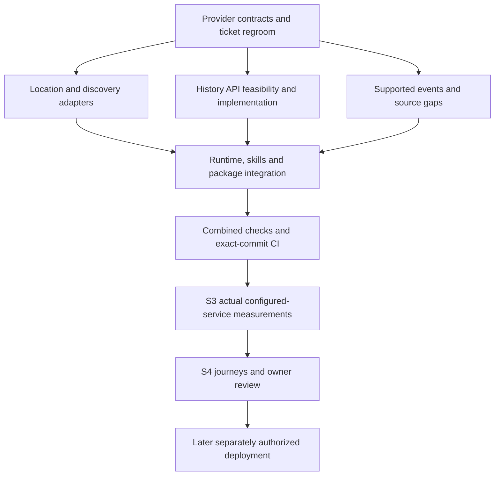

# V1 completion tracker

Updated: 17 October 2026. **Current plan: API-first, multiple suitable sources, no exhaustive owned global catalogue prerequisite.** This tracker supersedes earlier acquisition-wave sequencing. See the [owner decision](api-search-discovery-v1-decision.md), [regroomed execution plan](../superpowers/plans/2026-10-17-api-first-v1-regroom.md) and [27-ticket acceptance matrix](v1-remaining-ticket-release-matrix.md).

## Where we stand

Original executable headings: **12 Done / 9 Partial / 6 Not started = 27**. Original numbered groups: **6 Done / 10 Partial / 3 Not started = 19**. A scope change is not implementation evidence and adds no completion credit. Done means the original local deliverable, not production readiness or immunity from regression checks.

- Working local MCP/tool/skill baseline exists. MET Norway forecasts and NOAA aurora adapters, astronomy calculations and supported event calculations can be reused.
- An opt-in API discovery implementation is implemented and locally verified: GeoNames/Geoapify adapters and source-revision selection. Legacy catalogue modes remain available; live provider acceptance is still pending.
- API mode resolves names remotely and does not require local GeoNames/OSM files. Legacy modes still use their reference artifacts; do not delete those files on behalf of legacy runtime users.
- Bulk planet receipt/build, exhaustive candidate membership/footprint preparation and their capacity gates are **deferred outside V1**. Do not resume them to close V1.
- Historical-weather capability remains required for source-route evaluation. API-first access must preserve defined period, quality, timezone and missingness semantics; current prepared-history code is retained but does not establish an on-demand API route.
- Event/source gaps, client integration, owner testing and later hosted/publication gates remain explicit.

The [previous tracker snapshot](archive/v1-completion-tracker-before-api-regroom-20261017.md) preserves engineering evidence and failed attempts. Synthetic/retained tests do not establish live API suitability or actual release acceptance.

## Source research and implementation update — 17 October 2026

[Consolidated free API research and cleanup plan](api-provider-research-and-cleanup-plan.md): three official-source investigations completed. GeoNames + Geoapify are the recommended location shortlist; MET/NOAA/local astronomy retained; CDS point history remains a feasibility gate. The subsequent implementation wave adds adapters, runtime and workflow changes; offline review/tests are recorded separately and do not close live-source gates. Cleanup is planned, not executed; original counts are unchanged.

## Stable stages

| Stage | Status | Remaining acceptance |
| --- | --- | --- |
| S1 — Local engineering baseline | Complete for original baseline | Preserve code/evidence; rerun affected regressions for API mode |
| S2 — Ready data access and supported content | In progress | Suitable free providers; working location/discovery adapters and host-search fallback; historical route decision; supported event/source coverage; explicit unavailable states |
| S3 — Measure actual configured service locally | Pending working S2 configuration | Startup/peak memory, bounded cache/storage, latency/concurrency, rate-limit and failure behavior, refresh/rollback needs; actual enabled sources/content |
| S4 — Assembled experience and final audit | Pending assembled configuration | Existing journeys, native tool/skill behavior, permitted live checks, owner questions and fixes; Claude remains owner-deferred |

## Work register — stable IDs, revised acceptance

| ID | Original tickets | Status / concrete next result |
| --- | --- | --- |
| S2-G1 | 0, 4, 8 | Bounded GeoNames/Geoapify design recorded; API identity/selection and adapters locally verified. Live accounts/policy/endpoint checks and restart-safe quota admission remain open |
| S2-G2 | 4, 8 | Historical boundary preparation completed within its scope; exhaustive boundary/membership build deferred. API-based region filtering and exact-site timezone validation remain to implement/test |
| S2-G3 | 0, 8 | Opt-in API discovery, snapshot details and planning locally verified; optional host-search guidance updated. Unsupported complex administrative combinations retain explicit gaps; no mandatory global catalogue |
| S2-H1 | 0, 9 | Existing history preparation/decoder software retained; evaluate API-first history source, free-use limits and scientific/statistical equivalence |
| S2-H2 | 9 | Retained sample acceptance is historical evidence only; no complete baseline or live API claim. Cleanup must not trigger automatic reacquisition |
| S2-H3 | 0, 9 | Select practical history route and implement/validate it, or present a concrete unmet capability decision to owner. Do not silently drop history or restart bulk jobs |
| S2-E1 | 6 | Existing calculated astronomy/events and small reviewed content retained; finish supported event coverage and regression checks |
| S2-E2 | 0, 6 | Resolve remaining season/radiant/year/source rights gaps; use an API where suitable, otherwise explicit supported content/limitations. No invented universal event API |
| S2-R1 | 3, 8, 12A, 14 | API-mode bootstrap/preflight and five skills updated; no-local-geography compiled smoke added to CI. Full historical and hosted release gates remain independent |
| S3-M1 | 0, 8, 9, 14 | Measure actual configured-service storage/cache/startup/peak memory and update/refresh cost; bulk planet build not required |
| S3-M2 | 0, 8, 9, 14 | Synthetic offline measurement harness implemented; actual enabled-source latency/concurrency/quotas and small-host fit remain pending permitted live evidence |
| S4-T1 | 12B, 15 | Run existing fifteen journeys/eight review cases in API mode, including absent host search, ambiguous locations and unavailable sources |
| S4-T2 | 12B, 17 | Owner questions and feedback; actual tester activity only when authorized |
| S4-T3 | 15 | Fix material findings, final source/security/privacy/requirements audit, package freeze and exact-commit CI |

## Ordered execution and parallel work

1. **Regroom and source admission (current):** original-ticket reconciliation, provider/data matrix, code migration plan and independent review. History and event audits may run beside discovery design.
2. **Implementation lanes:** A location/discovery adapters; B independent history/events source work; C runtime/package/skills/test updates after A's shared interface is frozen. Assign shared registry/schema files to one integration owner.
3. **Integrate:** targeted tests per change, combined suite/types/build/package/runtime checks at milestone; update evidence, push and observe CI for that exact commit.
4. **Measure S3:** actual API-mode configuration and remaining required content. Separately authorize bounded live calls; fixtures alone do not prove live availability or useful search quality.
5. **S4 and later gates:** assembled journeys and owner review; only afterward host configuration, authorized staging, actual client/draft checks, submission and publication. Website remains separate.

## Current implementation evidence

See [API local setup](api-mode-local-setup.md), [provider admission](api-provider-admission.md), [history feasibility](history-api-feasibility.md) and [event gaps](api-event-gaps-20261017.md). [Local wave evidence](api-migration-wave-20261017.md) records approved review fixes, full integration and targeted tests, built-runtime checks and remaining activation gaps. Exact-commit CI is checked after push. Original counts remain unchanged; unsupported scope and live activation gates are not marked complete.

## Code correction boundaries

See the [implementation plan](../superpowers/plans/2026-10-17-api-first-v1-regroom.md) for exact files/tests. Main changes: discovery provider interfaces/adapters; registry and planning selection; stable source-backed candidate identities/timezone handling; runtime/preflight mode; five skills and matching workflow documents; API-mode tests/CI/measurement inputs. Preserve astronomy, MET/NOAA adapters, generic controls and useful optional catalogue code. Do not delete code merely to make the new plan look simpler.

## Verification and cleanup status

Latest verified pushed baseline: `e0916cee3a1c7656a12cfd1319ea4ecd7158a2ea`, [all six CI jobs passed](https://github.com/tandavkrishna27/nightsky.earth/actions/runs/39001214466). This includes the reviewed Windows directory/path corrections and API scope decision. Local preparer verification ran 22 tests: 21 passed, one privilege skip. That baseline includes the original-ticket regroom. The current source-research update changes documentation, not runtime implementation; its own exact-tip CI must be checked after push.

Owner authorized downloaded-data cleanup. Automatic execution policy rejected deletion before execution. [48-file manifest/report](dataset-cleanup-api-v1-20261017.md) and [manual folder guide](manual-dataset-cleanup-20261017.md) identify about 1.86 GB, still retained at last verification. Preserve the required GeoNames gzip until replacement exists. No 95 GB planet body was downloaded. No new dataset/provider job, deployment or publication is authorized by this regroom.
