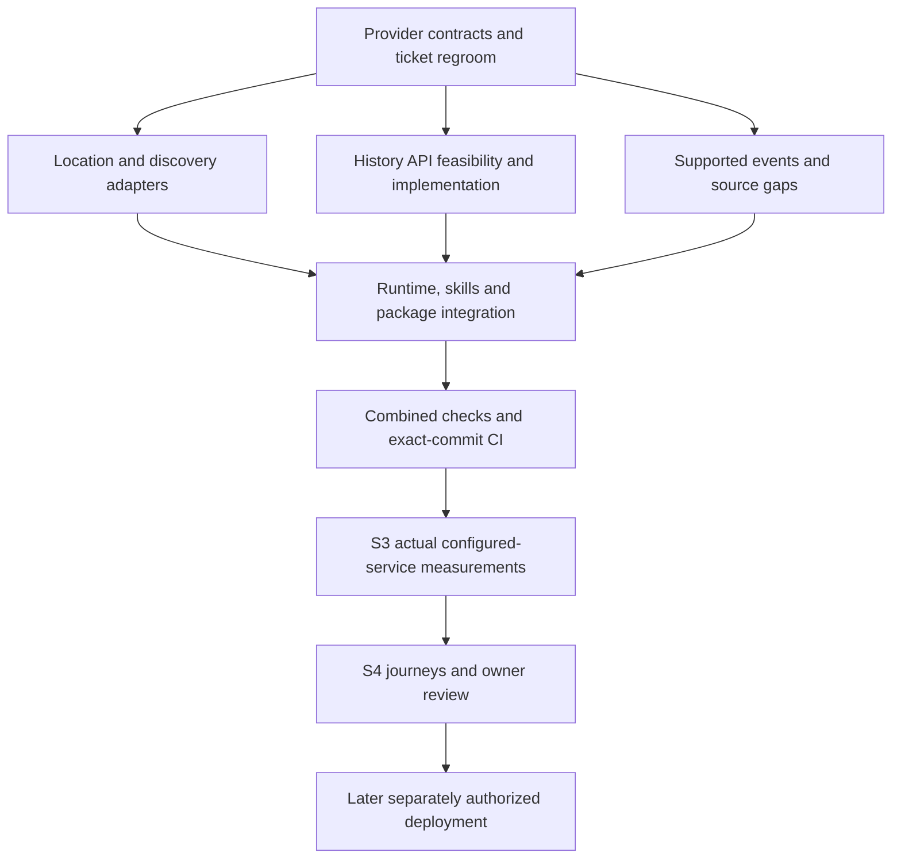

# V1 completion tracker

Updated: 17 October 2026. **Current plan: API-first, multiple suitable sources, no exhaustive owned global catalogue prerequisite.** This tracker supersedes earlier acquisition-wave sequencing. See the [owner decision](api-search-discovery-v1-decision.md), [regroomed execution plan](../superpowers/plans/2026-10-17-api-first-v1-regroom.md) and [27-ticket acceptance matrix](v1-remaining-ticket-release-matrix.md).

Latest completed execution: [source/native results](source-native-acceptance-results-20261017.md), commit `18d1be04f5921758bb6fb7b8c3556787e50c1ac7`, [all six CI jobs passed](https://github.com/tandavkrishna27/nightsky.earth/actions/runs/39027586708). Current work: [V1 outdoor conversation plan](../superpowers/plans/2026-10-17-v1-outdoor-conversation.md). All agreed outdoor defaults, activity-aware discovery, clarification and conversation-quality acceptance belong to V1.

## Remaining sequence — one checklist

These six blocks group the original tickets; they are not new tickets or a guarantee of one coding session each. Keep open work inside its block instead of resetting the wave count. Three local completion blocks precede three release stages. Website Task 18 remains separate.

| Order | Completion block | Status | Exit evidence / original tickets |
| --- | --- | --- | --- |
| 1 | Capability gaps: history, geography, events in parallel | Local implementation integrated; live/source acceptance remains | Source-qualified implemented behavior, explicit unresolved gates; 0/6/8/9 |
| 2 | Assemble and measure | Package assembled and offline measurements passed; actual-source/host acceptance remains | Integrated tools/skills/package, attribution/privacy flows, measured bounded memory/cache/concurrency/failures; 12A/13/14 |
| 3 | Full local experience and final audit | API scripted cases passed; assembled native-model/owner review remains | Existing journeys, Codex/owner questions, material fixes, criterion reconciliation; 12B/15. Claude deferred |
| 4 | Hosting and actual client checks | Later; no deployment authorized | Hetzner/HTTPS, actual connection/location checks, rollback, publisher/URL evidence; 0F/3B/3C/4B/12A/14 |
| 5 | Submission and publication | Later; explicit authorization required | Official validation/review and authorized publication; 15/16 |
| 6 | Pilot and feedback | Later | Real invited-user evidence; 17 |

Latest local milestone: [three-session completion run](parallel-completion-run-20261017.md), integrating geography, history and events with the API planner/runtime, privacy, package and rehearsal changes. **1,446 Node tests passed, zero failed, two skipped**; 214 ERA5 and 245 geography Python tests passed (13 skips); types, builds, both local packages and compiled runtime checks passed. Integration and its documentation follow-up are pushed at `627c3769c7bf3ea335444eaab864258381c1b807`; [all six exact-commit CI jobs passed](https://github.com/tandavkrishna27/nightsky.earth/actions/runs/39023699488). The preceding baseline `bc8de008` passed all six [CI jobs](https://github.com/tandavkrishna27/nightsky.earth/actions/runs/39019791036); that earlier result does not validate this newer integration.

Current block 1 deliverables: distinct hosted historical method and one successful bounded pilot; staged opt-in geometry retrieval/discovery with snapshot evidence; IGN civil meteor guidance and bounded radiant sampling. See the [latest wave evidence](activation-integration-wave-20261017.md). Full history admission/baseline, real geometry acceptance and remaining event references stay open. The one-request history allowance is consumed; no further live calls are implied.

## Next validation preparation

Three parallel preparations now map to the existing blocks, not new waves:

| Existing block | Concrete packet | Readiness |
| --- | --- | --- |
| 1: geography | [Country selection results](source-native-acceptance-results-20261017.md) | Structured and revised filter-free attempts both empty; allowances consumed. Point discovery remains independent. Country geometry acceptance remains open |
| 1: history | [Annual result and accounting](source-native-acceptance-results-20261017.md) | Accounting added preserving counters; one annual request passed: 8,784 hours, no missing/nulls. Allowance consumed. Production method/full-baseline admission remains open |
| 3: experience | [Native installation](native-acceptance-path-20261017.md) and [V1 behaviour contract](../product/v1-outdoor-discovery-contract.md) | 1.0.14 installed; refreshed tool exposure remains unresolved. Outdoor behaviour correction and conversation variants are V1 acceptance. Claude deferred |

Offline preparation was followed by exactly one owner-approved Geoapify selection request, which stopped empty. No historical request, private ledger reset, installation or deployment occurred. The earlier history runner was not suitable
for a standalone calendar-year probe; this gap is explicit rather than using a
full-baseline request or weakening its decoder. Current original counts remain
unchanged. Validation evidence for these preparation changes is recorded in
[next validation preparation](next-validation-preparation-20261017.md): **1452 tests passed, zero failed, two skipped**, all type checks passed; exact pushed-commit CI is checked separately.

## Where we stand

Original executable headings: **12 Done / 9 Partial / 6 Not started = 27**. Original numbered groups: **6 Done / 10 Partial / 3 Not started = 19**. A scope change is not implementation evidence and adds no completion credit. Done means the original local deliverable, not production readiness or immunity from regression checks.

- Working local MCP/tool/skill baseline exists. MET Norway forecasts and NOAA aurora adapters, astronomy calculations and supported event calculations can be reused.
- An opt-in API discovery implementation is implemented and locally verified: GeoNames/Geoapify adapters and source-revision selection. Legacy catalogue modes remain available; initial Geoapify live connectivity passed, while broader provider acceptance remains pending.
- API mode resolves names remotely and does not require local GeoNames/OSM files. Legacy modes still use their reference artifacts; do not delete those files on behalf of legacy runtime users.
- Bulk planet receipt/build, exhaustive candidate membership/footprint preparation and their capacity gates are **deferred outside V1**. Do not resume them to close V1.
- Historical-weather capability remains required for source-route evaluation. API-first access must preserve defined period, quality, timezone and missingness semantics; current prepared-history code is retained but does not establish an on-demand API route.
- Event/source gaps, client integration, owner testing and later hosted/publication gates remain explicit.

The [previous tracker snapshot](archive/v1-completion-tracker-before-api-regroom-20261017.md) preserves engineering evidence and failed attempts. Synthetic/retained tests do not establish live API suitability or actual release acceptance.

## Source research and implementation update — 17 October 2026

[Consolidated free API research and cleanup plan](api-provider-research-and-cleanup-plan.md): three official-source investigations completed. GeoNames + Geoapify are the recommended location shortlist; MET/NOAA/local astronomy retained; The later history route decision selects Open-Meteo ERA5 as the conditional integration candidate; CDS is not the active implementation route. The subsequent implementation wave adds adapters, runtime and workflow changes; offline review/tests are recorded separately and do not close live-source gates. Cleanup is planned, not executed; original counts are unchanged.

## Stable stages

| Stage | Status | Remaining acceptance |
| --- | --- | --- |
| S1 — Local engineering baseline | Complete for original baseline | Preserve code/evidence; rerun affected regressions for API mode |
| S2 — Ready data access and supported content | In progress | Suitable free providers; working location/discovery adapters and host-search fallback; historical route decision; supported event/source coverage; explicit unavailable states |
| S3 — Measure actual configured service locally | Pending working S2 configuration | Startup/peak memory, bounded cache/storage, latency/concurrency, rate-limit and failure behavior, refresh/rollback needs; actual enabled sources/content |
| S4 — Assembled experience and final audit | Pending assembled configuration | Existing journeys, native tool/skill behavior, permitted live checks, owner questions and fixes; Claude remains owner-deferred |

## Work register — stable IDs, revised acceptance

| ID | Original tickets | Status / concrete next result |
| --- | --- | --- |
| S2-G1 | 0, 4, 8 | Bounded GeoNames/Geoapify design recorded; API identity/selection and adapters locally verified. Private accounts, persistent quota initialization and the first bounded live batch are verified; public policy/attribution and broader acceptance remain open |
| S2-G2 | 4, 8 | Historical boundary preparation completed within its scope; exhaustive boundary/membership build deferred. Expanded scope/timezone fixtures, inactive membership composition and a bounded snapshot-relative geometry decoder/classifier are implemented. Selected-region Geoapify retrieval and discovery composition are now implemented behind two disabled gates, with bounded quota/cache and geometry receipts; one bounded live geography attempt stopped at country selection (one HTTP 200 response); geometry source admission/live verification remain open |
| S2-G3 | 0, 8 | Opt-in API discovery, snapshot details and planning locally verified; optional host-search guidance updated. Unsupported complex administrative combinations retain explicit gaps; no mandatory global catalogue |
| S2-H1 | 0, 9 | Existing history tooling retained; conditional Open-Meteo ERA5 offline partition/decoder contract implemented. Current free/ad-free/no-affiliate facts are settled. Official source inspection establishes whole-percent quantization and a one-unit pilot estimate; distinct method defined, one 336-hour wire pilot passed, and retained-data sample aggregation/provider implemented through MCP/planner; production method admission and full baseline remain open |
| S2-H2 | 9 | Retained sample acceptance is historical evidence only; no complete baseline or live API claim. Cleanup must not trigger automatic reacquisition |
| S2-H3 | 0, 9 | Optional bounded API baseline planning, explicit operator worker, durable summary cache and read-only provider implemented; see the history completion handoff. The old 782-additional-request proposal is superseded: default annual partitioning plans 30 calls, or six explicitly selected larger ranges, with weighted credit reservations. These are offline estimates, not provider guarantees. Production admission, mapping validation and a real baseline remain open; request handlers never acquire history |
| S2-E1 | 6 | Existing calculated astronomy/events retained; all nineteen meteor identities share one validated resolver and evidence inventory. IGN Lyrid/Leonid/Orionid/Draconid/Ursid civil guidance is source-qualified, with bounded radiant samples only for supported models. Planner integration preserves the selected meteor and identifies ambiguous names and unsupported models. Full supported seasons, reference gaps and continuous-window acceptance remain open |
| S2-E2 | 0, 6 | Resolve remaining season/radiant/year/source rights gaps; use an API where suitable, otherwise explicit supported content/limitations. No invented universal event API |
| S2-R1 | 3, 8, 12A, 14 | API-mode bootstrap/preflight and five skills updated; no-local-geography compiled smoke added to CI. Full historical and hosted release gates remain independent |
| S3-M1 | 0, 8, 9, 14 | Measure actual configured-service storage/cache/startup/peak memory and update/refresh cost; bulk planet build not required |
| S3-M2 | 0, 8, 9, 14 | Synthetic offline measurement harness implemented; actual enabled-source latency/concurrency/quotas and small-host fit remain pending permitted live evidence |
| S4-T1 | 12B, 15 | Run existing fifteen journeys/eight review cases in API mode, including absent host search, ambiguous locations and unavailable sources |
| S4-T2 | 12B, 17 | Owner questions and feedback; actual tester activity only when authorized |
| S4-T3 | 15 | Fix material findings, final source/security/privacy/requirements audit, package freeze and exact-commit CI |

## Ordered execution and parallel work

1. **Regroom and source admission (completed groundwork; remaining admission gates stay open):** original-ticket reconciliation, provider/data matrix, code migration plan and independent review. History and event audits may run beside discovery design.
2. **Implementation lanes:** A location/discovery adapters; B independent history/events source work; C runtime/package/skills/test updates after A's shared interface is frozen. Assign shared registry/schema files to one integration owner.
3. **Integrate:** targeted tests per change, combined suite/types/build/package/runtime checks at milestone; update evidence, push and observe CI for that exact commit.
4. **Measure S3:** actual API-mode configuration and remaining required content. Separately authorize bounded live calls; fixtures alone do not prove live availability or useful search quality.
5. **S4 and later gates:** assembled journeys and owner review; only afterward host configuration, authorized staging, actual client/draft checks, submission and publication. Website remains separate.

## Current implementation evidence

See [API local setup](api-mode-local-setup.md), [provider admission](api-provider-admission.md), [history feasibility](history-api-feasibility.md) and [event gaps](api-event-gaps-20261017.md). [Local wave evidence](api-migration-wave-20261017.md) records approved review fixes, full integration and targeted tests, built-runtime checks and remaining activation gaps. Exact-commit CI is checked after push. Original counts remain unchanged; unsupported scope and live activation gates are not marked complete.

## Code correction boundaries

See the [implementation plan](../superpowers/plans/2026-10-17-api-first-v1-regroom.md) for exact files/tests. Main changes: discovery provider interfaces/adapters; registry and planning selection; stable source-backed candidate identities/timezone handling; runtime/preflight mode; five skills and matching workflow documents; API-mode tests/CI/measurement inputs. Preserve astronomy, MET/NOAA adapters, generic controls and useful optional catalogue code. Do not delete code merely to make the new plan look simpler.

## Verification and cleanup status

Pre-wave verified pushed implementation baseline: `8b35b2556c9ea805235c65041ec9b0833faff715`, [all six CI jobs passed](https://github.com/tandavkrishna27/nightsky.earth/actions/runs/39003796579). This includes opt-in API discovery and exact-site planning. The newer multi-weather implementation has passed local verification; follow [branch CI runs](https://github.com/tandavkrishna27/nightsky.earth/actions?query=branch%3Acodex%2Fplugin-v1) for the exact pushed commit; superseded runs may be cancelled. It adds runtime evidence, not live-provider acceptance. See the wave report below for exact local results and portability corrections.

Owner authorized downloaded-data cleanup. Automatic execution policy rejected deletion before execution. [48-file manifest/report](dataset-cleanup-api-v1-20261017.md) and [manual folder guide](manual-dataset-cleanup-20261017.md) identify about 1.86 GB, still retained at last verification. Preserve the required GeoNames gzip until replacement exists. No 95 GB planet body was downloaded. No new dataset/provider job, deployment or publication is authorized by this regroom.

## Immediate implementation sequence — reviewed 17 October 2026

Use the [multiple-weather activation plan](../superpowers/plans/2026-10-17-multi-weather-activation.md). Its seven tasks are slices within existing tickets, not seven new product waves or a replacement V1 backlog. Source admission/contracts first; persistent quotas, WeatherAPI and OpenWeather adapters in parallel; collection/planner integration; private setup and offline verification; then separately authorized live measurement. OpenWeather Free five-day/three-hour entitlement is confirmed; optional activation still requires private configuration, source admission and bounded live checks. Geoapify and WeatherAPI accounts exist; private credential configuration and the initial live batch are now complete (see activation follow-up). GeoNames signup remains blocked.

Counts remain **12 Done / 9 Partial / 6 Not started**. Multi-weather work revalidates existing weather/planning deliverables; S2-G1 source controls, S3 and S4 remain open. History, event gaps and complex region combinations remain separate required decisions/work. No source account or documentation change closes those gates.

## Multi-weather implementation update

The [local multi-weather wave](multi-weather-wave-20261017.md) implements the reviewed adapters, persistent quotas, shared conditions/planner integration, runtime/operator configuration and workflow/CI fixtures. Task reviews and final broad review approved the offline implementation after fixes. The initial live activation batch is now complete (see follow-up); public source-admission requirements remain open. Current final verification results are recorded in that wave report. Original 27-ticket counts and independent history/events/geography/hosting gates remain unchanged.

## Activation follow-up — 17 October 2026

The preceding implementation `95c2cff` passed all six [CI jobs](https://github.com/tandavkrishna27/nightsky.earth/actions/runs/39010038764). Local verification recorded 1,250 passed tests, zero failures and two skips.

Private provider configuration is now complete with owner authorization; the earlier pending-configuration statements describe the pre-activation state. The owner confirmed the accounts were unused elsewhere, and the existing initializer successfully created the local quota ledger. A subsequently approved live batch completed twelve requests, all HTTP 200, resolving three named places and receiving all three weather sources. See [live results and reporting caveats](api-live-validation-results-20261017.md). Public release source admission, broader measurements and assembled journeys remain open.

The [bounded live proposal](api-live-validation-proposal.md), [history route decision](history-api-route-decision-20261017.md) and [event/geography closure plan](events-geography-closure-20261017.md) describe the concrete remaining work. The history candidate is conditional, the meteor selection remains proposed, and existing planetary calculations are retained. These documents do not add original tickets or establish release readiness.

Counts remain **12 Done / 9 Partial / 6 Not started**. S2 remains in progress; S3 actual-source measurements and S4 assembled-product acceptance remain open.

S3 now has a bounded initial latency/RSS observation from the first live batch, not completed concurrency, peak-resource or small-host acceptance. The original derived report is retained; no repeated live requests are authorized by the reporting fixes.

Post-live reporting correction independently approved. Final local suite: 1,265 passed, zero failures, two skipped; TypeScript checks passed. Exact-commit CI passed all six jobs at `291fc0a` (linked above); the original live evidence remains unchanged.

## Capability wave evidence — 17 October 2026

[History, geography and event offline work](capability-closure-wave-20261017.md) passed lane reviews and final combined review. Integrated verification: **1,294 passed, zero failed, two skipped**, TypeScript/plugin build/package generation passed. New tests are included in CI. No live requests, downloads, deployment or runtime source admission occurred. Block 1 remains in progress with the explicit source and scope gates above; original counts remain **12/9/6**, not a measure of this wave’s engineering output.

## Source-resolution continuation — 17 October 2026

Current block remains **1 — capability gaps**. Owner confirmed the product is currently free with no advertisements or affiliate links; do not reopen those settled facts. Official-source research and supported offline implementation proceed in parallel. Host search may discover names/access references where available; plugin resolution, exact selected-point calculations and source-qualified conditions remain necessary. The existing workflow already handles search absence and untrusted web content.

Previous offline capability commit `7839e5526013f408c5fdc64083ed1a1e1e63c84c` passed all six [CI jobs](https://github.com/tandavkrishna27/nightsky.earth/actions/runs/39013346282). The current continuation does not authorize a weather-data request, geometry download, deployment or publication. See [source-resolution wave](source-resolution-wave-20261017.md) for reviewed outcomes and finite remaining decisions. Original counts stay 12/9/6; this is progress inside block 1, not a new wave sequence.

Source-resolution continuation verification: independent lane/final reviews approved; **1,309 tests passed, zero failed, two skipped**; TypeScript, plugin build and package generation passed. [Wave evidence](source-resolution-wave-20261017.md) records implemented behavior, source decisions and exact remaining gates. New suites run in existing CI.

## Source activation integration — 17 October 2026

[Latest wave](activation-integration-wave-20261017.md): distinct quantized history method/executor and one successful 4,418-byte pilot; disabled-by-default geometry acquisition/discovery with quota/cache/snapshot receipts; IGN civil meteor guidance and up to 97 timestamped radiant samples. Independent review and full local verification passed: **1,322 passed, zero failed, two skipped**, plus TypeScript, plugin build and packaging. The single history request allowance is consumed; geometry live packet remains unexecuted. Full history serving/baseline, geometry admission and listed event gaps remain in block 1. Counts remain **12 Done / 9 Partial / 6 Not started**; no deployment or publication. Exact-commit CI is checked after push.

## Planning-flow integration — 17 October 2026

See [current wave outcomes](planning-flows-wave-20261017.md). History sample-only aggregation/provider crosses MCP and planner without network access; five skills now reflect current event and geometry evidence. The authorized geography check stopped after one HTTP 200 response, 136 bytes and one reserved credit because country selection did not pass; no geometry was requested and no retry occurred. Improved diagnostics are tested offline, not retroactively applied to the original response. Production flags remain disabled. Full baseline and actual geometry acceptance remain open; original counts remain **12 Done / 9 Partial / 6 Not started**. Final combined verification and exact-commit CI are recorded after completion.

Planning-flow local verification completed: **1,341 tests passed, zero failed, two skipped**; TypeScript, plugin build and packaging passed, with independent final review. The engineering increment is complete; unresolved history/geometry/event acceptance above remains open. Exact-commit CI is observed after push.

## Validation readiness — 17 October 2026

The [validation-readiness wave](validation-readiness-wave-20261017.md) completes three offline preparations within the same six blocks:

- Geography: official query review found no confirmed adapter defect. The retained empty country selection remains unresolved; a filter-free diagnostic is proposed but unexecuted. Ordinary point/radius discovery does not depend on this country case.
- History: a reviewed atomic provider-admission path preserves existing quota counters, imports verified usage conservatively, and connects the annual probe to durable accounting. Actual private-ledger migration and annual request remain separately pending.
- Experience: the complete 1.0.14 fixture package was built with 14 tools and five skills and its loopback connection checked. Native installation, skill activation and model-answer acceptance remain pending; Claude remains deferred.

Original ticket counts remain **12 Done / 9 Partial / 6 Not started**. This wave does not close live-source or host acceptance. The preceding `2b298d52f172a552ef315fe60e2b21a12f4e7812` passed all six [CI jobs](https://github.com/tandavkrishna27/nightsky.earth/actions/runs/39024965392); current-wave CI must be verified for its own commit.

Current wave local aggregate: **1,462 passed / 0 failed / 2 skipped**; types, build, packages and compiled runtimes passed. Independent review found no material findings. The wave was pushed as `887cb46925b448783f45826895d36f94ceed7860`; [all six exact-commit CI jobs passed](https://github.com/tandavkrishna27/nightsky.earth/actions/runs/39026264217).

## Source and native acceptance continuation

See [continuation plan](../superpowers/plans/2026-10-17-source-native-acceptance.md). The [revised geography executor](geography-filter-probe-handoff-20261017.md) is implemented and reviewed offline under a new one-request envelope. [History usage reconciliation](history-usage-readiness-20261017.md) records the prior one-credit estimate and owner confirmation of no outside use; old packet implementation prerequisites were corrected. Requests and actual ledger mutation remain pending their concrete approvals.

The [supported native installation](native-acceptance-path-20261017.md) returned version **1.0.14** successfully. The current chat still has no refreshed NightSky tools, so native skills/tool/answer acceptance remains open. The prior nested-model policy block was not retried or bypassed. Original counts remain **12 Done / 9 Partial / 6 Not started**; this advances the same blocks 1 and 3.

Execution update: the owner subsequently approved both specific actions and then the separate annual request. [Results](source-native-acceptance-results-20261017.md): geography again returned `selection-empty` after exactly one request; accounting import preserved every previous entry; annual history validated 8,784 hours with zero missing/null values in 111,061 bytes. Both live allowances are consumed. Native 1.0.14 installation succeeded but refreshed host answer acceptance remains open. No production source admission or deployment follows from these outcomes.

Continuation local verification: **1,466 passed / 0 failed / 2 skipped** and all TypeScript checks passed. New filter-probe regressions are registered in the aggregate CI suite. Exact pushed-commit CI is observed separately.

## V1 conversation quality and remaining sequence

The owner-approved [outdoor discovery contract](../product/v1-outdoor-discovery-contract.md), [shared packaged instructions](../product/outdoor-conversation-contract.md), [conversation scorecard](../product/v1-conversation-acceptance.md) and [implementation plan](../superpowers/plans/2026-10-17-v1-outdoor-conversation.md) belong to V1. Internal package revision 1.0.15 identifies these changed bytes; it does not defer the work to V2.

| Existing block | Current evidence and next acceptance |
| --- | --- |
| 1 — sources/capabilities | Annual history response shape passed; full baseline/method admission remains. Both Vatican selection variants were empty; do not require that particular lookup for ordinary point discovery. Remaining event coverage and source limitations remain explicit. No fresh live allowance carries forward |
| 2 — assembly/measurement | Shared contract composed into all five workflows and all host packages; local 1.0.15 build/fixture checks. Actual configured-source/host measurements remain separate |
| 3 — experience/audit | Eleven regression variants extend the existing fifteen journeys/twenty harness cases. Controlled model review is separate from native tool exposure and owner acceptance; the normal host tool-loading gap remains open |
| 4–6 — hosting/publication/pilot | Still V1 release stages in sequence; no deployment/publication authorization or real-user pilot evidence is implied |

No extra wave counter or ticket set is introduced. Original 12 Done / 9 Partial / 6 Not started remains scoped original-deliverable accounting, not a claim that the revised conversational experience is fully accepted. [Evidence](v1-outdoor-conversation-evidence-20261017.md) retains baseline/revised answers and limits. The two-minute native listener in the preceding continuation closed with no native tool calls and zero external attempts; an owner refresh did not change this active conversation's tool inventory. No nested-model retry is authorized.

Outdoor instruction/evaluation implementation: shared instructions now reach all five workflows and portable/Codex/Claude packages. Eleven controlled-agent cases passed independent scored review with zero critical failures; native-host acceptance remains pending. Supported local installation is now 1.0.15 under `nightsky-native-acceptance-20261017`. See the evidence record for exact response/score artifacts and two minor guidance omissions. All of this is V1.

Current V1 conversation wave local aggregate: **1,475 passed / 0 failed / 2 skipped**, fresh types, build and packages passed; exact-commit CI is checked after push. Controlled 11/11 is a separate model-review count, not added to the automated-test total.
