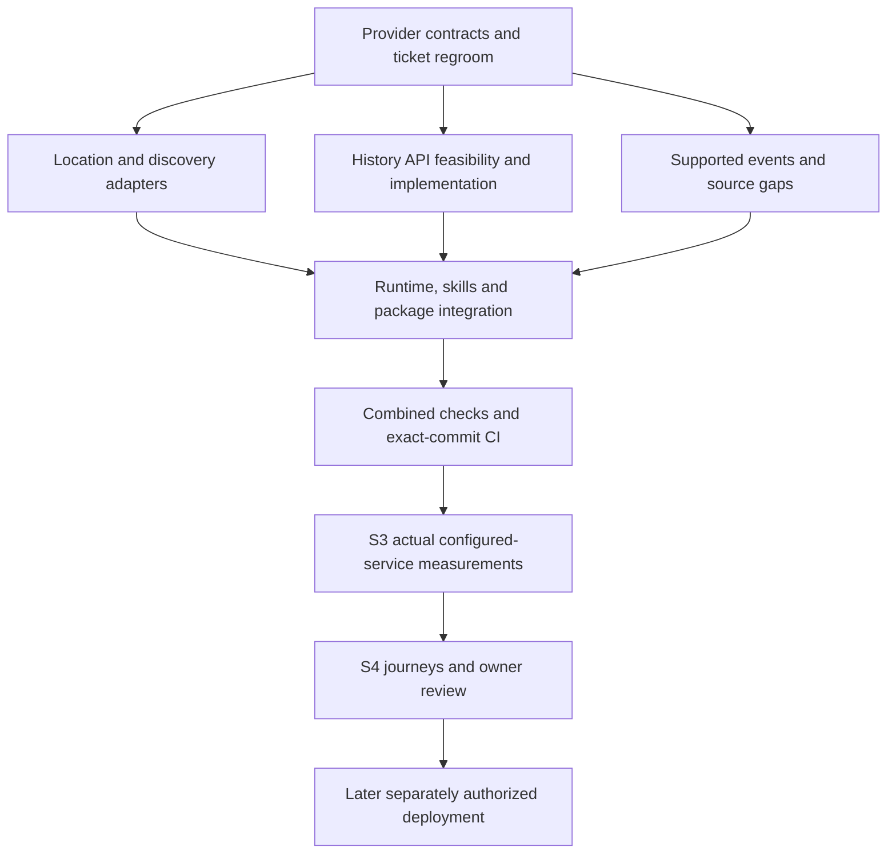

# V1 completion tracker

## Current readiness summary — 18 October 2026

[All 27 original headings are reconciled here](v1-remaining-ticket-release-matrix.md), with [final audit details](v1-final-reconciliation-20261018.md). Current work-location categories: **12 original local deliverables done; 5 with local acceptance remaining; 8 release dependent; 2 separate/deferred items**. These are not replacement Done/Partial/Not-started counts. Older 12/9/6 and checkbox totals below are historical snapshots, not current launch-readiness percentages.

## Current local release-readiness wave — explicit API-only profile

[API-only release contract](v1-api-release-profile-20261018.md) removes mandatory historical artifacts only for explicitly profiled current/rollback releases, preserving legacy/security/quota gates. [Event maintenance](v1-event-maintenance-20261018.md) records all19 identities, actual finite evidence/gaps and NightSky.earth annual responsibility. [Independent audit](v1-release-audit-20261018.md) found no new demonstrated material defect; exact source activation/credits and real hosting/publication remain open. Original categories stay12/5/8/2: event ownership closure alone does not complete compound Task6. No new package version is needed for these operations-only changes; installed plugin remains1.0.34. Coordinator44/44 affected tests, types/package checks and final1,831passed/0failed/2skipped full suite pass; [wave receipt](v1-api-release-wave-20261018.md) records limits and remaining gates.

## Current owner scope amendment — API/search-only V1

The [explicit owner decision](v1-api-only-scope-20261018.md) removes numerical historical-cloud preparation and baseline admission as V1 launch requirements. Ticket9 is **deferred by scope, not done**; ticket18 remains the separate website. The current27-heading categories are12done/5local/8release/2separate-deferred. Prior6-local/1-separate figures below are dated snapshots, not current requirements. No bulk datasets, raw ERA5 work, direct OSM extraction, owned global catalogue or database is required. APIs may use OSM internally; required credits remain.

[API-only acceptance](v1-api-only-acceptance-20261018.md) verifies no-artifact startup, honest unavailable history, source failure isolation and finite event boundaries. [API readiness](v1-api-readiness-20261018.md) records selected data reuse/credit mapping and remaining exact feature/account/branding conditions. Whole V1/public hosting acceptance is not inferred from this scope change.

## Current local wave — API-only scope and answer acceptance (1.0.34)

[Reviewed wave evidence](v1-api-only-wave-20261018.md): scoped four-turn synthetic native replay passes required credits, explicit timezone handling and retained sparse-sample evidence. All15 installed files match. Final offline suite1,826passed/0failed/2skipped (1,828total); types, packages and compiled checks pass. No data requests or deployment. API/source readiness is documented; production profile and final release gates remain open. Historical preparation is deferred by scope, not completed.

## Previous local wave — result-boundary recovery and source decisions (1.0.33)

[Result-boundary recovery](v1-result-boundary-recovery-20261018.md) clarifies existing API snapshot identities/revisions/expiry and conditional next actions in text. Empty forecast text now describes only this response and conditionally preserves earlier timestamped evidence without inventing current freshness. No structured schema, workflow priority, provider, quota, cache or source-admission changes were made.

The final installed1.0.33 controlled native conversation passed both targeted failures: one resolution plus details, one aggregate after explicit display-zone choice, one explicit forecast refresh. All three turns exit0, four MCP calls total, one synthetic geocode/two synthetic weather dispatches, zero external-provider attempts. The answer preserves18/25/40% at20:30/21:30/22:30 when the refresh is unavailable. This is a scoped pass, not universal model or all-client acceptance; wider final-credit and sparse-sample phrasing findings remain under12B/15. Earlier failed1.0.32 receipts are retained.

The [freeze decision record](v1-freeze-decisions-20261018.md) now includes dated primary public documentation for Geoapify storage/Places reuse/Free geometry and DarkSkySites application/cache/credit conditions. Public Universe selected-record rights mapping remains engineering work. [Target/event boundaries](../../data/targets/README.md) are current rather than a stale historical capability list. All nineteen meteor identities and current available evidence remain; no scope reduction or method/source activation occurred. The owner has confirmed NightSky.earth as the maintenance identity; maintained set/years/review schedule remain unadopted. Historical-method choice remains pending after the requested alternatives explanation; account-specific/WeatherAPI transition and actual baseline evidence stay explicit. Original ticket categories are unchanged.

## Previous local wave — source decisions, site guidance and audit (1.0.32)

All three parallel lanes are reconciled: [source decision record](v1-source-decisions-20261018.md), [site-guidance regression evidence](v1-site-guidance-lane-a-20261018.md), and [independent local audit](v1-local-audit-20261018.md). All five packaged workflows and the canonical outdoor contract now reuse selected snapshots through display-zone clarification, explicitly preserve the city-no-details route, and qualify opening site-suitability claims. The audit's logging-disclosure mismatch is corrected in the draft policy and both operational documents; generated per-request correlation is distinguished from user/session identifiers.

Installed1.0.32 native replays corrected the unsupported suitability opener: final answers open with a provisional opportunity and unverified access/safety/lighting/horizon, wait for explicit display-zone choice and retain exact field identity/revision. The final priority-order artifact replay has nine MCP calls, one synthetic geocode, two synthetic weather dispatches and zero external-provider attempts; both turns exit0. **Overall native acceptance remains partial:** an identical resolver call persists and the final answer drops earlier successful cloud rows after a later focused forecast failure. The earlier six-call pre-layout replay is retained separately. [Follow-up evidence](v1-followup-acceptance-20261018.md) distinguishes all receipts and the package-prefix regression/fix. This is not all-client or live-source acceptance.

The source record confirms that the profile remains a proposal, historical serving is already wired, and old handoff instructions must not trigger repeating the consumed annual probe. Exact production source/features/account rights, meteor selection/maintenance and historical-method/coverage admission remain decisions/evidence, not missing bulk-build work. No source activation, private quota changes, provider requests, data downloads or deployment occurred. Final verification and exact-commit CI are recorded after integration below; original work-location categories are unchanged rather than silently closing tickets.

## Previous local wave — geography, resources and follow-ups (1.0.31)

[Geographic acceptance](v1-geographic-acceptance-20261018.md) now covers default/opt-in/unsupported combinations and fixes the unreachable five-included/five-excluded request: ten selected references fit the existing ten-geometry/twenty-credit plus five-POI/five-credit ceiling. [Measured core API runtime](v1-api-resource-measurement-20261018.md) completed12loopback requests, including four sequential/four concurrent client operations, with explicit synthetic/warm-cache/host-capacity limits. [Follow-up acceptance](v1-followup-acceptance-20261018.md) adds strict MCP fixtures and the controlled three-turn native conversation: changed preferences reused matching geometry with zero calls; expired selection was resolved again; unavailable refresh preserved prior timestamped cloud values. Final unknown-site replay waited for explicit timezone choice and continued correctly, but remains partial overall: one duplicate lookup and an overstrong suitability opener despite unknown access/safety. Deterministic API-point label defect is corrected and regression-tested. Final post-label-fix full suite: **1,811 passed / 0 failed / 2 skipped (1,813 total)**; types, compiled/default/capacity checks, both packages and installed15-file verification pass. Final cross-review has no code blocker; partial native quality findings remain explicit. Exact-commit CI follows after push. No provider calls, new downloads, private quota changes or deployment.

Remaining work is the exact real-source/geometry and enabled-profile evidence, event maintenance/claim and historical-method decisions, broader final acceptance, then actual hosting/publication gates. The bounded local measurement is completed; full host/optional-source capacity is not inferred. Original work categories above remain; no hidden ticket closure.

## Earlier 18 October reconciliation checkpoint (1.0.29)

The two observed named-city/candidate-detail and darkness-cutoff issues are corrected in local package **1.0.29**, with affected offline tests and a controlled native replay: both cases exited successfully, 14 tool calls, no invalid candidate-details calls or data-provider attempts; Milky Way darkness cutoff wording corrected. Repeated successful meteor calls were recorded as an efficiency gap, subsequently addressed and exercised by the1.0.30 controlled replay below. Final full suite: **1,796 passed / 0 failed / 2 skipped**; types, compiled checks and both package builds pass. Independent review findings resolved; exact-commit CI follows after push. Draft privacy now includes optional API request sharing. Source/coverage admission, complete applicable journey/resource acceptance and real release-environment gates remain as listed in the matrix. No bulk planet build, database, deployment or new data-provider request is required by this audit.

## Source/coverage and reuse wave — 18 October 2026

Local package **1.0.30** adds completed-result reuse across all five workflows. The [API profile](v1-api-source-profile-20261018.md) and machine-checked JSON record 15 source roles and 11 exported quota policies without reading or applying private configuration. The [event/history profile](v1-event-history-profile-20261018.md) records actual supported families, 38 dated meteor maxima, 12 bounded radiant models and unavailable production history; old target README is explicitly historical. The [assembled journey status](v1-assembled-journey-status-20261018.md) distinguishes earlier failures, later owner passes, controlled native cases and remaining acceptance. Independent source/profile reviews resolved stale 7Timer and GeoNames timezone claims. Controlled installed1.0.30 replay completed both cases:12 successful tool calls, zero identical duplicates, no timeouts or provider attempts. Types/compiled/package checks and installed15-file byte verification pass. Full offline suite: **1,799 passed / 0 failed / 2 skipped (1,801 total)**; exact-commit CI follows after push. No source activated or allowance changed. Original work categories remain unchanged; documenting a gap does not close it.

## Earlier implementation and evidence checkpoints

Native timing self-test: [two Codex CLI cases](native-timing-selftest-20261018.md) completed against1.0.28 with14native calls and0data-provider attempts. Main meteor/target timing distinctions pass; end-to-end acceptance remains partial because of4recovered candidate-detail validation errors and unqualified clipped-darkness start wording. Fixed coordinates/real astronomy, not live source or desktop acceptance. Next step is ticket/release reconciliation including these findings; original counts unchanged.

Latest timing correction: [1.0.28 activity-aware viewing windows](activity-viewing-window-correction-20261018.md), [reviewed plan](../superpowers/plans/2026-10-18-activity-viewing-windows.md). Native1.0.27 discovery scenario passed; Milky Way/Geminids timing remains partial pending focused retest. Optional geometric boundary metadata, bounded meteor peak/radiant text and five workflow updates implemented;129affected tests, types and compiled/package checks pass;1.0.28 installed with all15 files verified. Final full suite:1,792passed/0failed/2skipped (1,794total); installed files verified. Exact-commit CI follows. Original ticket counts unchanged; wholeV1 is not declared done.

Latest discovery checkpoint: [1.0.27 reviewed correction](native-discovery-correction-20261018.md). Owner native discovery and Milky Way conversations are **partial**, with missing origin comparison, incomplete qualified shortlist, overstrong unknown-coverage ranking, incomplete route investigation and lost travel preference. Guidance correction reviewed; 76 workflow tests, types and both host packages pass; 1.0.27 installed and all15 files verified. Targeted native retest pending. Geminids remains not exercised. Original **12 Done / 9 Partial / 6 Not started** unchanged.

Latest follow-up correction: [1.0.25 forecast evidence preservation](native-forecast-followup-fix-20261018.md). Root cause confirmed from existing logs: the local OpenWeather allowance was consumed, not an observed provider outage. Five workflow skills preserve previous conversation samples separately from failed refreshes, with precise sample and neighbour wording. Targeted owner native follow-up passed at 13:48 IST: exact rows and prior OpenWeather evidence retained, both MET neighbours considered, no clear-window claim. Minor edition wording is tightened in 1.0.26; broader acceptance remains open. No new API calls or deployment. Original ticket totals unchanged.

Next acceptance sequence: [three native V1 journeys and one proposed batch](../superpowers/plans/2026-10-18-native-v1-journey-acceptance.md). Batch approval and execution pending.

## Current implementation checkpoint - 18 October 2026

Latest local correction: [timestamp-bound evidence 1.0.24](native-timestamp-evidence-fix-20261018.md), following the owner's accurate-transport but inaccurate forecast-table follow-up. Source-bound local/UTC rows, visible existing Moon/planet positions and five workflow updates are implemented and reviewed. **56 affected tests pass**, as do types, rebuilt packages and compiled isolation checks; the final full suite passed **1,786 / 0 failed / 2 skipped** (1,788 total). A controlled offline agent replay preserved all nine values, seven local times and both 22:00 positions without extra calls. Same installed identity, all 15 files verified. **The owner initial plan and targeted timestamp follow-up passed subsequently; broader journey acceptance remains open**; no new provider requests or deployment. Original **12 Done / 9 Partial / 6 Not started** unchanged.

Latest local correction: [native request reliability 1.0.23](native-reliability-fix-20261018.md) separates bounded startup/protocol and tool accounting, adds redacted request/source timing correlation, and corrects strict catalogue recipes and partial-result guidance. Independent reviews completed; affected tests, types, packages and compiled synthetic checks pass. Final full suite: **1,778 passed / 0 failed / 2 skipped**. Same local plugin identity updated and all 15 installed files verified. All six implementation CI jobs passed on `433fb9b`; subsequent native resolve/astronomy/discovery preflight returned available in 555/36/13,690 ms, with correlated diagnostics and two provider attempts. The fresh owner conversation remains pending; this does not establish the original five-minute failure is fully resolved. **Native owner acceptance remains open**. Implementation/offline checks made no external requests; the separately approved native preflight above used two. No deployment; original **12 Done / 9 Partial / 6 Not started** unchanged.

Native owner test is **not accepted**: [timeout investigation](native-timeout-investigation-20261018.md) confirms startup HTTP 429s during the failed batch and reproduces shared protocol/tool budget starvation offline. The exact original gate and full five-minute client wait remain unproven. Later native astronomy/three forecast checks work; optional discovery separately reaches its fifteen-second deadline. Six local native calls complete in 53–56 ms, so concurrency alone is not the diagnosis. At that investigation checkpoint the corrections were not implemented and package was 1.0.22; the subsequent 1.0.23 correction above supersedes implementation status, while native acceptance and original totals remain unchanged.

Latest correction: [Public Universe named-file hash fix](publicuniverse-hashmap-fix-20261018.md), package **1.0.22**, resolves the two earlier validation failures. Two live recheck requests returned available; Sirius search was valid-empty, so dependent detail/window checks were skipped. Hyderabad discovery returned two targets with windows/samples. Independent re-review and 42 affected tests passed; final full suite **1,760 passed / 0 failed / 2 skipped**; types/builds/packages/compiled checks passed. Default source admission remains off and native conversation acceptance remains pending. Earlier failures below are historical evidence, not current unresolved parser defects.

Latest source acceptance: [Public Universe bounded live result](publicuniverse-live-results-20261018.md) is **partial**: ten HTTP 200 requests / 335,445 bytes; eight normalized reference checks available, starter search and observing discovery rejected as invalid-response, two dependent starter checks skipped. Source stays disabled in normal plugin configuration. No native acceptance or deployment implied; original ticket totals unchanged. The earlier separate-approval requirement below was satisfied for this completed batch only.

Public Universe addition is **implemented locally, reviewed and installed as 1.0.21; source remains unadmitted**: [implementation and verification](publicuniverse-implementation-20261018.md), [design](../product/publicuniverse-v1-integration-design.md), [implementation sequence](../superpowers/plans/2026-10-18-publicuniverse-v1.md), [planning reviews](publicuniverse-plan-review-20261018.md). Four optional tools cover reference search/details, equipment-aware discovery and selected catalogue-target windows. Existing default inventory remains 14; selecting only this source exposes 18. Dedicated accounting isolates it from legacy providers. Independent reviews found material evidence/schema gaps, fixed with regressions and rechecked. Fresh aggregate: **1,758 passed / 0 failed / 2 skipped**; types/builds/packages/compiled synthetic checks passed, all 15 installed files match. All six [release CI jobs](https://github.com/tandavkrishna27/nightsky.earth/actions/runs/39072377236) passed on exact code commit 5bcc77a. The [approved bounded batch](publicuniverse-live-results-20261018.md) completed with partial acceptance; further diagnostic calls need separate approval, and no deployment is implied. Original **12 Done / 9 Partial / 6 Not started** totals remain unchanged.

Prior checkpoint package: **1.0.20** - [implementation and verification evidence](host-aware-outing-20261018.md), [reviewed plan](../superpowers/plans/2026-10-18-host-aware-outing-v1.md). Host-aware workflows, independent preferences, scouting-point guidance, tailored preparation and timestamped geometric orientation are implemented. Independent whole-diff review found one answer-budget P2; fixed with a passing regression and confirmed by the reviewer. Final local regression: **1,689 passed / 0 failed / 2 skipped**. Types, backend/package builds and synthetic runtime checks passed; all 15 installed files match. Exact-commit CI is checked after push.

The earlier 1.0.19 owner conversation has genuine transport evidence:7 Geoapify + 5 DarkSkySites HTTP 200 responses. Its 12-request allowance is exhausted; logs alone do not independently verify all point/value bindings. Browser permission was accepted, but successful map extraction remains unproven. New 1.0.20 native conversation acceptance remains pending. Claude is deferred; Gemini host integration remains researched design rather than tested installation. No source requests, deployment or publication in this engineering pass. Original **12 Done / 9 Partial / 6 Not started** totals remain unchanged. Following entries are dated historical evidence.

Current V1 answer revision: **1.0.18** — [compact credits and darkness workflow evidence](answer-presentation-20261018.md). Relevant answer references replace catalogue-wide dumps and duplicate credit blocks; full structured provenance remains. Five skills explain useful values and mandatory adjacent credits. The first native 1.0.17 comparison passed owner-reported review; the broader conversation remains partial, including expired-session follow-ups. This revision passed 1,677 local tests (0 failures, 2 skipped), affected/package/runtime checks and independent review; 1.0.18 is installed with matching bytes. Revised native answers and live new-candidate comparisons remain open. Original ticket totals are unchanged.

V1 light-pollution addition: [reviewed plan](../superpowers/plans/2026-10-17-light-pollution-v1.md) and [current acceptance evidence](light-pollution-acceptance-20261017.md). LP1/LP2/LP5 and local LP6 assembly are implemented and reviewed, portable package 1.0.17. Code commit a2cb606 passed all six CI jobs; the approved DarkSkySites pilot returned two HTTP 200 results (783 bytes): Hyderabad SQM17.96/Bortle9, Shamirpet-area SQM19.73/Bortle6, August2026 model with coverageVerified=false. Dedicated accounting records two requests; approval consumed. LP3/LP4 remain experimental browser scaffolds with public use hard blocked, and native package/owner acceptance remains open. No deployment or installed-plugin update. These six subtasks remain inside blocks 1–3; original 12 Done / 9 Partial / 6 Not started totals are unchanged.

Current continuation: [sky-source acceptance follow-up](sky-continuation-results-20261017.md) adds verified-usage setup and combined optional-source journeys. AstronomyAPI Moon positions passed live; NASA 503 and JPL provider error remain open. Owner native Hyderabad answer reviewed: outdoor/city-site distinction improved; bounded-launcher repeated-success guard corrected and tested, native rerun remains open. Original ticket totals remain unchanged.

Latest additive V1 work: **local package 1.0.16**, [optional sky providers and live results](additional-sky-providers-20261017.md). 7Timer, Dark Sky Planner, AstronomyAPI, NASA DONKI and JPL adapters, six optional tools, workflow guidance and quota/cache controls are implemented. The bounded live diagnostic passed four capability checks; NASA returned 503 and JPL observer output remained unavailable. AstronomyAPI production allowance and native full-package acceptance remain open. Final local regression: **1,541 passed / 0 failed / 2 skipped**; types and package build passed. Exact-commit CI is checked after push. This is additional work within blocks 1–3; original **12 Done / 9 Partial / 6 Not started** counts are unchanged.
Latest local integration: [local experience completion](local-experience-completion-20261017.md) — three lanes implemented and independently reviewed; local aggregate 1,478 passed / 0 failed / 2 skipped, with the six newly registered Hyderabad cases separately passing in the 21-test affected suite. Types, packages and synthetic compiled-runtime checks passed. Exact-commit CI is checked after push. Real Hyderabad calls and native full-skill/answer acceptance remain pending.

Updated: 17 October 2026. **Current plan: API-first, multiple suitable sources, no exhaustive owned global catalogue prerequisite.** This tracker supersedes earlier acquisition-wave sequencing. See the [owner decision](api-search-discovery-v1-decision.md), [regroomed execution plan](../superpowers/plans/2026-10-17-api-first-v1-regroom.md) and [27-ticket acceptance matrix](v1-remaining-ticket-release-matrix.md).

Latest completed implementation: `b10f05451cb7ccd0cc6c77b4faabefbd6b4d7e66`, internal package **1.0.15**, [outdoor conversation evidence](v1-outdoor-conversation-evidence-20261017.md): **1,475 passed / 0 failed / 2 skipped** and **11/11 controlled-agent cases**. The controlled cases are not native-client acceptance. These are retained results, not tests rerun by this reconciliation; the coordinator verified [exact-commit CI run 39029122239](https://github.com/tandavkrishna27/nightsky.earth/actions/runs/39029122239) successful during this turn.

Owner-reported native evidence at **17:22 on 17 October 2026**: Codex successfully invoked resolve for `Fictionvale`. This establishes a native tool invocation from the owner's pasted report. Synthetic provenance and a fixed 15 October expiry are misleading in that result; it does not establish a real provider result, current snapshot freshness, full skill/reference loading or end-to-end answer acceptance. The earlier blanket tool-exposure blocker is therefore superseded for this observed invocation. See the [current reconciliation and finite acceptance checklist](v1-acceptance-reconciliation-20261017.md).

Current local experience implementation is `cf265c6b217fe9992f4d519871d7c225873b2368`; all six [exact-commit CI jobs passed](https://github.com/tandavkrishna27/nightsky.earth/actions/runs/39031080277), verified by the coordinator. [Integration evidence](local-experience-completion-20261017.md) records local aggregate 1,478 passed / 0 failed / 2 skipped, with the six newly registered Hyderabad cases separately covered by the 21-test affected suite; overlapping counts are not added. Package remains 1.0.15.

The owner subsequently approved the exact Hyderabad packet: **four requests, all HTTP 200, 138,199 bytes**, source-verified city timezone and MET/WeatherAPI/OpenWeather **25/24/8 partial samples**. See [live results](hyderabad-owner-live-results-20261017.md) and [setup handoff](hyderabad-owner-real-api-setup.md). The allowance is consumed; prior private quota state was preserved. This is current city-point forecast integration, not site/Geminids/native acceptance. Sampled RSS is not capacity evidence; MET overlapping interval anchors are not a temporal-value failure. Native skills/reference loading and the full real API/model journey remain pending. Original counts and six blocks remain unchanged.

## Remaining sequence — one checklist

These six blocks group the original tickets; they are not new tickets or a guarantee of one coding session each. Keep open work inside its block instead of resetting the wave count. Three local completion blocks precede three release stages. Website Task 18 remains separate.

| Order | Completion block | Status | Exit evidence / original tickets |
| --- | --- | --- | --- |
| 1 | Capability gaps: history, geography, events in parallel | Local implementation integrated; live/source acceptance remains | Source-qualified implemented behavior, explicit unresolved gates; 0/6/8/9 |
| 2 | Assemble and measure | Package assembled and offline measurements passed; actual-source/host acceptance remains | Integrated tools/skills/package, attribution/privacy flows, measured bounded memory/cache/concurrency/failures; 12A/13/14 |
| 3 | Full local experience and final audit | API scripted cases passed; assembled native-model/owner review remains | Existing journeys, Codex/owner questions, material fixes, criterion reconciliation; 12B/15. Claude deferred |
| 4 | Hosting and actual client checks | Later; no deployment authorized | Hetzner/HTTPS, actual connection/location checks, rollback, publisher/URL evidence; 0F/3B/3C/4B/12A/14 |
| 5 | Submission and publication | Later; explicit authorization required | Official validation/review and authorized publication; 15/16 |
| 6 | Pilot and feedback | Later | Real invited-user evidence; 17 |

Latest local milestone is the 1.0.15 implementation and verification above. The earlier [three-session integration](parallel-completion-run-20261017.md) and [source/native continuation](source-native-acceptance-results-20261017.md) remain dated evidence; their test/CI counts must not be read as the current total.
Current block 1 deliverables: distinct hosted historical method and one successful bounded pilot; staged opt-in geometry retrieval/discovery with snapshot evidence; IGN civil meteor guidance and bounded radiant sampling. See the [latest wave evidence](activation-integration-wave-20261017.md). Full history admission/baseline, real geometry acceptance and remaining event references stay open. The one-request history allowance is consumed; no further live calls are implied.

## Next validation preparation

Three parallel preparations now map to the existing blocks, not new waves:

| Existing block | Concrete packet | Readiness |
| --- | --- | --- |
| 1: geography | [Country selection results](source-native-acceptance-results-20261017.md) | Structured and revised filter-free attempts both empty; allowances consumed. Point discovery remains independent. Country geometry acceptance remains open |
| 1: history | [Annual result and accounting](source-native-acceptance-results-20261017.md) | Accounting added preserving counters; one annual request passed: 8,784 hours, no missing/nulls. Allowance consumed. Production method/full-baseline admission remains open |
| 3: experience | [Native installation](native-acceptance-path-20261017.md) and [V1 behaviour contract](../product/v1-outdoor-discovery-contract.md) | 1.0.15 installed; owner reports a native Fictionvale resolve invocation at 17:22. Fixture provenance/freshness correction, real API and full skills/answer acceptance remain open. Claude deferred |

The two approved country-selection variants returned empty. The later approved annual history request passed 8,784 hours with zero missing/null hours; both live allowances are consumed. These supersede earlier preparation-only statements. History production admission/full baseline and actual geographic acceptance remain open. Original counts remain unchanged.
## Where we stand

Original executable headings: **12 Done / 9 Partial / 6 Not started = 27**. Original numbered groups: **6 Done / 10 Partial / 3 Not started = 19**. A scope change is not implementation evidence and adds no completion credit. Done means the original local deliverable, not production readiness or immunity from regression checks.

- Working local MCP/tool/skill baseline exists. MET Norway forecasts and NOAA aurora adapters, astronomy calculations and supported event calculations can be reused.
- An opt-in API discovery implementation is implemented and locally verified: GeoNames/Geoapify adapters and source-revision selection. Legacy catalogue modes remain available; initial Geoapify live connectivity passed, while broader provider acceptance remains pending.
- API mode resolves names remotely and does not require local GeoNames/OSM files. Legacy modes still use their reference artifacts; do not delete those files on behalf of legacy runtime users.
- Bulk planet receipt/build, exhaustive candidate membership/footprint preparation and their capacity gates are **deferred outside V1**. Do not resume them to close V1.
- Historical-weather capability remains required. The optional operator-build/cache and read-only serving route is implemented; a successful annual probe does not establish an admitted 1991–2020 baseline. Request handlers never acquire history.
- Event/source gaps, client integration, owner testing and later hosted/publication gates remain explicit.

The [previous tracker snapshot](archive/v1-completion-tracker-before-api-regroom-20261017.md) preserves engineering evidence and failed attempts. Synthetic/retained tests do not establish live API suitability or actual release acceptance.

## Source research and implementation update — 17 October 2026

[Consolidated free API research and cleanup plan](api-provider-research-and-cleanup-plan.md): three official-source investigations completed. GeoNames + Geoapify are the recommended location shortlist; MET/NOAA/local astronomy retained; The later history route decision selects Open-Meteo ERA5 as the conditional integration candidate; CDS is not the active implementation route. The subsequent implementation wave adds adapters, runtime and workflow changes; offline review/tests are recorded separately and do not close live-source gates. Cleanup is planned, not executed; original counts are unchanged.

## Stable stages

| Stage | Status | Remaining acceptance |
| --- | --- | --- |
| S1 — Local engineering baseline | Complete for original baseline | Preserve code/evidence; rerun affected regressions for API mode |
| S2 — Ready data access and supported content | In progress | Suitable free providers; working location/discovery adapters and host-search fallback; historical route decision; supported event/source coverage; explicit unavailable states |
| S3 — Measure actual configured service locally | Pending working S2 configuration | Startup/peak memory, bounded cache/storage, latency/concurrency, rate-limit and failure behavior, refresh/rollback needs; actual enabled sources/content |
| S4 — Assembled experience and final audit | Pending assembled configuration | Existing journeys, native tool/skill behavior, permitted live checks, owner questions and fixes; Claude remains owner-deferred |

## Work register — stable IDs, revised acceptance

| ID | Original tickets | Status / concrete next result |
| --- | --- | --- |
| S2-G1 | 0, 4, 8 | Bounded GeoNames/Geoapify design recorded; API identity/selection and adapters locally verified. Private accounts, persistent quota initialization and the first bounded live batch are verified; public policy/attribution and broader acceptance remain open |
| S2-G2 | 4, 8 | Historical boundary preparation completed within its scope; exhaustive boundary/membership build deferred. Expanded scope/timezone fixtures, inactive membership composition and a bounded snapshot-relative geometry decoder/classifier are implemented. Selected-region Geoapify retrieval and discovery composition are now implemented behind two disabled gates, with bounded quota/cache and geometry receipts; one bounded live geography attempt stopped at country selection (one HTTP 200 response); geometry source admission/live verification remain open |
| S2-G3 | 0, 8 | Opt-in API discovery, snapshot details and planning locally verified; optional host-search guidance updated. Unsupported complex administrative combinations retain explicit gaps; no mandatory global catalogue |
| S2-H1 | 0, 9 | Existing history tooling retained; conditional Open-Meteo ERA5 offline partition/decoder contract implemented. Current free/ad-free/no-affiliate facts are settled. Official source inspection establishes whole-percent quantization and a one-unit pilot estimate; distinct method defined, one 336-hour wire pilot passed, and retained-data sample aggregation/provider implemented through MCP/planner; production method admission and full baseline remain open |
| S2-H2 | 9 | Retained sample acceptance is historical evidence only; no complete baseline or live API claim. Cleanup must not trigger automatic reacquisition |
| S2-H3 | 0, 9 | Optional bounded API baseline planning, explicit operator worker, durable summary cache and read-only provider implemented; see the history completion handoff. The old 782-additional-request proposal is superseded: default annual partitioning plans 30 calls, or six explicitly selected larger ranges, with weighted credit reservations. These are offline estimates, not provider guarantees. Production admission, mapping validation and a real baseline remain open; request handlers never acquire history |
| S2-E1 | 6 | Existing calculated astronomy/events retained; all nineteen meteor identities share one validated resolver and evidence inventory. IGN Lyrid/Leonid/Orionid/Draconid/Ursid civil guidance is source-qualified, with bounded radiant samples only for supported models. Planner integration preserves the selected meteor and identifies ambiguous names and unsupported models. Full supported seasons, reference gaps and continuous-window acceptance remain open |
| S2-E2 | 0, 6 | Resolve remaining season/radiant/year/source rights gaps; use an API where suitable, otherwise explicit supported content/limitations. No invented universal event API |
| S2-R1 | 3, 8, 12A, 14 | API-mode bootstrap/preflight and five skills updated; no-local-geography compiled smoke added to CI. Full historical and hosted release gates remain independent |
| S3-M1 | 0, 8, 9, 14 | Measure actual configured-service storage/cache/startup/peak memory and update/refresh cost; bulk planet build not required |
| S3-M2 | 0, 8, 9, 14 | Synthetic offline measurement harness implemented; actual enabled-source latency/concurrency/quotas and small-host fit remain pending permitted live evidence |
| S4-T1 | 12B, 15 | Run existing fifteen journeys/eight review cases in API mode, including absent host search, ambiguous locations and unavailable sources |
| S4-T2 | 12B, 17 | Owner questions and feedback; actual tester activity only when authorized |
| S4-T3 | 15 | Fix material findings, final source/security/privacy/requirements audit, package freeze and exact-commit CI |

## Ordered execution and parallel work

1. **Regroom and source admission (completed groundwork; remaining admission gates stay open):** original-ticket reconciliation, provider/data matrix, code migration plan and independent review. History and event audits may run beside discovery design.
2. **Implementation lanes:** A location/discovery adapters; B independent history/events source work; C runtime/package/skills/test updates after A's shared interface is frozen. Assign shared registry/schema files to one integration owner.
3. **Integrate:** targeted tests per change, combined suite/types/build/package/runtime checks at milestone; update evidence, push and observe CI for that exact commit.
4. **Measure S3:** actual API-mode configuration and remaining required content. Separately authorize bounded live calls; fixtures alone do not prove live availability or useful search quality.
5. **S4 and later gates:** assembled journeys and owner review; only afterward host configuration, authorized staging, actual client/draft checks, submission and publication. Website remains separate.

## Current implementation evidence

See [API local setup](api-mode-local-setup.md), [provider admission](api-provider-admission.md), [history feasibility](history-api-feasibility.md) and [event gaps](api-event-gaps-20261017.md). [Local wave evidence](api-migration-wave-20261017.md) records approved review fixes, full integration and targeted tests, built-runtime checks and remaining activation gaps. Exact-commit CI is checked after push. Original counts remain unchanged; unsupported scope and live activation gates are not marked complete.

## Code correction boundaries

See the [implementation plan](../superpowers/plans/2026-10-17-api-first-v1-regroom.md) for exact files/tests. Main changes: discovery provider interfaces/adapters; registry and planning selection; stable source-backed candidate identities/timezone handling; runtime/preflight mode; five skills and matching workflow documents; API-mode tests/CI/measurement inputs. Preserve astronomy, MET/NOAA adapters, generic controls and useful optional catalogue code. Do not delete code merely to make the new plan look simpler.

## Verification and cleanup status

Pre-wave verified pushed implementation baseline: `8b35b2556c9ea805235c65041ec9b0833faff715`, [all six CI jobs passed](https://github.com/tandavkrishna27/nightsky.earth/actions/runs/39003796579). This includes opt-in API discovery and exact-site planning. The newer multi-weather implementation has passed local verification; follow [branch CI runs](https://github.com/tandavkrishna27/nightsky.earth/actions?query=branch%3Acodex%2Fplugin-v1) for the exact pushed commit; superseded runs may be cancelled. It adds runtime evidence, not live-provider acceptance. See the wave report below for exact local results and portability corrections.

Owner authorized downloaded-data cleanup. Automatic execution policy rejected deletion before execution. [48-file manifest/report](dataset-cleanup-api-v1-20261017.md) and [manual folder guide](manual-dataset-cleanup-20261017.md) identify about 1.86 GB, still retained at last verification. Preserve the required GeoNames gzip until replacement exists. No 95 GB planet body was downloaded. No new dataset/provider job, deployment or publication is authorized by this regroom.

## Immediate implementation sequence — reviewed 17 October 2026

Use the [multiple-weather activation plan](../superpowers/plans/2026-10-17-multi-weather-activation.md). Its seven tasks are slices within existing tickets, not seven new product waves or a replacement V1 backlog. Source admission/contracts first; persistent quotas, WeatherAPI and OpenWeather adapters in parallel; collection/planner integration; private setup and offline verification; then separately authorized live measurement. OpenWeather Free five-day/three-hour entitlement is confirmed; optional activation still requires private configuration, source admission and bounded live checks. Geoapify and WeatherAPI accounts exist; private credential configuration and the initial live batch are now complete (see activation follow-up). GeoNames signup remains blocked.

Counts remain **12 Done / 9 Partial / 6 Not started**. Multi-weather work revalidates existing weather/planning deliverables; S2-G1 source controls, S3 and S4 remain open. History, event gaps and complex region combinations remain separate required decisions/work. No source account or documentation change closes those gates.

## Multi-weather implementation update

The [local multi-weather wave](multi-weather-wave-20261017.md) implements the reviewed adapters, persistent quotas, shared conditions/planner integration, runtime/operator configuration and workflow/CI fixtures. Task reviews and final broad review approved the offline implementation after fixes. The initial live activation batch is now complete (see follow-up); public source-admission requirements remain open. Current final verification results are recorded in that wave report. Original 27-ticket counts and independent history/events/geography/hosting gates remain unchanged.

## Activation follow-up — 17 October 2026

The preceding implementation `95c2cff` passed all six [CI jobs](https://github.com/tandavkrishna27/nightsky.earth/actions/runs/39010038764). Local verification recorded 1,250 passed tests, zero failures and two skips.

Private provider configuration is now complete with owner authorization; the earlier pending-configuration statements describe the pre-activation state. The owner confirmed the accounts were unused elsewhere, and the existing initializer successfully created the local quota ledger. A subsequently approved live batch completed twelve requests, all HTTP 200, resolving three named places and receiving all three weather sources. See [live results and reporting caveats](api-live-validation-results-20261017.md). Public release source admission, broader measurements and assembled journeys remain open.

The [bounded live proposal](api-live-validation-proposal.md), [history route decision](history-api-route-decision-20261017.md) and [event/geography closure plan](events-geography-closure-20261017.md) describe the concrete remaining work. The history candidate is conditional, the meteor selection remains proposed, and existing planetary calculations are retained. These documents do not add original tickets or establish release readiness.

Counts remain **12 Done / 9 Partial / 6 Not started**. S2 remains in progress; S3 actual-source measurements and S4 assembled-product acceptance remain open.

S3 now has a bounded initial latency/RSS observation from the first live batch, not completed concurrency, peak-resource or small-host acceptance. The original derived report is retained; no repeated live requests are authorized by the reporting fixes.

Post-live reporting correction independently approved. Final local suite: 1,265 passed, zero failures, two skipped; TypeScript checks passed. Exact-commit CI passed all six jobs at `291fc0a` (linked above); the original live evidence remains unchanged.

## Capability wave evidence — 17 October 2026

[History, geography and event offline work](capability-closure-wave-20261017.md) passed lane reviews and final combined review. Integrated verification: **1,294 passed, zero failed, two skipped**, TypeScript/plugin build/package generation passed. New tests are included in CI. No live requests, downloads, deployment or runtime source admission occurred. Block 1 remains in progress with the explicit source and scope gates above; original counts remain **12/9/6**, not a measure of this wave’s engineering output.

## Source-resolution continuation — 17 October 2026

Current block remains **1 — capability gaps**. Owner confirmed the product is currently free with no advertisements or affiliate links; do not reopen those settled facts. Official-source research and supported offline implementation proceed in parallel. Host search may discover names/access references where available; plugin resolution, exact selected-point calculations and source-qualified conditions remain necessary. The existing workflow already handles search absence and untrusted web content.

Previous offline capability commit `7839e5526013f408c5fdc64083ed1a1e1e63c84c` passed all six [CI jobs](https://github.com/tandavkrishna27/nightsky.earth/actions/runs/39013346282). The current continuation does not authorize a weather-data request, geometry download, deployment or publication. See [source-resolution wave](source-resolution-wave-20261017.md) for reviewed outcomes and finite remaining decisions. Original counts stay 12/9/6; this is progress inside block 1, not a new wave sequence.

Source-resolution continuation verification: independent lane/final reviews approved; **1,309 tests passed, zero failed, two skipped**; TypeScript, plugin build and package generation passed. [Wave evidence](source-resolution-wave-20261017.md) records implemented behavior, source decisions and exact remaining gates. New suites run in existing CI.

## Source activation integration — 17 October 2026

[Latest wave](activation-integration-wave-20261017.md): distinct quantized history method/executor and one successful 4,418-byte pilot; disabled-by-default geometry acquisition/discovery with quota/cache/snapshot receipts; IGN civil meteor guidance and up to 97 timestamped radiant samples. Independent review and full local verification passed: **1,322 passed, zero failed, two skipped**, plus TypeScript, plugin build and packaging. The single history request allowance is consumed; geometry live packet remains unexecuted. Full history serving/baseline, geometry admission and listed event gaps remain in block 1. Counts remain **12 Done / 9 Partial / 6 Not started**; no deployment or publication. Exact-commit CI is checked after push.

## Planning-flow integration — 17 October 2026

See [current wave outcomes](planning-flows-wave-20261017.md). History sample-only aggregation/provider crosses MCP and planner without network access; five skills now reflect current event and geometry evidence. The authorized geography check stopped after one HTTP 200 response, 136 bytes and one reserved credit because country selection did not pass; no geometry was requested and no retry occurred. Improved diagnostics are tested offline, not retroactively applied to the original response. Production flags remain disabled. Full baseline and actual geometry acceptance remain open; original counts remain **12 Done / 9 Partial / 6 Not started**. Final combined verification and exact-commit CI are recorded after completion.

Planning-flow local verification completed: **1,341 tests passed, zero failed, two skipped**; TypeScript, plugin build and packaging passed, with independent final review. The engineering increment is complete; unresolved history/geometry/event acceptance above remains open. Exact-commit CI is observed after push.

## Validation readiness — 17 October 2026

The [validation-readiness wave](validation-readiness-wave-20261017.md) completes three offline preparations within the same six blocks:

- Geography: official query review found no confirmed adapter defect. The retained empty country selection remains unresolved; a filter-free diagnostic is proposed but unexecuted. Ordinary point/radius discovery does not depend on this country case.
- History: a reviewed atomic provider-admission path preserves existing quota counters, imports verified usage conservatively, and connects the annual probe to durable accounting. Actual private-ledger migration and annual request remain separately pending.
- Experience: the complete 1.0.14 fixture package was built with 14 tools and five skills and its loopback connection checked. Native installation, skill activation and model-answer acceptance remain pending; Claude remains deferred.

Original ticket counts remain **12 Done / 9 Partial / 6 Not started**. This wave does not close live-source or host acceptance. The preceding `2b298d52f172a552ef315fe60e2b21a12f4e7812` passed all six [CI jobs](https://github.com/tandavkrishna27/nightsky.earth/actions/runs/39024965392); current-wave CI must be verified for its own commit.

Current wave local aggregate: **1,462 passed / 0 failed / 2 skipped**; types, build, packages and compiled runtimes passed. Independent review found no material findings. The wave was pushed as `887cb46925b448783f45826895d36f94ceed7860`; [all six exact-commit CI jobs passed](https://github.com/tandavkrishna27/nightsky.earth/actions/runs/39026264217).

## Source and native acceptance continuation (dated history; current status above)

See [continuation plan](../superpowers/plans/2026-10-17-source-native-acceptance.md). The [revised geography executor](geography-filter-probe-handoff-20261017.md) is implemented and reviewed offline under a new one-request envelope. [History usage reconciliation](history-usage-readiness-20261017.md) records the prior one-credit estimate and owner confirmation of no outside use; old packet implementation prerequisites were corrected. Requests and actual ledger mutation remain pending their concrete approvals.

The [supported native installation](native-acceptance-path-20261017.md) returned version **1.0.14** successfully. The current chat still has no refreshed NightSky tools, so native skills/tool/answer acceptance remains open. The prior nested-model policy block was not retried or bypassed. Original counts remain **12 Done / 9 Partial / 6 Not started**; this advances the same blocks 1 and 3.

Execution update: the owner subsequently approved both specific actions and then the separate annual request. [Results](source-native-acceptance-results-20261017.md): geography again returned `selection-empty` after exactly one request; accounting import preserved every previous entry; annual history validated 8,784 hours with zero missing/null values in 111,061 bytes. Both live allowances are consumed. Native 1.0.14 installation succeeded but refreshed host answer acceptance remains open. No production source admission or deployment follows from these outcomes.

Continuation local verification: **1,466 passed / 0 failed / 2 skipped** and all TypeScript checks passed. New filter-probe regressions are registered in the aggregate CI suite. Exact pushed-commit CI is observed separately.

## V1 conversation quality and remaining sequence

The owner-approved [outdoor discovery contract](../product/v1-outdoor-discovery-contract.md), [shared packaged instructions](../product/outdoor-conversation-contract.md), [conversation scorecard](../product/v1-conversation-acceptance.md) and [implementation plan](../superpowers/plans/2026-10-17-v1-outdoor-conversation.md) belong to V1. Internal package revision 1.0.15 identifies these changed bytes; it does not defer the work to V2.

| Existing block | Current evidence and next acceptance |
| --- | --- |
| 1 — sources/capabilities | Annual history response shape passed; full baseline/method admission remains. Both Vatican selection variants were empty; do not require that particular lookup for ordinary point discovery. Remaining event coverage and source limitations remain explicit. No fresh live allowance carries forward |
| 2 — assembly/measurement | Shared contract composed into all five workflows and all host packages; local 1.0.15 build/fixture checks. Actual configured-source/host measurements remain separate |
| 3 — experience/audit | Eleven regression variants extend the existing fifteen journeys/twenty harness cases. Controlled model review is separate from native tool exposure and owner acceptance; owner-reported native resolve works; complete native skills/reference and answer acceptance remains open |
| 4–6 — hosting/publication/pilot | Still V1 release stages in sequence; no deployment/publication authorization or real-user pilot evidence is implied |

No extra wave counter or ticket set is introduced. Original 12 Done / 9 Partial / 6 Not started remains scoped original-deliverable accounting, not a claim that the revised conversational experience is fully accepted. [Evidence](v1-outdoor-conversation-evidence-20261017.md) retains baseline/revised answers and limits. The two-minute native listener in the preceding continuation closed with no native tool calls and zero external attempts; an owner refresh did not change this active conversation's tool inventory. No nested-model retry is authorized.

Outdoor instruction/evaluation implementation: shared instructions now reach all five workflows and portable/Codex/Claude packages. Eleven controlled-agent cases passed independent scored review with zero critical failures; native-host acceptance remains pending. Supported local installation is now 1.0.15 under `nightsky-native-acceptance-20261017`. See the evidence record for exact response/score artifacts and two minor guidance omissions. All of this is V1.

Current V1 conversation wave local aggregate: **1,475 passed / 0 failed / 2 skipped**, fresh types, build and packages passed; exact-commit CI is checked after push. Controlled 11/11 is a separate model-review count, not added to the automated-test total.

### 2026-10-18 outdoor discovery follow-up

Local revision 1.0.19 strengthens all five skills and canonical workflows: outdoor candidates first, organisations distinguished from sites, bounded discovery without repeated travel questions, assistant-led coordinate resolution. The four affected offline suites passed 33 tests before final release-note encoding repair; the final package was rebuilt afterward. Native conversation acceptance and connected local service setup remain pending; original ticket totals are unchanged. No provider calls or deployment.

## 1.0.32 final local verification

Final suite after the package-priority fix: **1,815 passed / 0 failed / 2 skipped (1,817 total)**, exit0; log `.superpowers/sdd/2026-10-18-publicuniverse-v1/source-conversation32-final-full.log`. The earlier full run had1priority-guard failure; it is retained, and the guard was preserved rather than weakened. All three TypeScript projects, both local host packages, portable package build, compiled API/Public Universe/light-pollution runtime checks and final installed15-file byte comparison pass. The bounded final native replay remains partial as detailed above; deterministic tests do not cancel the duplicate lookup or loss of earlier weather evidence. Three independent lanes and cross-reviews completed; corrected diagnostic disclosure, city-details conditional wording and priority position were reviewed. Exact-commit CI is watched after push. No data-provider request, new download, private accounting mutation, scraping or deployment occurred.

## 1.0.33 final local verification

Final suite: **1,819 passed / 0 failed / 2 skipped (1,821 total)**; all TypeScript projects, portable/both local packages,15-file installed equality, compiled API/Public Universe/light-pollution checks and the existing bounded capacity probe pass. The final three-turn controlled native case passes both targeted failures with four completed tool calls; wider final-credit/sparse-sample phrasing and release gates remain explicitly open. New result-text regressions observed failing baselines, and independent cross-reviews found no implementation blocker. CI is watched against the exact pushed commit. No dataset/API acquisition, source activation, credential/quota mutation, scraping or deployment occurred; source research inspected public documentation only.

Owner response18October: NightSky.earth is confirmed as the event-maintenance owner. Historical alternatives were explained; no method evaluation/admission or acquisition was approved by that response. The [freeze record](v1-freeze-decisions-20261018.md#owner-response-and-historical-alternatives) preserves the three approaches and remaining decisions. No runtime inventory/schema or private configuration changed.
