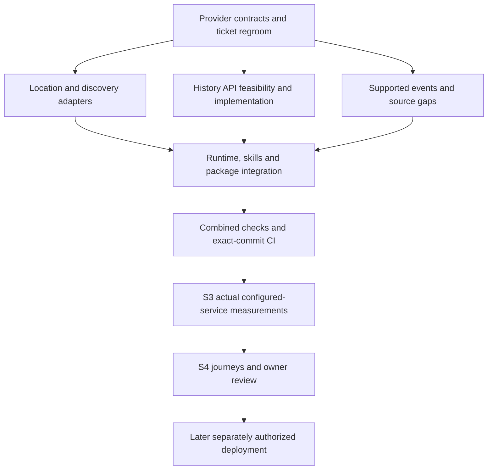

# V1 completion tracker

Updated: 17 October 2026. **Current plan: API-first, multiple suitable sources, no exhaustive owned global catalogue prerequisite.** This tracker supersedes earlier acquisition-wave sequencing. See the [owner decision](api-search-discovery-v1-decision.md), [regroomed execution plan](../superpowers/plans/2026-10-17-api-first-v1-regroom.md) and [27-ticket acceptance matrix](v1-remaining-ticket-release-matrix.md).

## Remaining sequence — one checklist

These six blocks group the original tickets; they are not new tickets or a guarantee of one coding session each. Keep open work inside its block instead of resetting the wave count. Three local completion blocks precede three release stages. Website Task 18 remains separate.

| Order | Completion block | Status | Exit evidence / original tickets |
| --- | --- | --- | --- |
| 1 | Capability gaps: history, geography, events in parallel | **In progress — current wave** | Source-qualified implemented behavior, explicit unresolved gates; 0/6/8/9 |
| 2 | Assemble and measure | Pending block 1's required capability decisions | Integrated tools/skills/package, attribution/privacy flows, measured bounded memory/cache/concurrency/failures; 12A/13/14 |
| 3 | Full local experience and final audit | Pending assembled package | Existing journeys, Codex/owner questions, material fixes, criterion reconciliation; 12B/15. Claude deferred |
| 4 | Hosting and actual client checks | Later; no deployment authorized | Hetzner/HTTPS, actual connection/location checks, rollback, publisher/URL evidence; 0F/3B/3C/4B/12A/14 |
| 5 | Submission and publication | Later; explicit authorization required | Official validation/review and authorized publication; 15/16 |
| 6 | Pilot and feedback | Later | Real invited-user evidence; 17 |

Latest completed milestone: API location/multiple-weather implementation, private quota setup and one bounded live batch (12/12 HTTP200). Commit `291fc0a35ac5a220469725987fcd77b70acdf4b0` passed all six [CI jobs](https://github.com/tandavkrishna27/nightsky.earth/actions/runs/39012079230). Local suite: 1,265 pass, zero fail, two skip. This proves that milestone, not all capabilities or release readiness.

Current block 1 deliverables: offline historical request/decoder contract; geographic scope/timezone regression and bounded membership preparation; event evidence inventory without activating unapproved scope. See the [current wave evidence](capability-closure-wave-20261017.md). Provider/scientific admission and missing event references are explicit gates within block 1, not automatically complete when offline code passes. No new live allowance is granted.

## Where we stand

Original executable headings: **12 Done / 9 Partial / 6 Not started = 27**. Original numbered groups: **6 Done / 10 Partial / 3 Not started = 19**. A scope change is not implementation evidence and adds no completion credit. Done means the original local deliverable, not production readiness or immunity from regression checks.

- Working local MCP/tool/skill baseline exists. MET Norway forecasts and NOAA aurora adapters, astronomy calculations and supported event calculations can be reused.
- An opt-in API discovery implementation is implemented and locally verified: GeoNames/Geoapify adapters and source-revision selection. Legacy catalogue modes remain available; initial Geoapify live connectivity passed, while broader provider acceptance remains pending.
- API mode resolves names remotely and does not require local GeoNames/OSM files. Legacy modes still use their reference artifacts; do not delete those files on behalf of legacy runtime users.
- Bulk planet receipt/build, exhaustive candidate membership/footprint preparation and their capacity gates are **deferred outside V1**. Do not resume them to close V1.
- Historical-weather capability remains required for source-route evaluation. API-first access must preserve defined period, quality, timezone and missingness semantics; current prepared-history code is retained but does not establish an on-demand API route.
- Event/source gaps, client integration, owner testing and later hosted/publication gates remain explicit.

The [previous tracker snapshot](archive/v1-completion-tracker-before-api-regroom-20261017.md) preserves engineering evidence and failed attempts. Synthetic/retained tests do not establish live API suitability or actual release acceptance.

## Source research and implementation update — 17 October 2026

[Consolidated free API research and cleanup plan](api-provider-research-and-cleanup-plan.md): three official-source investigations completed. GeoNames + Geoapify are the recommended location shortlist; MET/NOAA/local astronomy retained; The later history route decision selects Open-Meteo ERA5 as the conditional integration candidate; CDS is not the active implementation route. The subsequent implementation wave adds adapters, runtime and workflow changes; offline review/tests are recorded separately and do not close live-source gates. Cleanup is planned, not executed; original counts are unchanged.

## Stable stages

| Stage | Status | Remaining acceptance |
| --- | --- | --- |
| S1 — Local engineering baseline | Complete for original baseline | Preserve code/evidence; rerun affected regressions for API mode |
| S2 — Ready data access and supported content | In progress | Suitable free providers; working location/discovery adapters and host-search fallback; historical route decision; supported event/source coverage; explicit unavailable states |
| S3 — Measure actual configured service locally | Pending working S2 configuration | Startup/peak memory, bounded cache/storage, latency/concurrency, rate-limit and failure behavior, refresh/rollback needs; actual enabled sources/content |
| S4 — Assembled experience and final audit | Pending assembled configuration | Existing journeys, native tool/skill behavior, permitted live checks, owner questions and fixes; Claude remains owner-deferred |

## Work register — stable IDs, revised acceptance

| ID | Original tickets | Status / concrete next result |
| --- | --- | --- |
| S2-G1 | 0, 4, 8 | Bounded GeoNames/Geoapify design recorded; API identity/selection and adapters locally verified. Private accounts, persistent quota initialization and the first bounded live batch are verified; public policy/attribution and broader acceptance remain open |
| S2-G2 | 4, 8 | Historical boundary preparation completed within its scope; exhaustive boundary/membership build deferred. Expanded API scope/timezone fixtures and inactive membership composition are implemented; actual membership source and live site/region acceptance remain open |
| S2-G3 | 0, 8 | Opt-in API discovery, snapshot details and planning locally verified; optional host-search guidance updated. Unsupported complex administrative combinations retain explicit gaps; no mandatory global catalogue |
| S2-H1 | 0, 9 | Existing history tooling retained; conditional Open-Meteo ERA5 offline partition/decoder contract implemented. Free-use eligibility, scientific provenance and measured accounting remain open |
| S2-H2 | 9 | Retained sample acceptance is historical evidence only; no complete baseline or live API claim. Cleanup must not trigger automatic reacquisition |
| S2-H3 | 0, 9 | Select practical history route and implement/validate it, or present a concrete unmet capability decision to owner. Do not silently drop history or restart bulk jobs |
| S2-E1 | 6 | Existing calculated astronomy/events retained; all nineteen meteor identities now have a validated offline evidence inventory. Full supported seasons, source gaps and local event acceptance remain open |
| S2-E2 | 0, 6 | Resolve remaining season/radiant/year/source rights gaps; use an API where suitable, otherwise explicit supported content/limitations. No invented universal event API |
| S2-R1 | 3, 8, 12A, 14 | API-mode bootstrap/preflight and five skills updated; no-local-geography compiled smoke added to CI. Full historical and hosted release gates remain independent |
| S3-M1 | 0, 8, 9, 14 | Measure actual configured-service storage/cache/startup/peak memory and update/refresh cost; bulk planet build not required |
| S3-M2 | 0, 8, 9, 14 | Synthetic offline measurement harness implemented; actual enabled-source latency/concurrency/quotas and small-host fit remain pending permitted live evidence |
| S4-T1 | 12B, 15 | Run existing fifteen journeys/eight review cases in API mode, including absent host search, ambiguous locations and unavailable sources |
| S4-T2 | 12B, 17 | Owner questions and feedback; actual tester activity only when authorized |
| S4-T3 | 15 | Fix material findings, final source/security/privacy/requirements audit, package freeze and exact-commit CI |

## Ordered execution and parallel work

1. **Regroom and source admission (completed groundwork; remaining admission gates stay open):** original-ticket reconciliation, provider/data matrix, code migration plan and independent review. History and event audits may run beside discovery design.
2. **Implementation lanes:** A location/discovery adapters; B independent history/events source work; C runtime/package/skills/test updates after A's shared interface is frozen. Assign shared registry/schema files to one integration owner.
3. **Integrate:** targeted tests per change, combined suite/types/build/package/runtime checks at milestone; update evidence, push and observe CI for that exact commit.
4. **Measure S3:** actual API-mode configuration and remaining required content. Separately authorize bounded live calls; fixtures alone do not prove live availability or useful search quality.
5. **S4 and later gates:** assembled journeys and owner review; only afterward host configuration, authorized staging, actual client/draft checks, submission and publication. Website remains separate.

## Current implementation evidence

See [API local setup](api-mode-local-setup.md), [provider admission](api-provider-admission.md), [history feasibility](history-api-feasibility.md) and [event gaps](api-event-gaps-20261017.md). [Local wave evidence](api-migration-wave-20261017.md) records approved review fixes, full integration and targeted tests, built-runtime checks and remaining activation gaps. Exact-commit CI is checked after push. Original counts remain unchanged; unsupported scope and live activation gates are not marked complete.

## Code correction boundaries

See the [implementation plan](../superpowers/plans/2026-10-17-api-first-v1-regroom.md) for exact files/tests. Main changes: discovery provider interfaces/adapters; registry and planning selection; stable source-backed candidate identities/timezone handling; runtime/preflight mode; five skills and matching workflow documents; API-mode tests/CI/measurement inputs. Preserve astronomy, MET/NOAA adapters, generic controls and useful optional catalogue code. Do not delete code merely to make the new plan look simpler.

## Verification and cleanup status

Pre-wave verified pushed implementation baseline: `8b35b2556c9ea805235c65041ec9b0833faff715`, [all six CI jobs passed](https://github.com/tandavkrishna27/nightsky.earth/actions/runs/39003796579). This includes opt-in API discovery and exact-site planning. The newer multi-weather implementation has passed local verification; follow [branch CI runs](https://github.com/tandavkrishna27/nightsky.earth/actions?query=branch%3Acodex%2Fplugin-v1) for the exact pushed commit; superseded runs may be cancelled. It adds runtime evidence, not live-provider acceptance. See the wave report below for exact local results and portability corrections.

Owner authorized downloaded-data cleanup. Automatic execution policy rejected deletion before execution. [48-file manifest/report](dataset-cleanup-api-v1-20261017.md) and [manual folder guide](manual-dataset-cleanup-20261017.md) identify about 1.86 GB, still retained at last verification. Preserve the required GeoNames gzip until replacement exists. No 95 GB planet body was downloaded. No new dataset/provider job, deployment or publication is authorized by this regroom.

## Immediate implementation sequence — reviewed 17 October 2026

Use the [multiple-weather activation plan](../superpowers/plans/2026-10-17-multi-weather-activation.md). Its seven tasks are slices within existing tickets, not seven new product waves or a replacement V1 backlog. Source admission/contracts first; persistent quotas, WeatherAPI and OpenWeather adapters in parallel; collection/planner integration; private setup and offline verification; then separately authorized live measurement. OpenWeather Free five-day/three-hour entitlement is confirmed; optional activation still requires private configuration, source admission and bounded live checks. Geoapify and WeatherAPI accounts exist; private credential configuration and the initial live batch are now complete (see activation follow-up). GeoNames signup remains blocked.

Counts remain **12 Done / 9 Partial / 6 Not started**. Multi-weather work revalidates existing weather/planning deliverables; S2-G1 source controls, S3 and S4 remain open. History, event gaps and complex region combinations remain separate required decisions/work. No source account or documentation change closes those gates.

## Multi-weather implementation update

The [local multi-weather wave](multi-weather-wave-20261017.md) implements the reviewed adapters, persistent quotas, shared conditions/planner integration, runtime/operator configuration and workflow/CI fixtures. Task reviews and final broad review approved the offline implementation after fixes. The initial live activation batch is now complete (see follow-up); public source-admission requirements remain open. Current final verification results are recorded in that wave report. Original 27-ticket counts and independent history/events/geography/hosting gates remain unchanged.

## Activation follow-up — 17 October 2026

The preceding implementation `95c2cff` passed all six [CI jobs](https://github.com/tandavkrishna27/nightsky.earth/actions/runs/39010038764). Local verification recorded 1,250 passed tests, zero failures and two skips.

Private provider configuration is now complete with owner authorization; the earlier pending-configuration statements describe the pre-activation state. The owner confirmed the accounts were unused elsewhere, and the existing initializer successfully created the local quota ledger. A subsequently approved live batch completed twelve requests, all HTTP 200, resolving three named places and receiving all three weather sources. See [live results and reporting caveats](api-live-validation-results-20261017.md). Public release source admission, broader measurements and assembled journeys remain open.

The [bounded live proposal](api-live-validation-proposal.md), [history route decision](history-api-route-decision-20261017.md) and [event/geography closure plan](events-geography-closure-20261017.md) describe the concrete remaining work. The history candidate is conditional, the meteor selection remains proposed, and existing planetary calculations are retained. These documents do not add original tickets or establish release readiness.

Counts remain **12 Done / 9 Partial / 6 Not started**. S2 remains in progress; S3 actual-source measurements and S4 assembled-product acceptance remain open.

S3 now has a bounded initial latency/RSS observation from the first live batch, not completed concurrency, peak-resource or small-host acceptance. The original derived report is retained; no repeated live requests are authorized by the reporting fixes.

Post-live reporting correction independently approved. Final local suite: 1,265 passed, zero failures, two skipped; TypeScript checks passed. Exact-commit CI passed all six jobs at `291fc0a` (linked above); the original live evidence remains unchanged.

## Capability wave evidence — 17 October 2026

[History, geography and event offline work](capability-closure-wave-20261017.md) passed lane reviews and final combined review. Integrated verification: **1,294 passed, zero failed, two skipped**, TypeScript/plugin build/package generation passed. New tests are included in CI. No live requests, downloads, deployment or runtime source admission occurred. Block 1 remains in progress with the explicit source and scope gates above; original counts remain **12/9/6**, not a measure of this wave’s engineering output.
