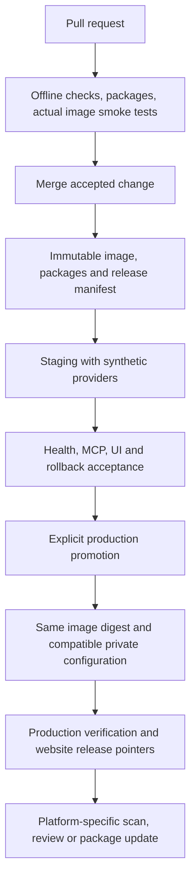

# Hosting, platform delivery and release plan — 19 October 2026

**Status:** Hetzner is the owner's preferred hosting direction; exact plan, region and purchase remain pending. Product launch-readiness work comes first; CI/CD, website release work and hosting setup follow afterward. No deployment, new data allowance or publication authorization. Existing27ticket categories are unchanged. V1 remains API/search based, without a product database or bulk geography/history preparation. Start with ChatGPT; accept each additional client separately.

## Implementation update — 19 October 2026

The finite local pass is accepted with scoped limits. The owner has approved deployment preparation and confirmed `mcp.nightsky.earth` / `mcp-staging.nightsky.earth`. Another server session removed Tunes and prepared the host, but has not created the deployment account/key or deployed NightSky. Follow [the canonical setup checklist](hetzner-setup-20261019.md), which supersedes the proposed URLs/order below where more specific. Exact Hetzner plan/region and actual hosted acceptance are still unverified. This task prepares code/workflows only; registry publication, server activation and marketplace submission remain separate actions.

## Owner priority — finish the product before infrastructure

This section supersedes the execution order in the earlier researched proposal below. Retain the infrastructure research as a later handoff, without making hosting choices a prerequisite for finishing local product work.

| Order | Work now / later | Completion evidence |
| --- | --- | --- |
| Now: 1 | Reconcile the existing Tasks12B/15 acceptance findings against the current code and package. Keep the API-only and bounded event scope. | One finite list of material failures, accepted limitations and deferred items; no new ticket-count reset. |
| Now: 2 | Finish product issues: exact place reuse, timestamp-bound forecast comparisons, activity-aware targets/viewing guidance, partial-source failure handling and readable mandatory credits. Complete the current card/text presentation decision. | Reviewed fixes and affected regressions; no false claim that instructions alone guarantee model behaviour. |
| Now: 3 | Assemble the exact intended package/runtime and audit required runtime assets, including the recorded container event-file mismatch. Verify locally where the available runtime permits. | Versioned package, source/rights checks, startup and representative MCP tests; an unavailable container engine remains explicit rather than a claimed pass. CI/CD changes remain later. |
| Now: 4 | Run bounded representative model journeys and review the complete answers, including follow-ups, outage cases and credits. Fix material failures and perform the final local product audit. | Evidence tied to the exact tested build; native card/client gaps explicitly recorded. Live calls require an agreed allowance. Claude testing remains deferred until its platform acceptance stage. |
| Later: 5 | Return to CI/CD, website/install/policy URLs, Hetzner provisioning, secrets migration and operations/analytics decisions. | Reviewed deployment plan and owner decisions before activation; no purchase or deployment implied now. |
| Later: 6 | Hosted ChatGPT-first acceptance, production promotion, submission and pilot; Claude and Gemini accepted separately. | Actual HTTPS/client/policy/source compliance and platform review evidence. Local product completion is not public launch approval. |

The immediate goal is a locally verified product candidate. Public launch readiness additionally requires the later hosting, public-page, operational and platform gates; those cannot honestly be closed by local tests alone. Existing accepted local deliverables are retained, not repeated automatically. Historical downloads, bulk geography and a product database remain out of scope.

## Shared service and client delivery

One hosted Node MCP service supplies tools and provider controls. Each client receives appropriate connection configuration, package and workflow instructions. MCP connection alone does not install skills or prove identical UI, search, location, reminders or attribution behaviour.

| Client | Verified route | Proposed action / condition |
| --- | --- | --- |
| ChatGPT/Codex | Public HTTPS MCP and reviewed plugin package; server and package updates have separate paths. | First staging connection/journeys/card, then public review. Exact endpoint, publisher/pages/materials and actual scans still needed. |
| Claude | Remote custom connector; directory accepts a connector or GitHub-hosted connector/skills bundle. | Test the shared service and adapt existing package. Developer submission requires paid-plan access; actual native acceptance/review remain. |
| Gemini CLI | Streamable HTTP MCP plus extensions. | Port workflow context, package and test. CLI acceptance is not mobile-app acceptance. |
| Gemini Apps | Custom apps currently require US location,18+, personal account, English and Keep Activity. | Conditional native trial with an eligible tester. Do not infer availability for the India-based owner or bypass restrictions. |

Checked19October2026: [OpenAI submission](https://developers.openai.com/plugins/deploy/submission), [package format](https://developers.openai.com/plugins/build/plugins), [Claude directory](https://claude.com/resources/articles/build-plugins-for-claude), [Claude remote connectors](https://support.claude.com/en/articles/11175166-get-started-with-custom-connectors-using-remote-mcp), [Gemini Apps requirements](https://support.google.com/gemini/answer/17209137?hl=en-yt), [Gemini CLI MCP](https://geminicli.com/docs/tools/mcp-server/), [Gemini extensions](https://geminicli.com/docs/extensions/). Recheck at submission time.

## Hosting comparison

| Option | Published allowance/cost | Repository fit and recommendation |
| --- | --- | --- |
| MCPHosting Free |2projects,20builds/month,500MCPrequests/month | Optional development trial. Clarify metering, persistent private quota storage, SDK compatibility, outbound access, custom domain/TLS and body/log retention. Several requests per conversation make this a small pilot allowance. Not selected for production. |
| MCPHosting Pro |$19/month;10projects,200builds,50,000MCPrequests/month | Consider for managed operation only after the same checks. Advertised request-history analytics must not silently enable raw body logging. |
| Hetzner shared VM | Published EU CX23 reference€5.49/month excluding IPv4/VAT; cost-optimized listing shows4GB. Final cart controls exact price. | Preferred proposal: close fit for existing Node/Docker/atomic filesystem quota code. A2vCPU/4GB target needs hosted measurement, not a capacity guarantee. We own maintenance, TLS, backups and monitoring. |
| Cloudflare Workers Free |100,000requests/day,10msCPU/request,128MBmemory | Remote MCP exists, but astronomy CPU and Node/Express/filesystem quota persistence need compatibility measurement/adaptation. A separate port, not a drop-in promise. |

Sources: [MCPHosting](https://www.mcphosting.io/), [Hetzner pricing](https://docs.hetzner.com/general/infrastructure-and-availability/price-adjustment/), [Hetzner configuration](https://www.hetzner.com/cloud/cost-optimized/), [Workers limits](https://developers.cloudflare.com/workers/platform/limits/), [Cloudflare MCP](https://developers.cloudflare.com/agents/model-context-protocol/guides/remote-mcp-server/). Checked19October2026; entitlements/purchases unverified.

The earlier four-client local fixture sampled about311MiB RSS; it is not sustained hosted capacity. Build images in CI rather than on the small VM. One VM can initially separate staging/production by process/domain, but is one failure domain, not high availability. Staging uses synthetic providers by default; live rehearsal needs explicit budget and account accounting. Do not create independent zeroed quota counters for the same provider account.

## Concrete release-preparation findings

| Existing piece | Actual state | Required work |
| --- | --- | --- |
| CI | Windows/Linux code, package, build and runtime checks pass. | Add construction/startup/image-content probes for the actual container. |
| Docker | Non-root pinned recipe exists; the product completion pass adds the missing inventory and2027peak file to its explicit event list, with static regression checks. | Built-process startup passes. Actual pinned-image construction/start still needs verification; its base is not locally cached and was not downloaded. Keep optional worker boundaries and private-data exclusions intact. |
| Distribution | Local Codex/Claude builders and installed1.0.36; local card prototype off. | Verified HTTPS manifests, host-specific packages, checksums and versioned downloads. Gemini package/native support not yet tested. |
| UI/model | Browser fixture card passed; initial duplicate lookup and prose licence omissions persist. | Actual target-host display/link/credit acceptance; source/logo-compatible presentation. No universal control over model prose claimed. |
| Operations docs | Earlier sections describe dormant bulk/artifact modes. | Canonical API-only launch instructions; label legacy sections rather than reacquiring data. |
| Website | Netlify publishes static `dist/public`, config selects Node20; policy drafts exist. | Verify supported build runtime, separate website/backend jobs, direct policy routes, publisher/support details and preview checks. Backend hosting need not move the website. |
| Provider configuration | Local keys/ledgers and source-specific controls exist. | Private Linux migration, actual free-use/account checks and persistent quotas through deploy/rollback. Credit/logo/method offers must be live and correct. No provider keys in ordinary CI. |

## Proposed URL inventory — not live/configured values

Use our owned production hostname independently of hosting vendor. Verify DNS, HTTPS and actual content before placing these in public manifests.

| Purpose | Proposal |
| --- | --- |
| Homepage | `https://nightsky.earth/` |
| Install/connect instructions | `https://nightsky.earth/connect` |
| Downloads and versions | `https://nightsky.earth/downloads`, `/changelog` |
| Product policies/help | `https://nightsky.earth/privacy`, `/terms`, `/support` |
| Credits/method offer | `https://nightsky.earth/data-sources`, `/openweather-normalization-method.json` |
| Production MCP | `https://mcp.nightsky.earth/mcp` |
| Staging MCP | `https://mcp-staging.nightsky.earth/mcp` |

Marketplace links are verified later; website buttons distinguish available/pending integrations. Downloads serve supported desktop/CLI routes, not automatic normal-chat installation. Publish versioned packages/checksums/release manifests and update a latest pointer after promotion; preserve supported old releases. Never put provider keys in browser code or archives.

## CI/CD and publication proposal

Every PR gets checks/previews; selected successful merges update staging. Production initially needs an explicit release/promotion gate. Backend, website and packages use separate change detection with one manifest linking tested versions. Build once/promote the same digest, serialize deployments, record rollback image/configuration and test recovery. Rollback never restores an older consumed-quota counter or resets accounting.

Provider secrets stay in private runtime configuration. CI receives only required registry/deployment credentials; untrusted PR jobs receive none. Any live-source acceptance is a separately gated job with exact allowances. The repository is public on main; configure GitHub deployment controls under actual account eligibility, allowing the solo owner to approve rather than requiring an unavailable second person. [GitHub environment rules](https://docs.github.com/en/actions/reference/workflows-and-actions/deployments-and-environments).

Deploying the backend and publishing a platform listing are different actions. OpenAI scans server changes while package/skill updates require package handling; retain approved schema compatibility while updates are held, and freeze the owned endpoint before submission. Claude has separate directory review; Gemini extension releases and eligible app connections differ. No promise that pushing code immediately publishes every client directory.

## Lightweight analytics proposal

Start with aggregate tool usage, success/partial/unavailable/error counts, latency buckets, provider failures, quota remaining, release version, uptime, website connect/download clicks and voluntary usefulness feedback. Tool success does not establish a successful trip.

No raw conversations/query bodies/exact coordinates/gear details/full IPs, persistent user IDs or session reconstruction. Existing diagnostics are not a full analytics system. Bounded aggregate counters/files and a private operations view are enough initially; no product DB or large monitoring stack required. Choose retention/access/storage/deletion limits before activation and update the privacy text to observed behaviour.

Requests, downloads, installs and unique users are different. AI hosts proxy calls; client headers do not establish verified identity. Use platform metrics where available (Claude documents install/version data), and label unknown client origin unknown. Disable/request changes to managed-host raw request-history analytics before selecting such a host.

## Ordered work and parallel lanes

| Sequence | Deliverable / existing tickets | Parallel work | Acceptance |
| --- | --- | --- | --- |
|1| Host, URL, access and analytics decisions —0/3C/13/14 | Website structure/package preparation | Exact budget/region/architecture, DNS control, anonymous-versus-authenticated decision, privacy settings. |
|2| Correct/test actual API-only image —14/15 | Website/policy preparation —13/18 | Image starts, representative synthetic MCP calls, required runtime assets/credits, no secrets/bulk files. |
|3| CI/CD and versioned artifacts —12A/14 | Claude/Gemini packaging/docs | Dry-run pipeline, registry/environments, scoped deploy credentials and rollback. |
|4| Approved staging/page publication —3B/3C/13/14 | Listing/demo preparation | TLS/streaming/proxy/firewall/retention/capacity; actual URL contents verified. |
|5| ChatGPT-first hosted acceptance —3B/4B/12B/15 | Claude/eligible Gemini trials | Native credits/UI, entitlements, bounded live batch, outage/reuse/forecast cases and official checks. |
|6| Production and directory review/publication —12A/16 | Downloads/remaining platform submissions | Exact approved release, owner attestations, public URLs and tested recovery. No review approval guarantee. |
|7| Pilot and platform expansion —17 | Tested maintenance | Real outcomes/aggregate use and client-specific acceptance. |

These sequence existing tickets, not seven newly counted waves. No completion reset or new bulk data requirement. Hosted checks require staging; deployment code can be prepared before they close. Public launch means applicable gates have actually passed.

## Owner decisions still needed

- Owner clarified that the fourth platform name was a transcription error. Only ChatGPT, Claude and Gemini are in the requested platform scope, starting with ChatGPT; no fourth-platform task or blocker remains.
- Hetzner is preferred. Exact all-in monthly ceiling, plan/region/architecture and whether a server exists can be settled after local product completion.
- Domain/DNS and current website host control; proposed hostnames before configuration.
- Verified publisher identity for platform use, country targeting and support/log/analytics retention/access. Brand and support email are already known.
- Bounded anonymous read-only service versus authenticated access; no account DB/OAuth provider added implicitly.

This research made no purchase, DNS/configuration change, credential migration, analytics activation, runtime change, deployment, publication or provider-data request. Historical notes remain evidence, not mandatory launch prerequisites.
