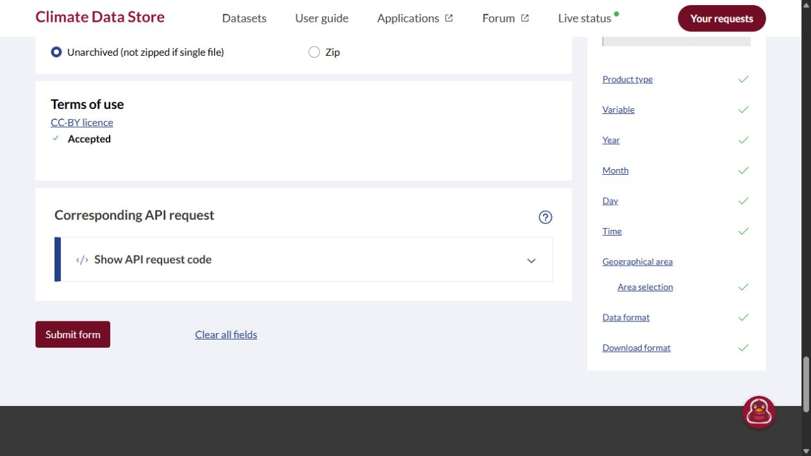

# Authenticated 27-request CDS form review — 17 October 2026

**All 27 exact current-form checks passed: generated request equality, existing
licence acceptance and enabled Submit controls. No job was submitted.** This
supersedes the login blocker from the [earlier Chrome comparison](weather-form-comparison-20261017.md).
It does not approve the proposed +11 submissions, raise the executor's 16-job
cap, establish provider queue acceptance or make the proposal executable.

The controlling [proposal](data-pilot-evidence/2026-10-16-weather-regrouping-proposal.json)
is unchanged: 59,765 bytes, SHA-256
`5482a483a50dd6870ac1b6e1bb061bfdfdc303596b7bee273fdab93e8ff846dd`.
Every ordered request, source pin, runtime pin and resource limit is preserved.

| New evidence | Bytes | SHA-256 |
| --- | ---: | --- |
| [Authenticated observations](data-pilot-evidence/2026-10-17-cds-authenticated-observations.json) | 31,722 | `09d3951aaa9cf4f83e83e96d368c5ddc0a222491911e64d23295200980c35c79` |
| [Offline computed comparison](data-pilot-evidence/2026-10-17-cds-authenticated-comparison.json) | 15,387 | `bbb34a6a10b26855f47e0ae99da11732c47716438bc87d2e678953ade667385a` |
| [Sanitized screenshot](data-pilot-evidence/2026-10-17-cds-authenticated-enabled.jpg) | 46,320 | `a9c310100eec0a6edc5bdf3361e93ab4c033d2fe70a6bfbdca7ddf594b96b2ca` |

## Actual account/form observations

The parent alone used `cua_repl` in a new **in-app browser (`iab`) tab**, sharing
the existing signed-in session. The coordinator's tab was not changed. The
initial page briefly displayed licence-loading state, then settled to **Accepted**.
The existing signed-in user menu and **CC-BY licence: Accepted** were independently
read for every captured row. No login, terms acceptance, user-menu interaction,
token/configuration access or account change was performed. Account name is
omitted from retained evidence.

For each of the 27 proposal rows, the visible API-code panel supplied the actual
dataset and full JSON request. The comparator checked all keys and values against
that exact pinned row, including its complete year list, month, days, every UTC
hour, both numeric areas, reanalysis/cloud variable and NetCDF/unarchived format.
The actual **Submit form** control was enabled for every captured selection.
No request-too-large/error message was observed on any recorded exact selection.
Intermediate incomplete/updating controls were not counted as completed checks.

Each generated object and UI state was written immediately to a fresh exclusive
lane-local metadata file before assembly into the ordered sanitized record.
All **27 timestamps retain instant precision** with UTC+05:30 offsets. No row
is inferred from a representative month and no timestamp is reconstructed at
day precision. The raw ordered record binds the proposal's byte hash, all
27 request identities and every source pin. It is an agent transcription of
visible UI, not a provider-signed response or a submitted-job receipt.

The normal request-size display did **not expose absolute cost units or an
absolute ceiling** for the recorded enabled selections. Rendered percentage bars
were visible; for example, the non-leap February bar had DOM style width
`73.3091%`, and row 27 had `0.238017%`. Those are UI bar widths, not quoted cost
units. The historical rejected January/April selections at 133,920/129,600 over
121,000 remain separate evidence. No six-units-per-hour formula, universal
121,000 ceiling or future provider suitability is inferred here. The actual
current evidence is exact selections, existing licence acceptance, no observed
too-large message and enabled Submit controls for **all 27**.



## Exact coverage of the review

| Row(s) | Preserved selection | Generated request | Submit / licence |
| --- | --- | --- | --- |
| 1 | 1990 December 30–31, first area | Exact | Enabled / Accepted |
| 2, 3 | January 1991–2017 and 2018–2020, days 01–31 | Both exact | Both enabled / Accepted |
| 4 | February's exact 22 non-leap years, days 01–28 | Exact | Enabled / Accepted |
| 5, 6 | March 27+3, days 01–31 | Both exact | Both enabled / Accepted |
| 7, 8 | April 27+3, days 01–30 | Both exact | Both enabled / Accepted |
| 9, 10 | May 27+3, days 01–31 | Both exact | Both enabled / Accepted |
| 11, 12 | June 27+3, days 01–30 | Both exact | Both enabled / Accepted |
| 13, 14 | July 27+3, days 01–31 | Both exact | Both enabled / Accepted |
| 15, 16 | August 27+3, days 01–31 | Both exact | Both enabled / Accepted |
| 17, 18 | September 27+3, days 01–30 | Both exact | Both enabled / Accepted |
| 19, 20 | October 27+3, days 01–31 | Both exact | Both enabled / Accepted |
| 21, 22 | November 27+3, days 01–30 | Both exact | Both enabled / Accepted |
| 23, 24 | December 27+3, days 01–31 | Both exact | Both enabled / Accepted |
| 25 | February's exact eight leap years, days 01–29 | Exact | Enabled / Accepted |
| 26 | 2021 January 01–02, first area | Exact | Enabled / Accepted |
| 27 | 1990 December 30–31, second area | Exact | Enabled / Accepted |

All select all 24 UTC hours. Full request objects and individual hashes remain
in the observations JSON rather than being replaced by the grouped prose table.
Computed facts: `comparedRows=27`, `enabledRows=27`, `disabledRows=0`,
`loginRequiredRows=0`, `missingRows=[]`, `allRequestsCompared=true`,
`allSubmitControlsEnabled=true`, **`executionEligible=false`**.

## Reproduction and independent review

```powershell
.data/weather-py314/Scripts/python.exe scripts/era5/form_readiness.py --proposal docs/operations/data-pilot-evidence/2026-10-16-weather-regrouping-proposal.json --proposal-sha256 5482a483a50dd6870ac1b6e1bb061bfdfdc303596b7bee273fdab93e8ff846dd --observations docs/operations/data-pilot-evidence/2026-10-17-cds-authenticated-observations.json --observed-date 2026-10-17
.data/weather-py314/Scripts/python.exe -m unittest discover -s tests/era5 -p test_form_readiness.py
```

The existing offline verifier compares all observed objects, order, dates and
source pins; its operator-supplied hash is fixed to the retained proposal above.
The new fixture recomputes the saved report and checks that all form controls
pass while execution stays ineligible and the cap remains 16. Existing public,
logged-out observations remain unchanged as historical evidence. There is no
new allowance or `currentProviderFormReviewed` authority artifact.

The parent ran all 19 focused tests successfully (2.231 seconds) and the full
195-test ERA5 suite successfully (22.509 seconds), both exit 0 in the lane-owned
Python 3.14 environment. `git diff --check` passed. Existing NumPy fixture
deprecation warnings remain. The independent reviewer reproduced the 27-row
comparison and report, checked hashes/timestamps and screenshot, reran the
19 focused tests, and checked the route audit's source claims and arithmetic;
no actionable findings remain.

The [global-history route audit](global-history-route-audit-20261017.md) separately
assesses practical full-target acquisition and aggregation. Passing 27 requests
does not demonstrate that the frozen 373,619-parent schedule (which predates the
latest overlay) is viable. Its concrete alternative is a metadata-only admission
decision for the exact new anonymous Earthmover temporal store, with NCAR as
comparator; `tcc` inventory, final revision/member, immutable snapshot, physical
read geometry/bytes and full retained-subtraction proofs remain explicit gates.
Efficient acquisition does not establish affordable solar/timezone aggregation.

## Next decision and unchanged controls

The login/current-form-selection blocker for these exact 27 requests is resolved
by the recorded UI observations. **Execution remains unapproved.** An owner must
decide the proposed +11 submissions and whether the unchanged eight-hour/512 MiB
envelope is suitable. A changed executable contract, fresh packet/code/runtime
pins and explicit allowance are still required. The proposal cannot be submitted
through the unchanged 16-job executor. No record is automatically promoted into
an execution decision or a provider acceptance flag for another packet.

Queue acceptance/completion, conversion/output packaging, route hosts, actual
bytes, whole-world throughput, scientific completeness and final serving fit
remain unproved. No dataset download, provider job, deployment or publication
occurred. Source and feature coverage are unchanged; acceptance totals remain
**12 Done / 9 Partial / 6 Not started**. The parent-owned in-app form tab is
retained for handoff, with final selection row 27 and no job submitted.
