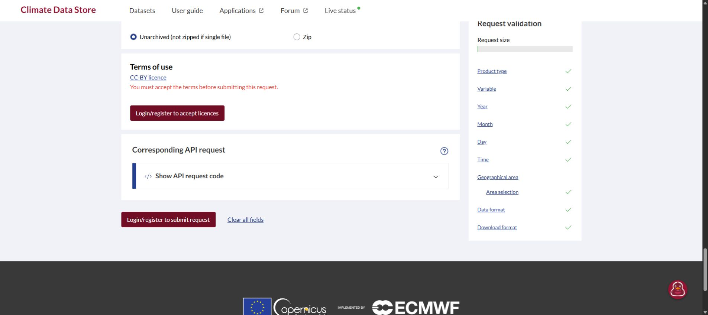

# Exact 27-request CDS public-form comparison — 17 October 2026

**All 27 generated requests match; account-side request validation remains
blocked by the logged-out session.** This is a public-form comparison, not provider
acceptance, licence acceptance or execution permission. The 16-submission cap and
all other executor limits are unchanged; the proposed +11 submissions still
requires an owner decision.

The controlling [27-parent proposal](data-pilot-evidence/2026-10-16-weather-regrouping-proposal.json)
remains exactly 59,765 bytes, SHA-256
`5482a483a50dd6870ac1b6e1bb061bfdfdc303596b7bee273fdab93e8ff846dd`.
Neither its request order nor its source/runtime/preparation pins were changed.
The [dated per-request observations](data-pilot-evidence/2026-10-17-cds-form-observations.json)
contain every exact generated dataset/request object, ordered identity, source
pin, UI state and blocker. The [computed comparison report](data-pilot-evidence/2026-10-17-cds-form-comparison.json)
rechecks all keys and values offline rather than trusting declared match flags.

| Artifact | Bytes | SHA-256 |
| --- | ---: | --- |
| Observations | 32,964 | `8b1ffdbb21fc8c6ffc06ef044791f9c05443e64c51ab35b5f094281b9a87f13d` |
| Computed report | 16,570 | `faf18164d0af07df7df989701a1bdf3c50d0e8a07ae35ccc4441525b24aa4f3e` |

## What was actually inspected

The parent agent alone operated the current
[CDS download form](https://cds.climate.copernicus.eu/datasets/reanalysis-era5-single-levels?tab=download)
through `cua_repl` in Chrome. Its header showed **Login - Register**. For each
selection the visible UI showed **You must accept the terms before submitting
this request**, **Login/register to accept licences**, and **Login/register to
submit request**. That final button initiates login; its enabled appearance does
not make it an actionable request-submission control. Each observation therefore
records `state: login-required` and `submitControl: unavailable`.

For every row the generated Python code's dataset and complete JSON request were
read from the visible API-code panel and compared for exact key/value equality.
This includes dataset, product type, cloud variable, every year/month/day/hour,
both numeric areas, NetCDF and unarchived format. Selected checkboxes alone were
insufficient: the form can retain a disabled, checked day 31 while correctly
excluding it from an April generated request, and code updates can lag field
edits. The second area's code was checked only after it actually contained
`[-39.75,-73,-40,-72.75]`. All observations retain the corresponding exact objects,
not a representative request substituted for the remaining rows.

The **Request size** widget showed its label and a bar, with **no numeric cost or
limit** in its visible DOM or screenshot. No current numeric threshold is claimed
for these requests. No too-large error remained for a recorded exact selection,
but a logged-out form cannot establish the signed-in constraint result. The
historical January/April 30-year rejections at 133,920/129,600 versus 121,000 and
the one enabled 27-year January candidate remain separate dated evidence; none
is copied forward as all-27 acceptance.

## Request-by-request result

Every row below has **exact generated-code equality; login required; numeric
cost/limit unavailable**. The JSON record retains each full request and hash.

| Proposal row(s) | Exact selection |
| --- | --- |
| 1 | 1990 December 30–31, first area |
| 2 / 3 | January, 1991–2017 / 2018–2020, days 01–31 |
| 4 | February, exact 22 non-leap years, days 01–28 |
| 5 / 6 | March, 1991–2017 / 2018–2020, days 01–31 |
| 7 / 8 | April, 1991–2017 / 2018–2020, days 01–30 |
| 9 / 10 | May, 1991–2017 / 2018–2020, days 01–31 |
| 11 / 12 | June, 1991–2017 / 2018–2020, days 01–30 |
| 13 / 14 | July, 1991–2017 / 2018–2020, days 01–31 |
| 15 / 16 | August, 1991–2017 / 2018–2020, days 01–31 |
| 17 / 18 | September, 1991–2017 / 2018–2020, days 01–30 |
| 19 / 20 | October, 1991–2017 / 2018–2020, days 01–31 |
| 21 / 22 | November, 1991–2017 / 2018–2020, days 01–30 |
| 23 / 24 | December, 1991–2017 / 2018–2020, days 01–31 |
| 25 | February, exact eight leap years, days 01–29 |
| 26 | 2021 January 01–02, first area |
| 27 | 1990 December 30–31, second area |

All select all 24 UTC hours. Counts computed by the offline verifier:
`observedRows=27`, `comparedRows=27`, `loginRequiredRows=27`, `enabledRows=0`,
`missingRows=[]`, `allRequestsCompared=true`,
`allSubmitControlsEnabled=false`, `executionEligible=false`.

## Evidence precision and interruptions

The review crossed midnight in Asia/Calcutta. Rows 1 and 2 were rechecked on
17 October. Row 5's retained instant is `2026-10-16T18:30:20.274Z`, already
17 October in the user's timezone. Twelve records retain exact offset timestamps;
the other fifteen retain **day precision**, `2026-10-17`, because their exact
clock instants were not retained. No midnight or other clock time was invented.
Their field objects were transcribed from the completed exact-key comparison,
whose individual success appeared during the browser review. They are sanitized
agent transcriptions, not provider-signed responses or raw server receipts.

The browser inventory initially timed out and recovered on retry. One tab stalled
during selection and was replaced with a fresh tab in the same Chrome session.
The public code panel later showed **Error loading request code** and a disabled
Copy control; reopening it did not recover immediately, but it subsequently
recovered and the remaining exact comparisons were completed. No interrupted or
stale selection was counted as a match. No cause such as rate limiting is inferred.



## Offline verifier, tests and unresolved gates

`scripts/era5/form_readiness.py` is a bounded, read-only offline comparator. The
operator-supplied proposal SHA is the trust input; this invocation fixes it to
the retained proposal above. Each file is capped at 1 MiB, JSON duplicates and
nonfinite values fail, paths reject aliases, and at most 27 ordered observations
are admitted. Missing/uninspected rows cannot count as compared; altered dataset,
years, area, request keys, order, hash, source pins or authority fields fail.
Datetime observations need an offset and are converted to Asia/Calcutta before
checking the review date. Canonical date-only observations retain day precision.
The output is derived comparison facts, not an allowance or a
`currentProviderFormReviewed` record.

```powershell
.data/weather-py314/Scripts/python.exe scripts/era5/form_readiness.py --proposal docs/operations/data-pilot-evidence/2026-10-16-weather-regrouping-proposal.json --proposal-sha256 5482a483a50dd6870ac1b6e1bb061bfdfdc303596b7bee273fdab93e8ff846dd --observations docs/operations/data-pilot-evidence/2026-10-17-cds-form-observations.json --observed-date 2026-10-17
.data/weather-py314/Scripts/python.exe -m unittest discover -s tests/era5 -p test_form_readiness.py
.data/weather-py314/Scripts/python.exe -m unittest discover -s tests/era5 -p 'test_*.py'
```

Independent review reproduced a timezone error in the first implementation;
boundary tests failed before the fix and passed after it. The reviewer rechecked
both UTC-midnight directions and reported no remaining actionable code findings.
The saved artifacts are also checked against the derived report by a regression
test. Existing ERA5 CI discovers these Python tests automatically; no aggregate
test, TypeScript config or workflow change is needed.

Final local verification: **18 focused form tests and 194 full ERA5 tests passed**
in this lane's own Python 3.14 environment (full run 35.641 seconds, exit 0).
Independent artifact review recomputed all 27 comparisons, report equality,
hashes, sizes and the twelve-instant/fifteen-day precision count, and inspected
the screenshot; no actionable findings remained.

**Outstanding:** an available signed-in session and truthful licence state, exact
current account-side validation for all 27 selections (including numeric limits
or errors actually exposed), an owner decision for the proposed +11 submissions
and resource implications, a fresh executable contract/runtime/packet and
explicit allowance. Queue acceptance, conversion, future asset routing, bytes
and scientific completeness remain unproved. No login, terms acceptance, token
access, submission, job, dataset download, deployment or publication occurred.
Acceptance totals remain **12 Done / 9 Partial / 6 Not started**.
