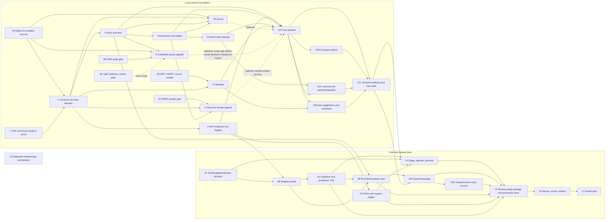

# NightSky V1 Task Sequence and Parallel Work Map

**Purpose:** Companion to the [V1 execution plan](2026-10-10-nightsky-v1-execution-ready.md). This document maps every numbered/lettered task to its prerequisites, safe parallel work, and release impact. The execution plan remains the source for task acceptance criteria and test details.

**Planning snapshot:** 13 October 2026. Current implementation counts and evidence are maintained in the [implementation status audit](../../operations/implementation-status.md), also dated 13 October 2026. This map does not change task completion status.

## Current next wave by original task number

Use the original task numbers in every progress report. A wave groups work across tasks; it is not a task number. Internal H1–H5 labels subdivide Task 9 only and do not add tasks to the 27-heading total.

| Original task | Detailed work | Current state |
|---|---|---|
| 9 | Statistic/result contract (H1) | Complete locally |
| 9 | Offline historical aggregation (H2) | Complete locally |
| 9 | Verified three-place 2025 pilot (H3) | Complete locally |
| 9 | Runtime reader and MCP/planning integration (H4) | Complete locally |
| 9, coordinated with 0F and 14 | Historical serving capacity and release claims (H5) | Pending; selected-host evidence required |

Task 9 remains Partial. The implemented history is a one-year three-place sample; global discovery and multi-year seasonal context have not been completed. The overall plan has other open data and launch dependencies.

### Recommended next local wave

| Lane | Original tasks | Concrete next deliverable | Parallelism / dependency |
|---|---|---|---|
| A — real candidate-place evidence | 0B → 8 → 10A/10B | Review the interrupted import and existing extract; establish an explicitly bounded real candidate artifact, with source/licence, access uncertainty, sizes and planner/comparison checks | Independent of weather and event review. Local pilot is not global coverage; measure before expanding an import |
| B — remaining source and field coverage | 0A/0D → 6 and 7A | Reconcile meteor/event rights and unsupported calculations; complete the missing Arctic/ocean weather and refresh-cycle evidence with bounded source calls | Can run alongside A. Scientific/rights findings may require a documented source choice before code changes |
| C — release preparation | 9 + 13 + 14 preparation | Prepare selected-index/history capacity scenarios and rollback checklist; draft accurate policy/support content from actual data handling | Can run alongside A/B. Policy deployment belongs to the separate website workstream; host measurements wait for the selected server |

These lanes are a proposed next wave, not claims of completed tasks or authorization for an unbounded/global download. Start with a short reconciliation of existing artifacts and acceptance gaps so interrupted work is reused safely.

### Hosted sequence and owner inputs

Confirm Task 0F's exact Hetzner plan/region, recurring budget and staging/production hostnames. Then follow the existing sequence: protected staging smoke (3B), publisher/production endpoint (3C), real draft location scan (4B), full release operations (14), review-ready package (15), owner-authorized submission/publication (16), invited pilot (17). Task 13 policy/support URLs and Task 12A/12B host packages remain dependencies where shown in the full map below.

Website/map design remains Task 18's separate workstream. Local tests do not establish a connection to ChatGPT, Claude or Gemini. Current verified evidence is [Task 9 runtime integration](../../operations/era5-runtime-wave.md); counts remain **7 Done / 12 Partial / 8 Not started**.

## Decisions the sequence preserves

- Build the assistant/plugin experience first; the website/map is an independent workstream.
- The plugin service has no persistent database. Use live providers, bounded in-process cache, local calculations, and compact versioned files. If a data artifact does not fit or cannot be used lawfully, defer that capability rather than add a database.
- The local core journey must work from a named place with astronomy/events and at least one live forecast even if optional data sources are unavailable.
- Spot discovery and months-ahead historical context are V1 journeys in the approved product scope. Their OSM/ERA5 feasibility gates can run alongside core development. If either cannot ship, document the affected journey and get the owner's explicit scope decision before claiming the full V1 promise or submitting publicly.
- Hosting, production deployment, OpenAI submission, and publishing are later gates. The selected hosting direction is Hetzner; no exact plan, hostname, or spend is authorized by this map.

## At-a-glance dependency map

Dashed edges are integrations that may arrive after the local core-planner milestone. They are not prerequisites for testing the basic planner. Candidate discovery and historical climate remain V1 scope promises; if either is unavailable for public launch, the affected journey requires an explicit owner decision. Aurora is coverage-limited and should return a clear unavailable/not-covered result where its official source does not support the location or time.

## Full task-by-task order and parallelism

| Task | Prerequisites / input | Recommended place in sequence | Safe parallel work and blockers |
|---|---|---|---|
| **0 — six preflight gates** | Product source inventory and free-data boundary | Split the gates instead of treating Task 0 as one large blocker; see the gate table below. | 0A/0D baseline research can run with Tasks 1–2. Optional 0B/0C/0E can run alongside the core build. 0F is required before hosted work, not local coding. |
| **1 — SDK/runtime/transport proof** | Current Node/Express setup | Early local foundation. | Can run alongside source research. Must precede Task 2 schema freeze and Task 3 transport implementation. No hosting or optional dataset needed. |
| **2 — contracts and test harness** | Task 1 schema decision; product tool inventory; baseline source shapes | After Task 1; freeze the common structures before adding domain handlers. | 0A/0D findings can arrive incrementally. Candidate/climate fields remain optional until their gates pass. Blocks Tasks 3–11 implementations that consume shared contracts. |
| **3 — MCP endpoint and registry** | Tasks 1–2 | After contracts. First code action: fix the audited 429 active-request counter leak and add regression coverage; also correct stale data-flow wording. | Can proceed while Tasks 4–9 are developed against stable interfaces. Must pass local abuse/logging controls before Task 3B or any remote exposure. |
| **3B — early hosted OpenAI smoke** | Task 3 minimum endpoint; Gate 0F host/staging decision | Run as soon as the minimal protected endpoint and host are ready, before broad feature development when practical. | Platform-only lane; does not block local domain implementation. Must precede Task 3C and Task 4B. |
| **3C — publisher and production URL** | Gate 0F; Task 3B | Before creating/scanning the real OpenAI draft. | Can proceed while domain features continue, once exact publisher/host choices are supplied. Blocks Task 4B and final release setup. |
| **4 — place and local time** | Task 2 `PlaceRef`; GeoNames/time-zone rights from 0A | Core domain foundation. | Can be implemented alongside Task 7A after Task 2. Blocks Tasks 5, 6, 7B, 8, 10A; Task 4B also needs it. |
| **4B — real draft location scan** | Tasks 3B, 3C, 4 | Scan the real minimal resolver draft before adding the full tool set, as soon as those prerequisites are met. | Can overlap with Tasks 5–11 locally. Requires production log controls before scan traffic. It does not mean the full plugin is ready. |
| **5 — astronomy and target windows** | Tasks 2 and 4 | After place/time resolution. | Can overlap with weather development and event-source research. Blocks Task 6, 7B, 9, and the core planner. |
| **6 — predictable events/catalogs** | Tasks 4–5; source/rights decisions | After astronomy primitives needed for event visibility. | Can overlap with 7A, 7B, and optional data work. Blocks event-rich Task 10A journeys and Task 11A learning boundaries. Unsupported classes stay explicit. |
| **7A — weather adapter** | Task 2 provenance contracts; MET sample in 0D | Start as soon as Task 2 and the baseline MET findings are ready; develop in parallel with Tasks 4–6. | Independent implementation lane. A usable 7A result is required for the minimum Task 10A plan. GEFS remains a separate conditional enhancement. |
| **7B — aurora adapter** | 0A rights, Task 2 schemas, Tasks 4–5, SWPC sample in 0D | After place/time and latitude handling. | Can run beside 7A or Tasks 6/8/9. It is optional to the core planner; no guaranteed-sighting claim. |
| **8 — candidate places** | OSM rights in 0A, scale gate 0B, Task 4; 0E only for any light-radiance context | Feasibility/build lane can run alongside core development. Integrate when a lawful artifact meets measured host limits. | Independent of Tasks 5–7A and 9. It does not block local planner testing. Since it is in the agreed V1 product scope, inability to include it needs an explicit owner scope decision before public launch. |
| **9 — historical cloud context** | ERA5 gate 0C, Task 2 result contract, Task 5 darkness intervals | Feasibility/build lane after its sample and rights decision. | Can run beside Task 8 and core development. It is not a specific-night forecast and does not block local core-planner testing. Since months-ahead historical context is a V1 journey, public omission requires explicit owner scope acceptance. |
| **10A — activity-aware planner** | Task 3 registry; Tasks 4, 5, 6 supported subset, 7A | Core integration milestone after foundation services exist. | 7B/8/9 may be absent during local development and return explicit availability states. This task is the first complete user journey and is the critical path for remaining user-facing tools. |
| **10B — comparisons** | Task 10A `PlanResult`; Task 2 comparison contract | After 10A. | Can run in parallel with Tasks 11A and 11B once the plan output contract is stable. Required for the planned comparison journey in the full V1 release. |
| **11A — learning/astrophotography** | Task 6 safety/event boundaries; Task 10A plan contract | Once content boundaries and planner contract are stable. | Can run beside 10B and 11B. Must cite reusable sources and avoid unsupported camera-specific settings. |
| **11B — app suggestions/checklists** | Task 10A; actually available weather fields | Once planner and weather contracts are stable. | Can run beside 10B and 11A. Needs source/review dates for app claims; no affiliate placement. |
| **11C — five workflows and host-specific skills** | Final MCP tool inventory; Tasks 10A–10B, 11A–11B | After the tools and guidance it describes are stable. | Host-neutral workflow drafting can start earlier, but final names/order/tests must match implemented tools. Blocks package task 12A and release readiness. |
| **12A — OpenAI package** | Implemented tools; Task 11C; real draft from 4B | Package after the full intended tool/skill set stabilizes. | Manifest/content preparation can overlap late development; final ZIP/draft update follows tool freeze. Live production review cases wait for Task 15. |
| **12B — Claude/Gemini route records** | Shared endpoint (Task 3); host-neutral prompts from 12A | Draft platform matrices after prompts exist; test actual routes when a suitable endpoint/client is available. | Documentation can overlap 12A's packaging work after prompt fixtures are stable. Protocol support is not proof of consumer marketplace availability; final route tests are recorded in Task 15. |
| **13 — policy/support pages** | Task 3 data-flow/logging contract; owner publisher/support details; jurisdiction review | Draft once actual data flow and retention are defined. | Content/legal research can run alongside Tasks 4–12. Final text must be reconciled against observed staging/production logs during Task 14. Blocks public listing readiness. |
| **14 — deployment and operations** | Gate 0F; Tasks 1, 3C; completed service; Task 13 policy draft | Deploy staging only after local service and operations checks are ready; promote after staging passes. | Host setup can be prepared while local work continues, but paid hosting requires owner-approved spend. Production promotion waits for core release and rollback/log controls. Optional features may ship unavailable only under the stated scope decision. |
| **15 — review-ready public package** | Tasks 4B, 12A, 12B, 13, 14 and 3C | After the production candidate has been promoted and the package is complete. | No earlier task should treat this as permission to submit. Run all five positive/three negative cases and verify platform routes against production. If Task 8 is unavailable, obtain owner acceptance of the V1 scope gap before using a reduced candidate-search case. |
| **16 — submit/review/publish** | Task 15 reviewed artifact | Submit only after explicit owner authorization; publish only after a separate owner instruction. | Strictly sequential external actions; review remediation may return to implementation/staging. |
| **17 — invited pilot** | Product is published | After public listing is live. | Collect only the aggregate/user-volunteered measures in the pilot plan. Cannot precede publication. |
| **18 — website/map workstream** | Owner chooses to start its separate scope | Independent track at any time when intentionally started. | May run in parallel with any plugin task using its own scope/plan. Does not share plugin acceptance gates and does not include the map in plugin V1 by default. |

## Explicit execution labels for every task

**Parallel** means the task can proceed beside the listed lane after its prerequisites are met. **Sequential** means it consumes a prior interface or release artifact. **Gated** means it also waits for owner/platform/source decisions. These labels identify safe overlaps; they do not authorize spending or public release.

| Task | Mode | Parallel window / handoff |
|---|---|---|
| 0A | Parallel source gate | Research alongside Task 1; each source disposition must precede enabling that provider. |
| 0B | Parallel V1 feasibility gate | OSM feasibility can run beside core services and Task 0C; Task 8 waits for its outcome. A no-go requires an explicit V1 scope decision before launch. |
| 0C | Parallel V1 feasibility gate | ERA5 feasibility can run beside 0B and core services; Task 9 waits for its outcome. A no-go requires an explicit V1 scope decision before launch. |
| 0D | Parallel source gate | MET/SWPC samples can run beside Tasks 1–6; 7A/7B wait for their relevant sample. GEFS remains conditional. |
| 0E | Parallel optional gate | Can run beside 0B/0C; Task 8 uses it only if a radiance field is approved. |
| 0F | Gated platform lane | Decide host/budget/hostnames while local tasks proceed; needed for 3B/3C/14. |
| 1 | Parallel foundation | Can proceed beside 0A/0D research; Task 2 waits for its SDK/schema decision. |
| 2 | Sequential contract barrier | Follows 1; after its schemas settle, Tasks 3/4/7A can build in isolated modules. |
| 3 | Parallel after contracts | Fix the 429 issue now; finish registry work after Task 2. Can develop beside domain/provider modules, then integrate registrations. |
| 3B | Gated parallel lane | After minimal Task 3 and 0F; run beside local feature work. |
| 3C | Sequential platform step | After 3B and 0F; can proceed beside local domain work. |
| 4 | Parallel after contracts | After 2 and required place-data rights; can proceed beside Task 3 and 7A. |
| 4B | Gated early scan | After 3B/3C/4; scan while Tasks 5–11 continue locally. |
| 5 | Sequential domain step | After 4; can proceed beside 7A and optional data feasibility work. |
| 6 | Sequential domain step | After 4/5; can proceed beside 7A/7B and Tasks 8/9 feasibility. |
| 7A | Parallel provider lane | After 2 and baseline MET sample; can proceed beside Tasks 4–6. |
| 7B | Parallel provider lane | After 2/4/5 and SWPC rights/sample; can proceed beside 6/8/9. |
| 8 | Parallel V1 capability lane | After 0A/0B/4; can be built beside the core planner, then integrated behind the optional result contract. Public omission requires owner scope decision. |
| 9 | Parallel V1 capability lane | After 0C/2/5; can be built beside Task 8 and the core planner. Public omission requires owner scope decision for the months-ahead journey. |
| 10A | Sequential integration gate | After 3/4/5/6/7A; integrate optional 7B/8/9 when ready. |
| 10B | Parallel after planner | After 10A; parallel with 11A and 11B once `PlanResult` is stable. |
| 11A | Parallel after planner | After 6/10A; parallel with 10B/11B. |
| 11B | Parallel after planner | After 10A/7A; parallel with 10B/11A. |
| 11C | Sequential content barrier | After 10A/10B/11A/11B and final tool names; then 12A can package. |
| 12A | Gated package lane | After 4B/11C and implemented tools; can proceed beside Task 13. |
| 12B | Parallel platform-doc lane | Draft after shared prompts exist; live tests wait for a reachable endpoint and final production checks in Task 15. |
| 13 | Parallel policy lane | Draft after Task 3 data-flow/retention contract and owner details; can proceed beside Tasks 10–12. Verify against actual staging logs in 14. |
| 14 | Sequential release gate | After 0F/3C, completed release candidate, and Task 13 draft; staging must pass before production promotion. |
| 15 | Sequential review gate | After 4B/12A/12B/13/14; obtain explicit scope decision for any V1 journey missing due to failed 8/9. |
| 16 | Owner-gated sequential step | After 15; submission authorization and publish instruction are separate. |
| 17 | Sequential post-launch step | After product is published. |
| 18 | Independent workstream | Can run at any time under its own scope; coordinate edits to shared client route files with Task 13. |

### Task 0 gate ordering

## Developer-ready work packages

Use these packets to pick up work without reopening the whole plan. Before starting a packet, check the [status audit](../../operations/implementation-status.md), finish only acceptance gaps for partial tasks, and preserve completed work. Each packet ends with a reviewable result; do not start downstream integration until its exit check passes.

| Packet | Tasks | Deliverable / exit check | Can run alongside |
|---|---|---|---|
| **P0. Stabilize the current branch** | Task 3 regression item | Fix the 429 active-request leak, add a regression test, update stale data-flow wording, then run the relevant MCP test and existing local check/build suite. Prove rejected requests do not consume concurrency slots afterward. | Baseline source research (0A/0D). Immediate implementation packet. |
| **P1. Freeze the local boundary** | Tasks 0A/0D baseline portions, Task 1 remaining checks, Task 2 remaining contracts | Rights/fallback decisions for enabled sources; stable shared schemas; offline harness and clean local verification. Record optional fields without inventing source claims. | Optional 0B/0C/0E research. |
| **P2. Verify the host handshake early** | 0F → 3B → 3C → 4B; Task 3 minimal endpoint | After exact host/budget/publisher decisions, connect a protected smoke tool, freeze the production endpoint, and verify the minimal named-place resolver draft before building every tool. Exit: dated staging/client evidence and a location scan result or documented platform finding. | Local feature work continues. If host spend/identity details are not ready, keep this packet queued; do not block local implementation. |
| **P3. Finish local data services** | Tasks 3, 4, 5, 6, 7A, 7B remaining acceptance gaps | Each adapter/domain module passes fixture-based unit/contract checks and provides source, time, units, and explicit availability. Exit: baseline handlers can be composed locally. | 7A can develop in its provider module alongside Tasks 4–6; 7B waits on 4–5. Serialize edits to shared schemas and tool registry. |
| **P4. Resolve V1 place-search feasibility** | 0B/0E → Task 8 | A measured, rights-cleared compact artifact and coverage/host benchmark, or a documented no-go with the user-facing gap. Exit: candidate search is enabled with evidence, or the owner explicitly accepts a revised V1 launch scope. | Independent of Task 9 and the core planner; can run while P3/P6 proceed. |
| **P5. Resolve historical-context feasibility** | 0C → Task 9 | A lawful ERA5 statistic and small artifact with source/vintage/coverage, or a documented no-go and owner decision on the months-ahead journey. Exit: tests label historical context separately from forecasts. | Independent of P4 and core services. |
| **P6. Deliver the first complete plan** | Task 10A | Given a named place/activity/date, return a structured plan using place, astronomy/event, and baseline forecast data, with missing evidence and preparation. Exit: journey fixtures pass, including provider failure and unknown optional fields. | P4/P5 continue independently; integrate later artifacts through the agreed optional result fields. |
| **P7. Finish assistant value and reusable guidance** | 10B, 11A, 11B in parallel after 10A; then 11C | Side-by-side comparisons; cited learning/astrophotography content; reviewed app suggestions/checklists; then five workflow guides whose tool calls match the final registry. Exit: every journey maps to a fixture or an explicitly owner-accepted unsupported state. | 10B/11A/11B parallel after `PlanResult` is stable. 11C waits for all three. |
| **P8. Package, policies, and platform records** | 12A, 12B, 13 | Valid OpenAI package draft; Claude/Gemini setup matrix with untested routes labeled; policy/support content reflecting actual data flow and retention. Exit: package and pages are reviewable with no unsupported compatibility claims. | Policy research/draft can overlap P6/P7 after data flow is stable. 12B docs can start after shared prompts exist; live checks wait for a reachable endpoint. |
| **P9. Stage, review, submit, pilot** | 14 → 15 → 16 → 17 | Staging operations and rollback proven; full review artifact/cases/video prepared; submit only with owner authorization; publish only with separate instruction; then run measured pilot. Before packaging, obtain an owner decision for any V1 journey omitted because Task 8 or Task 9 could not pass its feasibility gate. | Sequential at release boundaries. Fix failures on staging before production promotion/re-review. |
| **P10. Separate website/map** | Task 18 | Its own approved brief, design and implementation plan. | Independent when intentionally started. Coordinate shared `client/src/App.tsx` and policy-route edits with Task 13. |

### Safe parallelism rules for implementation

- Parallelize by isolated modules and evidence work, not by assigning two developers the same shared file. `shared/nightsky/*`, `server/mcp/registerTools.ts`, `package.json`/lockfile, and `client/src/App.tsx` are likely integration hotspots; designate one integrator or serialize edits there.
- After Task 2 contracts are stable, domain/provider modules can be built independently. Merge their tool registrations in a short integration step and run the full contract suite after each merge.
- Task 8 and Task 9 data spikes can run independently from each other and from Task 10A. They must not silently change `PlanResult`; integrate only through its agreed optional fields.
- Content research can start early, but final skills (11C), package manifests (12A), and review cases (15) must use actual registered tool names and supported results.
- Task 13 policy routes and Task 18 website work can touch the same client routing file. Keep redesign separate, but coordinate or serialize edits to shared route files.
- Hosted work may proceed in parallel only after exact host/publisher details are supplied and any spend is approved. A local build does not authorize a server purchase or production deployment.

### Definition of ready and done for each packet

**Ready:** prerequisite outputs exist; source rights are clear for enabled providers; shared schemas/filenames are agreed; the packet has an owner/reviewer; and required external credentials/host choices are available without guessing.

**Done:** packet acceptance checks pass; output schemas and provenance are validated; offline tests cover applicable happy, partial, stale, unavailable, and malformed inputs; `npm run check` and `npm run build` pass at integration points; docs/status are updated with evidence; and downstream work can use the named interfaces without changing them ad hoc. Live-provider tests must not be the only verification path.

### Task 0 gate ordering

| Gate | Work | Can run alongside | Must be ready before |
|---|---|---|---|
| **0A** | Source rights and fallback register for enabled sources | 0B–0F research, Tasks 1–2 | Enabling each external data source; Tasks 7B/8 and public claims need their specific rights disposition. |
| **0B** | OSM candidate-data scale/license feasibility for the V1 discovery journey | Core service and planner work | Task 8 artifact build; if infeasible, explicit owner scope decision before launch. |
| **0C** | ERA5 statistic/access feasibility for the V1 months-ahead context journey | Core service and other source spikes | Task 9; if infeasible, explicit owner scope decision before launch. |
| **0D** | MET/SWPC baseline source samples; GEFS optional feasibility | Tasks 1–6 and optional source spikes | MET-backed Task 7A and SWPC Task 7B; GEFS only if the enhancement is selected. |
| **0E** | Optional VIIRS/light-radiance context usefulness and license | OSM scale and ERA5 spikes | Only the radiance field in Task 8; never permits a Bortle/SQM/sky-brightness claim. |
| **0F** | Exact host, budget, stage/prod hostname, logging and operations decision | All local implementation | Tasks 3B/3C and 14 hosted work. Hetzner direction alone is not a configured host or spending approval. |

## Parallel work by lane

| Lane | Work package | Safe start | Integration point |
|---|---|---|---|
| **A. MCP foundation** | 1 → 2 → 3, including the 429 regression fix | Now; 0A/0D research can proceed alongside | Stable local `/mcp` and contracts are ready for feature branches. |
| **B. Core sky** | 4 → 5 → 6 | Once Task 2 contracts settle; each step follows its predecessor | Task 10A. |
| **C. Weather and aurora** | 7A; 7B after place/time foundations | 7A can overlap Tasks 4–6; 7B waits for Tasks 4–5 | Task 10A; weather is required for the baseline plan, aurora is optional. |
| **D. Optional public datasets** | 0B→8; 0C→9; 0E optionally feeds 8 | Parallel with B/C after the rights/source questions are clear | Add only after artifact/host benchmark; must be before Task 15 if included in public claims. |
| **E. Experience/content** | 10A → (10B, 11A, 11B in parallel) → 11C | After domain contracts/data; content research can begin earlier | Package and test fixtures. |
| **F. Hosting/platform** | 0F → 3B → 3C → 4B; separately 12A/12B/13 | Host/publisher details may be prepared while local code is built | Task 14 then Task 15. Do not let this delay local work. |
| **G. Website/map** | Task 18 | Whenever owner intentionally starts its separate scope | Independent deliverables. |

The main critical path to a locally testable complete plan is **1 → 2 → (3 and domain work) → 4 → 5 → 6 plus 7A → 10A**. Tasks 3 and 4–7A can overlap after Task 2 if interfaces stay stable. In parallel, resolve **0F → 3B → 3C → 4B** early when host/publisher decisions are ready; this checks platform risk and does not pause local work. Public release continues through experience/package/policy completion, **14 → 15 → 16 → 17**. Tasks 8 and 9 remain V1 journeys; failure of either feasibility gate requires an explicit owner scope decision before public submission.

## Whole-plan grooming review

The plan is ready to start with local implementation. It is not yet ready for hosting or public submission. The implementation-status counts are a dated snapshot from 11 October; refresh evidence as tasks are resumed rather than treating those counts as current execution progress.

| Review area | Finding | Plan treatment |
|---|---|---|
| Runtime support | The plan named Node.js 20, which is now end-of-life. The worktree audit already recorded Node 24 as the runtime used for current local checks. | Set Node.js 24 LTS as the implementation/deployment baseline; Task 1 still verifies SDK and app compatibility. |
| V1 scope alignment | Product scope marks candidate discovery and months-ahead climatology as V1 journeys, while their implementation gates allow local planning without those capabilities. | Keep the local planner independent from the data artifacts, and require an explicit owner scope decision before public release if Task 8 or Task 9 cannot ship. |
| Early platform risk | ChatGPT transport and location behavior are safer to validate before the full tool set is built. | Keep 3B→3C→4B as an early lane parallel to local domain work; host/spend decisions gate that lane only. |
| Integration coverage | Unit, schema, provider, and later platform tests are planned, but a complete local resolver-to-plan call through the real registry and deterministic fixtures is not explicit. | Add one local MCP end-to-end integration test before host deployment; replace every external provider call with a fixture. |
| Repeatable verification | Clean Windows/Linux commands are listed without a named automated CI gate. | Add a GitHub Actions matrix for Node 24 on Windows and Linux running install, test, type-check, and build; run Python OSM importer tests in a Linux job with pinned requirements. |
| Capacity evidence | Candidate-artifact load is benchmarked, but whole-service concurrency and memory headroom need a release check. | Add a staging load-smoke measurement at the selected 2 vCPU/4 GB target. Record latency distribution, throughput, memory, and safe concurrency; set service caps below measured stable capacity without inventing an SLA. |

**Start decision:** begin P0 now, then P1/P3 local work in dependency order. P2 (host handshake) can start alongside them only after the owner confirms the exact Hetzner plan, region, spend, hostnames, and publisher details. P4/P5 feasibility work can run in parallel, but if either V1 journey is unavailable, that is a public-scope decision before Task 15—not an automatic removal.

## Review references

- Node.js release status: [official release table](https://nodejs.org/en/about/previous-releases) and [official end-of-life table](https://nodejs.org/en/about/eol). As of 13 October 2026, Node 20 is EOL and Node 24 is LTS.
- MCP SDK v2: [official migration guide](https://ts.sdk.modelcontextprotocol.io/v2/migration/upgrade-to-v2) and [official SDK documentation](https://ts.sdk.modelcontextprotocol.io/v2/). SDK v2 documents Node 20+ compatibility; this project baseline uses the maintained Node 24 LTS line.
- OpenAI plugin requirements: [official submission guide](https://developers.openai.com/plugins/deploy/submission), [MCP server guide](https://developers.openai.com/plugins/build/mcp-server), and [plugin guidelines](https://developers.openai.com/plugins/plugin-guidelines). The reviewed flow still requires five positive and three negative test cases and a stable public HTTPS endpoint; recheck immediately before submission.

## Current next moves

Task 3's 429 counter fix, regression coverage, and stale data-flow correction are complete locally. Tasks 10A/10B's planner, no-network resolve → plan → compare MCP journey, and source-separated comparisons pass locally. Tasks 11A–11C now provide cited learning, reviewed app suggestions/checklists, five canonical workflows, and OpenAI-specific skill files. Task 12A contains OpenAI route notes and six checked host prompts; Task 12B records the current official Claude and Gemini MCP paths and restrictions. Task 14's cross-platform dev/prod scripts, separate Vite development bundle, clean production-only install, zero production audit findings, and local 11-tool MCP startup smoke pass on Windows. Neither assistant route has been connected to a live NightSky endpoint, and the OpenAI package still needs its production HTTPS URL in the initial ZIP. Staging/production, publisher identity and exact budget remain unresolved under Tasks 0F/3B/3C. Explicit data gaps remain for meteor radiant coordinates/drift, candidate-index availability and climatology. Task 2's contract schemas/tests and a Node 24 Windows/Linux CI workflow are present; its first GitHub run must still verify Linux and the pinned OSM importer job. Baseline rights/provider samples (0A/0D) and OSM/ERA5 feasibility can proceed alongside hosting preparation. Do not start bulk artifact processing or pay for hosting without the corresponding owner-approved budget. The full development tree has 14 findings (7 high, 7 moderate), concentrated in the existing build toolchain and ORM development packages, and needs reviewed remediation before exposing build runners to untrusted input. Current task counts and evidence are maintained in the [implementation status audit](../../operations/implementation-status.md).

## Next-wave evidence update — 13 October 2026

Supersedes earlier pending Linux/importer and unbounded-cache notes: Windows/Linux Node 24 aggregate checks pass (165 tests), production audit/runtime smoke pass, and Windows/Linux importer fixtures pass (3 each). Data intervals, provider deadlines, bounded fallback cache, health/shared admission controls and candidate index reuse are implemented. See docs/operations/implementation-status.md and the three next-wave reports. Ticket counts remain 6 done / 12 partial / 9 not started. Meteor reuse, live MET contact/sample, real regional OSM artifact, ERA5 account/sample, remaining numerical astronomy references, provider budgets and hosted release gates remain open. No database, global bulk import, deployment or publication was added.

## Lanes 1 and 2 — verified 13 October 2026

Two scoped implementers and an independent reviewer completed local astronomy validation and provider operational controls. Windows and clean Linux Node 24 each pass 207 tests, typecheck, build and production runtime smoke; Linux production audit has zero findings. Task 5 acceptance boxes now pass and the ticket is locally Done. Current counts: 7 Done / 11 Partial / 9 Not started (27 headings); groups 3 / 9 / 7 (19). See implementation-status.md and astronomy-validation-wave.md/provider-controls-wave.md in docs/operations.

Ruling: count Task 5 locally complete against its explicit named cases, independent reference and MCP schema gates, with extra scientific boundaries documented rather than claiming exhaustive validation — the plan does not require every field/location/date independently certified — remaining boundaries require follow-up if product claims expand.

Ruling: provider refresh/recovery is demand driven; no scheduled refresh exists to jitter, no automatic retry is added — immediate admission bounds, cache expiry and provider cooldown prevent unbounded waiting/retry traffic — adding a scheduler later requires jitter and its own fixtures.

Ruling: replace the unused ProviderRequestControls metadata with executed shared UpstreamControls and source timeout injection — all direct/planning/comparison paths must use one runtime budget — replicas still require deployment coordination. Truly abort-ignoring transports retain occupied slots until settling to prevent unbounded background work; bounded exhaustion may require a runtime restart.

Next lane 3 needs real MET contact, a known validation region/visited places and locally configured CDS access with manually accepted dataset terms. No paid processing, persistent database, deployment, commit, push or publication was added. Meteor source/radiant reuse, real artifact scale, historical sampling and hosted/privacy gates remain open.

## Hanle coverage and live journey — 13 October 2026

Two scoped implementers plus independent review added licensed Hanle GeoNames coverage, preserving every global baseline ID, and verified real local MCP planning at Hanle, Kodaikanal and Munnar across two successful runs. Combined three-place live comparison remains unrun. Four source requests across the implementation session; cached plans/comparisons required no extra requests. ZIP expansion and snapshot read limit findings were fixed and reviewed.

Windows: 220/220 tests, typecheck/build/runtime pass. Clean Linux: aggregate suite/typecheck/build/production audit/runtime pass; installed artifact smoke skips when ignored data is absent. No importer changes. Counts remain 7 Done / 11 Partial / 9 Not started. Full evidence: docs/operations/implementation-status.md, hanle-coverage-wave.md and live-planning-wave.md.

Historical design documented in docs/superpowers/plans/2026-10-13-nightsky-historical-statistics.md: proposed baseline, local-night/DST rules, astronomical darkness, threshold counts, per-bin/year completeness and bounded artifact/pilot tasks. Review the design before implementing Task 9 or expanding source retrieval. Historical statistics remain unimplemented. No database, deployment, commit, push or publication.

## Historical H1/H2 completed locally — 13 October 2026

Method review, strict V2 contract, planner observing-night month migration, bounded offline decoder/parser/aggregator and January sample reports completed. Independent review findings were fixed with reproducing RED→GREEN tests. Windows239 pass; Linux238 pass/1 installed-artifact skip; Python5 pass on both. Typecheck/build/runtime/production audit pass. See docs/operations/era5.md and the historical plan/ledger. Task9 nowPartial. Counts7Done/12Partial/8NotStarted; groups3/10/6. H3 full-year pilot, H4 public historical tool and H5 host/release remain pending. No new ERA5 request, database, deployment, commit, push or publication.

## H3 full-year wave completed — 13 October 2026

All 28 regional chunks and the 2025 sample-only artifact are verified. Downloader, recovery and builder lanes pass independent review. The next dependency is H4: bounded artifact reader and MCP integration. The multi-year baseline and H5 host/global release gates remain open. Current counts: 7 Done / 12 Partial / 8 Not started; groups 3 / 10 / 6. Full resource/source/test evidence is in `docs/operations/era5.md` and `implementation-status.md`. No deployment or public submission occurred.

## H4 completed locally — 13 October 2026

The bounded historical reader, twelfth MCP tool and shared planner/comparison integration are implemented. Actual installed three-place journey and independent 36-month/864-bin review pass. Current one-year coverage remains partial/sample-only; outside coverage is unavailable. No runtime CDS access or database. See [runtime evidence](../../operations/era5-runtime-wave.md) for configuration, controls, verification and limitations. Counts remain 7 Done / 12 Partial / 8 Not started; groups 3 / 10 / 6. H5 host/release and baseline/global gates remain open.
