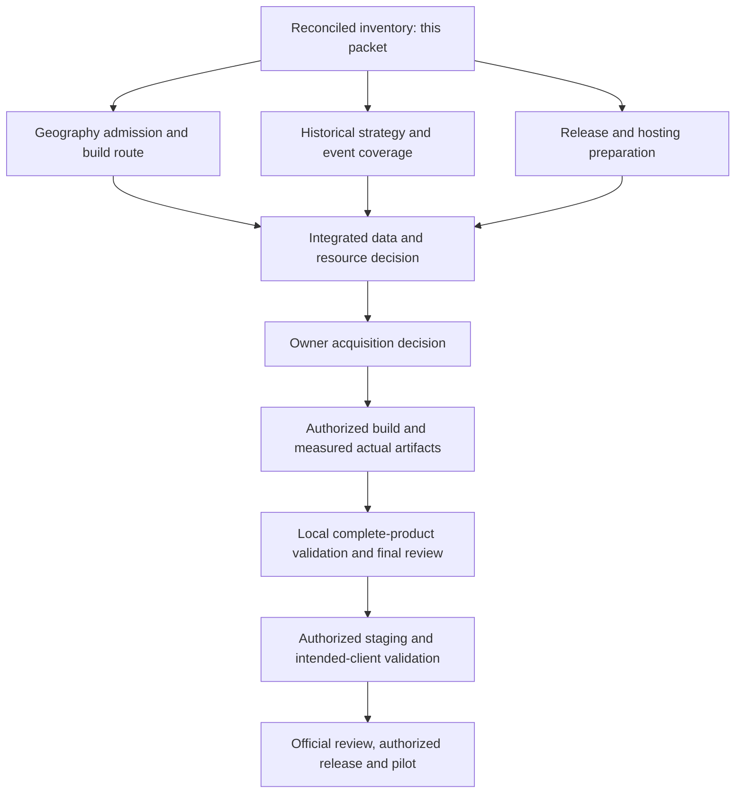

# NightSky V1 production-data readiness plan

> **For agentic workers:** Use superpowers:subagent-driven-development or superpowers:executing-plans for authorized implementation. Preserve the owner's execution method. This packet authorizes planning only; unchecked future work is not permission to acquire data, deploy or publish.

**Goal:** Assemble a defensible production-data inventory and dependency sequence for the existing global night-sky V1, without further place-by-place test waves.

**Architecture:** Keep shared read-only MCP tools and five workflows. Resolve named places locally; calculate astronomy locally; fetch source-specific forecasts on demand with controls; serve prepared, versioned candidate and historical files. Build bulk data outside the small serving host. No runtime relational database is introduced.

**Tech stack:** Existing TypeScript/Node MCP service, GeoNames/IANA, Astronomy Engine, MET/NOAA adapters, OSM/ERA5 builders, checksum-pinned files and existing Linux/Windows CI.

**Spec and owning plans:** [Original implementation](2026-10-10-nightsky-v1-implementation-reviewed.md), [global discovery extension](2026-10-15-nightsky-global-discovery.md), [original status](../../operations/implementation-status.md), [source admission](../../operations/global-catalogue-source-admission.md).

## Constraints and evidence precedence

- Global product objective, free data access, no runtime database and separate website workstream remain unchanged. Free data is not a guarantee of zero processing, storage, hosting or maintenance cost.
- No new dataset downloads, source requests, account changes, deployment, submission or publication are authorized by this packet. No paid builder or new account is assumed.
- This is a local document reconciliation, not fresh external-source research. Dated publication metadata must be revalidated before an acquisition decision; links and proposed releases are not proof a source is still available.
- Latest execution updates supersede earlier proposals. Completed March ERA5 jobs and the three acquired geographic pilot sources must not be requested again merely because an older checklist is open.
- Existing code closure, actual data coverage, client behavior and hosting acceptance are separate gates. Original counts stay **12 Done / 9 Partial / 6 Not started**. No new tickets or completion credit are created here.
- Owner accepts Codex evidence as enough to proceed locally. Claude retesting is deferred after a revoked sign-in; it is neither a failed backend nor proof of Claude compatibility. Actual launch-client acceptance remains a later gate.
- Do not silently drop agreed discovery/history/event scope to close tickets. A smaller launch claim requires an explicit owner decision; absent data stays unavailable or coverage-labeled.

## Consolidated inventory

The table records existing implementation/evidence, not a promise that every row is production-ready. Candidate categories remain park, viewpoint, protected-area, campground, beach and other under the existing reviewed selection rules.

| Data / journey | Existing usable implementation and evidence | Production gap / next evidence | Original owner |
| --- | --- | --- | --- |
| Named destinations | GeoNames cities500 index, country qualifiers and reviewed Hanle supplement; record-based IANA timezone | Pin actual release/runtime revision, attribution and refresh/rollback record; missing/ambiguous names require clarification. This is not every site/address. | 0 / 4 |
| Civil time | Node Intl/IANA rules and named-record timezone handling; explicit display timezone for selected candidates | Freeze runtime/image and gazetteer versions independently. No arbitrary-point timezone polygon promise. | 4 / 14 |
| Sun, Moon, planets, supported targets | Local Astronomy Engine calculations and reference/regression evidence; source-linked windows and sampled geometry | Freeze supported target definitions and evidence limits in release inventory; no terrain/visibility guarantee. | 5 / 10A |
| Weather/clouds | MET adapter, caching, issue/valid timestamps, period/instant semantics and unavailable fields; previous bounded real-source samples | Production contact/configuration and permitted live rehearsal; source-specific values do not establish seeing/transparency or global accuracy. An independent forecast source is not established by the shared multi-provider contract. | 0 / 7A / 14 |
| Aurora | NOAA adapter with freshness, cache and source limits | Production freshness/outage rehearsal; no personal sighting probability. | 7B / 14 |
| Meteor dated maxima | 13 NASA MEO peak instants for each of 2025 and 2026; separate source/year identities | Accepted peaks for other requested years, full season coverage and missing peak/radiant combinations remain open. Never annually recur dates. | 0 / 6 |
| Meteor radiants / typical seasons | 12 bounded radiant fits; ETA/ORI source-only typical longitude intervals | Fit windows are not activity seasons. Typical-season UTC conversion and requested-window overlap are unavailable; need scientific convention and independent boundary evidence. | 6 |
| Other events | Existing supported eclipse and calculated planet-event paths, with their recorded definitions and limits | Complete class/year/source/visibility inventory before release claims. Comets, maintained transient catalogs and apparent planet-pair events are not implicitly supported. | 6 / 15 |
| Observing candidates | Retained South India 1,327 and Bhutan 134 regional candidates; successful isolated Monaco 11 / Faroe 73 builds | These are different source editions and limited footprints, not a worldwide release. Fiji build/equality/date-line audit incomplete. Need real global source/producer, normalized edition and public derivative offer. | 0 / 8 |
| Country/state membership | Region resolver, paged membership, geometry checks and combined-scope query implementation | No admitted actual worldwide ADM0/ADM1 boundary edition. Source clipping polygons are not administrative boundaries. | 0 / 8 |
| Global indexing / exact-site plans | Paged files, bounded reads/cache, normalized-input builders and selected-point planning are implemented | Actual source ingestion, worldwide footprint residuals, output size, refresh cost and selected-host fit are unmeasured. Synthetic catalogs prove behavior, not coverage. | 8 / 10A / 14 |
| Historical runtime | Immutable tiles-2025-v3: Hanle, Kodaikanal and Munnar, 2025 sample, three tiles | Neither a 30-year baseline nor global context. Uncovered queries must stay unavailable. | 9 |
| Historical acquisition/build | Four older monthly checkpoints; two completed grouped March 1991–1992 jobs, separate year partitions; generic multi-year schema/build/publication paths | No actual complete 1991–2020/global release. Preserve eligibility gates (at least 90% samples and 27 qualifying years per relevant bin), adjacent-night boundaries, supplied-cell mapping and method provenance. | 0 / 9 |
| Guidance, gear, preparation, specialist apps | Five packaged workflows and cited guidance/checklists; no invented camera settings | Maintain dated links and accurately distinguish generic preparation from calculated opportunities. Native-client availability needs separate verification. | 11 / 12 / 15 |
| Attribution / release distribution | Source records and local policy/review/package preparation exist | Exact active source notices, OSM derivative database offer, verified publisher facts, real policy/support URLs and intended-client evidence remain gates. | 0 / 3C / 12 / 13 / 15 |

### Evidence ledger and superseded proposals

| Evidence | What it establishes | What it does not establish |
| --- | --- | --- |
| [Geographic pilot continuation](../../operations/fiji-pilot-wave.md) and [source admission](../../operations/global-catalogue-source-admission.md) | Original Monaco/Faroe/Fiji raw sources were acquired under earlier bounded allowances; Monaco/Faroe accepted builds have 11/73 candidates. Fiji stopped at its build deadline. | Permission to refetch, expand geography, install pilots or claim worldwide coverage. |
| [Completed grouped pilot](../../operations/data-pilot-wave.md) | Two March jobs completed, each with 1,488 source hours; all requested clocks supplied. Six place/year diagnostic rows each have 279 valid of 279 expected dark-hour samples. | More jobs allowed, complete local-night boundary coverage, a multi-month/30-year baseline, or worldwide storage predictions. |
| [Active historical tiles](../../operations/climate-tiles.md) | Three-place 2025 sample, 89,271 publication bytes; exact manifest and lineage are recorded in the owning document. | The additional March pilot has been installed, or a tiny output predicts global size. |
| [Latest local/model evidence](../../operations/complete-model-journey-validation.md#photography-timing-follow-up--15-october-2026-local-package-1012) | Package 1.0.12; 710 passing tests, one existing skip; reviewed Codex photography pass and six passing CI jobs at commit 192bbc1. | Fresh complete multi-client acceptance or production-data success. Claude's latest attempt is authentication-blocked. |

Earlier four-job/two-job history proposals are historical ceilings, not remaining allowances. The completed two March jobs must be excluded from future selections. Historical processingSeconds includes waiting, so it is not isolated decode CPU time. Retained pilot cells are test footprints, not a city-by-city product rollout strategy.

## Resource plan: distinguish a proposed ceiling from a feasible build

The existing global-source packet inventories eight dated continent PBFs with **85,563,268,782 metadata-listed bytes**. Its proposed ceiling is 100 GiB source input, a 64 GiB build worker, 48 hours and 1 TiB combined disk plus 128 GiB free reserve; a later serving trial proposes at most 10 GiB per runtime edition. **None is approved, locally measured global capacity, a size prediction or a requirement to purchase that hardware.** It is not a runnable plan for the small Hetzner server.

Before acquisition, lane A must resolve an executable route on available build hardware, with exact source identity and footprint accounting. If the existing envelope is infeasible, revise the strategy and re-admit inputs; do not quietly increase budgets, substitute a planet/Overture source or repeat country pilots. OSM remains the current preferred route; an alternative needs its own category, geometry, licence and producer admission.

For history, tiny March measurements do not supply a worldwide estimate. Lane B must freeze period, grid/cell coverage, variable selection, missing-hour policy and partitions, then calculate uncompressed workload from cells × eligible source hours × variables × representation size, separately accounting for indexes, raw retention, temporary files and rollback. Compression, provider queue time and final query performance remain unknown until measured. Monthly mean weather is not automatically equivalent to nighttime cloud-sample statistics. Do not publish invented worldwide size or completion-time estimates.

Keep raw acquisition/build output separate from serving files. The serving host gets only admitted immutable runtime editions and bounded caches, not raw planet imports or in-request ERA5 processing. Its exact Hetzner plan/storage is still an owner handoff for later; 2 vCPU/4 GiB is a target to measure, not established capacity.

## Parallel preparation wave — no acquisition

The three lanes can start together. They edit distinct owning documents; one integration owner alone updates shared status and this plan. These are preparation deliverables, not replacement original tickets.

| Lane | Existing tasks and files | Independently reviewable output | Required checks / stop |
| --- | --- | --- | --- |
| A: Global geography | 0/8; update `docs/operations/global-catalogue-source-admission.md` and `global-spot-acquisition-proposal.md`; consume existing `scripts/osm` producer contracts | One exact proposed release route, raw-to-normalized producer gap list, footprint/overlap/island/polar/date-line disposition, ADM0/ADM1 source-admission fields, ODbL offer requirements and hardware feasibility decision | Every release/size/vintage claim has dated evidence; unmeasured values remain unknown; no source substitution, body reads for new evidence or download command execution. Existing reports/manifests can be reconciled. |
| B: History and events | 0/6/9; append current ledger/strategy in `docs/operations/historical-baseline-wave.md`; reconcile `grouped-history-wave.md`, `meteor-coverage-matrix.md` and `meteor-typical-seasons-wave.md` | Explicit global historical coverage strategy and partition/eligibility specification; deduplicated future batch proposal excluding completed identities; event class/year/shower coverage and scientific-gap list | Separate active sample, completed pilots and missing baseline. No guessed season UTC conversion or duplicated jobs. Do not run CDS, fetch event bodies or reduce scope silently. |
| C: Release preparation | 3B/3C/12/13/14/15; update `docs/operations/local-package-readiness.md` and existing operations handoff documents | A field-by-field endpoint, identity, policy/retention, attribution, artifact-budget, staging/rollback and launch-client checklist; exact known facts filled and missing owner inputs visible | Support email is nightsky.earth2026@gmail.com; brand is NightSky.earth; do not invent verified legal identity, Hetzner plan/region/hostname, public URLs or actual client validation. No account changes or deployment. |

### Integration owner sequence

- [x] Reconcile existing geographic, historical and event evidence; preserve original ticket accounting.
- [x] Identify old proposal language superseded by completed pilots; consume no further allowance.
- [x] Map preparation lanes to original tasks, owning files, deliverables and stop rules.
- [ ] Complete A/B/C preparation packets in parallel, with independent review of each.
- [ ] Integrate one data release manifest and one concrete acquisition/build decision packet: exact source identities, geographic/temporal scope, proposed requests/jobs, execution machine, deadlines, storage/memory limits, first-result inspection, uncertain-job recovery and rollback/retention. Separate metadata requests from source-body requests. No open-ended worldwide download authority.
- [ ] Present the concrete choices and resource implications for owner decision. If free sources or available hardware cannot meet promised coverage, surface that before acquisition; do not claim readiness or change scope by implication.
- [ ] Only after explicit acquisition authorization, execute the selected bounded work; retain actual measurements and inspect the first result before continuing. A small format check is not a replacement for the global release.
- [ ] Validate/serve actual release artifacts locally, then run representative end-to-end journeys and owner questions. Any live-provider rehearsal needs its own bounded authorization under the current hold.
- [ ] Perform final integrated review, fix material findings and push/watch exact-revision CI. Document remaining coverage honestly.
- [ ] Obtain hosting handoff and separate deployment authorization; stage, measure actual host capacity, verify TLS/logging/retention/rollback and intended launch-client connection.
- [ ] Finish official package/reviewer validation, then separately authorized submission/publication and invited pilot. Website stays separate.

## Review focus and acceptance

| Failure mode | Required disposition / owning lane |
| --- | --- |
| Old proposal repeats a completed job or counts an acquired-but-failed source as a ready artifact | A/B reconcile exact identities against latest execution reports; no refetch/resubmission inferred. |
| Named-city global lookup or synthetic country tests are mistaken for worldwide candidate coverage | A separates city, candidate, boundary, footprint and installed-edition evidence. |
| A sample frequency becomes a forecast, or a radiant fit becomes a season | B retains method/domain labels, eligibility denominators and scientific conversion gaps. |
| A proposed resource ceiling becomes a promised server fit | A/B supply separate build/runtime measurements or mark unknown; C requires measured host admission. |
| Codex local success becomes an untested ChatGPT/Claude/Gemini launch claim | C records actual host/client evidence independently; deferred Claude stays deferred. |

Self-review: the inventory covers location/time, astronomy, weather, aurora, events, candidates/boundaries, history, guidance and release rights. File ownership avoids concurrent shared-status edits. Every future acquisition remains behind a concrete decision, with no new spending or scope reduction implied. This documentation wave changes no code, dataset, runtime configuration, ticket status or launch authority.
