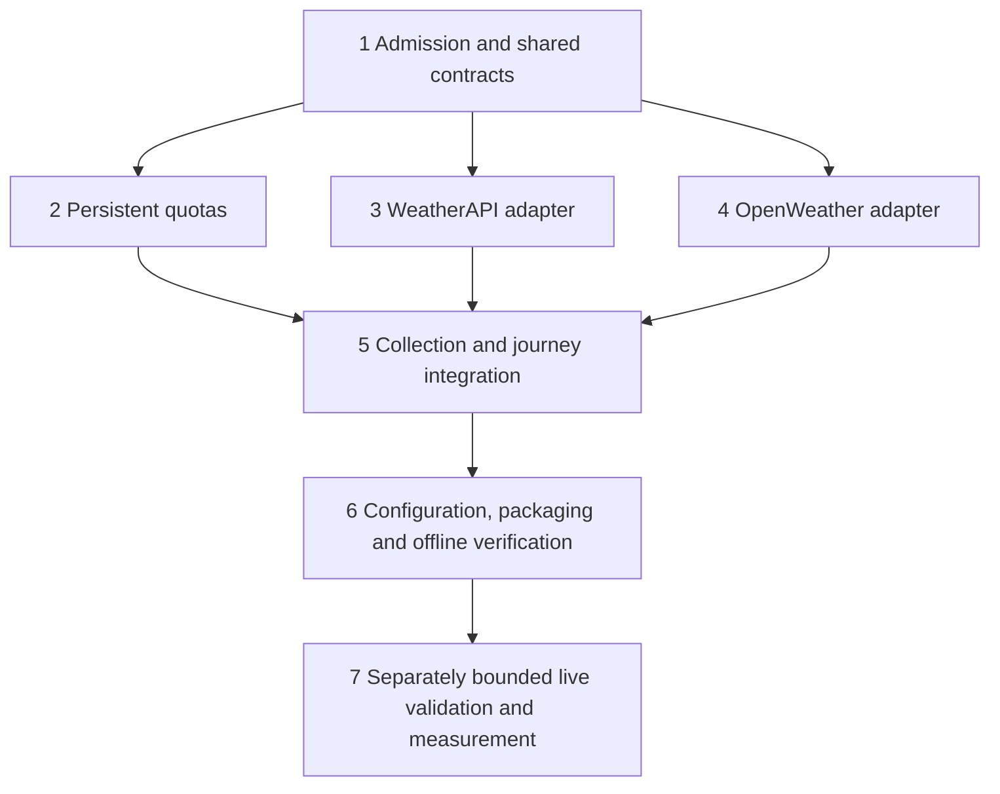

# Multiple weather sources and account activation implementation plan

> **For agentic workers:** REQUIRED SUB-SKILL: Use superpowers:subagent-driven-development or superpowers:executing-plans to implement this plan task-by-task. Steps use checkbox syntax for tracking.

**Goal:** Run independently labelled weather providers through the same local NightSky journeys, with free-tier enforcement and reusable adapter interfaces.

**Architecture:** Retain WeatherProvider as the per-source boundary. Add a bounded collection service and provider registry, consumed identically by direct conditions, planning and comparison. Keep location discovery separate; use a small persistent quota checkpoint, not a database or geography catalogue.

**Tech Stack:** Existing TypeScript, Node, Zod 4, MCP, node:test/tsx; no new external service or database dependency.

**Spec:** `docs/operations/api-mode-local-setup.md` (Multiple weather providers), `docs/operations/api-provider-admission.md`; parent `2026-10-17-api-first-v1-regroom.md`. Original 27-ticket acceptance remains authoritative.

## Global constraints

- Local work only. No deployment, publication, historical downloads, paid subscriptions or automatic live tests.
- Credentials stay outside source control, reports, command arguments and tool output. Account creation does not mean configured or integrated.
- WeatherAPI trial ends 2026-10-24; target Free capabilities even during trial. OpenWeather endpoint entitlement remains unverified; email-confirmation notice was visible.
- Preserve MET Norway and legacy single-provider injection, discovery modes, NOAA and astronomy.
- Global coordinates are supported inputs after existing selection validation; no promise of complete coverage or local forecast accuracy.
- Maximum four enabled weather sources. Do not pool forecasts, average disagreement, invent missing fields, or interpolate three-hour data into hourly certainty.
- No new original tickets or completion credit for this plan. Implementation slices below belong to existing 0, 7A, 8, 10A/B, 12A/B, 14 and 15 acceptance/revalidation.

## Reviewed starting point

Baseline HEAD: `8b35b2556c9ea805235c65041ec9b0833faff715`. Existing weather types live in `server/providers/weather/types.ts`; `shared/nightsky/weather.ts` already permits up to four forecasts. Both conditions handlers in `server/mcp/registerTools.ts` still call a single provider. `server/nightsky/planner.ts` contains pooled-value logic that must be reviewed before multi-source activation. `UpstreamProvider` currently lacks weatherapi/openweather IDs. Existing quota state is process-local.

This is an implementation plan, not a claim that adapters, credential setup, persistent quotas or live acceptance have been completed.

## Source and endpoint decisions

| Source | Intended use | Admission/activation decision |
| --- | --- | --- |
| MET Norway | Existing forecasts | Preserve existing endpoint, contact, cache and parsing behavior; include in collection service |
| WeatherAPI | Additional forecast series | Candidate fixed HTTPS `api.weatherapi.com/v1/forecast.json`, selected lat/lon, `days=3`, `aqi=no`, `alerts=no`; review exact Free schema, rights and timezone semantics before enabling |
| OpenWeather | Additional three-hour series | Candidate fixed HTTPS `api.openweathermap.org/data/2.5/forecast`, lat/lon, `units=metric`, `cnt=40`; verify account Free entitlement first. One Call and paid historical endpoints excluded |
| Geoapify | Location discovery | Existing adapter; private configuration and live validation pending; never classify as weather |
| GeoNames | Additional resolution/timezone | Signup blocked; leave unconfigured, prove Geoapify-only behavior |

Primary references checked 2026-10-17: [WeatherAPI pricing](https://www.weatherapi.com/pricing.aspx), [terms](https://www.weatherapi.com/terms.aspx), [docs](https://www.weatherapi.com/docs/), [OpenWeather pricing](https://openweathermap.org/price), [five-day forecast](https://openweathermap.org/api/forecast5), [MET terms](https://docs.api.met.no/doc/TermsOfService.html). OpenWeather's public endpoint description proves shape, not this account's free entitlement. WeatherAPI Free currently advertises 100K monthly calls and three forecast days; terms require attribution and constrain caching. Do not infer permission from marketing alone.

## Sequence and parallel ownership

After task 1 freezes interfaces, tasks 2/3/4 can run in three subagent lanes. One integration owner edits shared schemas, upstreamControls, registerTools, plugin bootstrap and planner. Adapter agents own only their new adapter/test files and source-specific documentation sections. Integrator lands shared provider IDs before parallel writers start. An unadmitted OpenWeather provider stays disabled; its failed admission does not block MET + WeatherAPI completion. History, events and complex geographic membership remain separate parent-plan work, not silently removed by this weather wave.

## Frozen interfaces

Retain `WeatherProvider.getForecast(place: WeatherPlace, window: {startUtc:string;endUtc:string;timeZone:string}): Promise<WeatherProviderResult>`.

Add in `server/providers/weather/types.ts`:
- `WeatherProviderId = "met" | "weatherapi" | "openweather"` (explicit registry, not arbitrary remote plugins).
- `WeatherProviderEntry { id: WeatherProviderId; provider: WeatherProvider; enabled: boolean }`.
- `WeatherCollection { outcomes: Array<{providerId:WeatherProviderId;result:WeatherProviderResult}> }`.
- `WeatherCollectionService.getForecasts(place:WeatherPlace, window:{startUtc:string;endUtc:string;timeZone:string}): Promise<WeatherCollection>`.
- `WeatherAdapterOptions { apiKey:string; fetcher:typeof fetch; now:()=>number; controls:UpstreamControls; quota:ProviderQuota }` with imported types from existing controls and task 2.

Add optional `weatherCollection?: WeatherCollectionService` dependency. Reject simultaneous collection and legacy weatherProvider configuration rather than choosing silently. Default single MET route remains supported. Add optional public `providerOutcomes` to nightConditionsResultSchema, maximum four, containing stable provider ID, existing status, bounded reason and SourceRecord; include disabled/not-configured configured entries as unavailable. Existing public forecasts and sources remain valid. Adapter factories: `createWeatherApiProvider(options:WeatherAdapterOptions):WeatherProvider` and `createOpenWeatherProvider(options:WeatherAdapterOptions):WeatherProvider`.

New configuration: `NIGHTSKY_WEATHER_PROVIDERS=met,weatherapi,openweather` (subset, unique, maximum four); `NIGHTSKY_WEATHERAPI_KEY`, `NIGHTSKY_OPENWEATHER_KEY`; `NIGHTSKY_QUOTA_STATE_PATH`. Existing Geoapify/MET variables remain unchanged. Unknown IDs fail configuration validation; missing credentials yield explicit unavailable outcomes, never paid fallback.

## Review focus

1. One source stalls or fails while another succeeds: retain successful source and bounded elapsed time (tasks 3–5).
2. Midnight/DST and hourly versus three-hour samples: preserve UTC instant and accumulation periods, no resampling (tasks 3–5).
3. Process crashes after reserving quota: restart cannot replenish allowance or leak keys (task 2).
4. All sources differ or none supplies night samples: no averaged score or false clear-night recommendation (task 5).
5. Trial ends, key changes or cached source revision expires: free capabilities and selected point identity remain correct (tasks 2, 3, 6).

## Task 1 — Admit sources and freeze shared contracts

Files: create `docs/operations/weather-provider-admission.md`; modify `server/providers/weather/types.ts`, `shared/nightsky/weather.ts`, `server/providers/upstreamControls.ts`; test `tests/providers/weather-collection-contract.test.ts`.

- [ ] Record per-endpoint account tier, free permission, attribution/disclaimer obligations, source resolution, supported fields, timestamp meaning, cache permissions and limitations. If proof is absent, mark activation blocked; do not make paid/live calls to infer permission.
- [ ] Write contract assertions: zero/one/three outcomes accepted; duplicate IDs and over-four rejected; missing fields remain missing; credentials absent from schemas. Run `node --import tsx --test tests/providers/weather-collection-contract.test.ts`, observe new cases fail.
- [ ] Implement frozen types/schema/provider IDs. Source issue time stays absent if unavailable; fetched time is never relabelled model issue time. Preserve old schema parsing and legacy provider injection.
- [ ] Re-run contract test and `npm run check`; expect pass. Commit only task files. Freeze ownership before lanes begin.

## Task 2 — Quotas that survive restart

Files: create `server/providers/quotaState.ts`, `tests/providers/quota-state.test.ts`; modify `server/places/api/http.ts` for shared quota reservation while preserving existing stricter limits; integrator wires bootstrap in task 6.

Produces `ProviderQuota.reserve(providerId:string,cost:number):Promise<{allowed:boolean;reason:string}>` and `createPersistentQuota(options:{path:string;now:()=>number;policies:QuotaPolicy[]}):Promise<ProviderQuota>`. `QuotaPolicy` defines providerId, operator account label (nonsecret), rolling-hour and rolling-24-hour limits and optional UTC-calendar-month limit. Serialize reservations and persist before any network attempt. Count failed/aborted attempts; do not double-charge coalesced requests or cache hits.

Proposed NightSky limits, lower than account limits and subject to stricter admission: WeatherAPI 60/hour, 1,000/24h, 20,000/calendar month; OpenWeather 30/hour, 300/24h, 5,000/calendar month. Preserve GeoNames 400/hour and 2,000/24h; Geoapify 200/hour and 1,000/24h. Reserve one attempt per request. MET retains existing policies; never impose invented upstream commercial quotas.

- [ ] Write tests for restart, crash between reservation and fetch, same-account key rotation, concurrent reservation, corrupt/truncated/missing-after-use state, rollback clock, UTC month boundary, full disk and second process. Assert remaining allowance never increases after a crash and no request begins after failed persistence.
- [ ] Run `node --import tsx --test tests/providers/quota-state.test.ts`; observe failure.
- [ ] Implement single-process ownership lock, bounded nonsecret checkpoint (maximum 4 MiB), atomic write/replace and conservative recovery. Use minute buckets charged until their full window expires. Retain auth/backoff state across restarts. Never persist queries, coordinates, keys or raw bodies. A missing checkpoint requires explicit verified-budget initialization; corruption fails closed, not automatic reset. Operator account label persists across key rotation. Reject unsafe paths/reparse targets and second process; test Windows replacement semantics.
- [ ] Re-run tests plus existing discovery HTTP tests and `npm run check`; expect pass. Document initialization/recovery procedure and commit.

## Task 3 — WeatherAPI adapter

Files: create `server/providers/weather/weatherApi.ts`, `tests/providers/weather-api.test.ts`; update source admission section only.

Consumes task 1 types/task 2 quota interface; produces `createWeatherApiProvider`.

- [ ] Write synthetic Free-shaped fixtures and tests: exact selected coordinates, three-day cap, local midnight/DST, documented UTC epoch handling, unit conversions, absent cloud layers, invalid values, malformed/oversized response, 401/403/429/HTTP-200 error, partial horizon and body timeout. Assert zero retries and no raw key/URL in diagnostics.
- [ ] Run `node --import tsx --test tests/providers/weather-api.test.ts`; observe failure.
- [ ] Implement allowlisted HTTPS GET only; reject redirects. Five-second total request/body deadline, 512 KiB decompressed cap, one concurrent request/provider, at least one second between starts, zero retries. Response cache maximum 128 entries/2 MiB total/64 KiB entry, 15-minute TTL (only if permitted). Normalize forecast hours only, not current observations. Preserve documented precipitation interval and probability meaning. Crop requested window to maximum 48 samples; label coverage gaps. Treat undocumented period semantics as missing field.
- [ ] Re-run tests, schema tests and `npm run check`; expect pass; commit. Account trial does not validate Free features.

## Task 4 — OpenWeather adapter

Files: create `server/providers/weather/openWeather.ts`, `tests/providers/openweather.test.ts`; update admission section only.

Consumes same interfaces and transport bounds as task 3; produces `createOpenWeatherProvider`. Free entitlement is an activation gate, not a reason to invent an endpoint.

- [ ] Write synthetic tests for five-day/three-hour timestamps, three-hour precipitation amounts, metric conversion, missing optional fields, requested window beyond returned horizon, duplicate/out-of-order samples, invalid cod/error objects, credential redaction, deadline/redirect/size/rate failures. Assert no hourly interpolation and no One Call URL.
- [ ] Run `node --import tsx --test tests/providers/openweather.test.ts`; observe failure.
- [ ] Implement fixed admitted endpoint using task 3's stated bounds and own separate cache/quota. Validate JSON independently; preserve cadence. A zero cloud value is valid; an absent cloud field is unknown. Do not use returned city center to move the selected location or treat fixed offset as IANA timezone.
- [ ] Re-run tests and `npm run check`; expect pass; commit. Keep activation disabled if entitlement unresolved.

## Task 5 — Collection service and all planning consumers

Files: create `server/providers/weather/collection.ts`, `tests/providers/weather-collection.test.ts`, `tests/mcp/multi-weather-planning.test.ts`; modify `server/mcp/registerTools.ts`, `server/nightsky/planner.ts`, `server/nightsky/compare.ts`, `shared/nightsky/weather.ts` as needed within frozen contract.

Produces `createWeatherCollection(entries:WeatherProviderEntry[],options:{deadlineMs:number}):WeatherCollectionService`. Use 12,000 ms overall deadline, concurrency two and deterministic registry ordering; adapters enforce request cancellation and their five-second deadline. Late results never mutate returned responses. No unlimited Promise.all fanout.

- [ ] Write failures-first tests for one/two/three sources, one stalled/failed/invalid source, all unavailable, unsupported horizon, mixed cadence/DST, no samples in darkness, conflicting values and legacy injection. Assert all requests receive identical selected coordinates and revision, and exact missing-data status survives direct tool/plan/compare paths.
- [ ] Run both new test files; observe failure.
- [ ] Implement collection and one shared conditions assembly helper used by both registry paths. Overall available only when enabled requested sources cover the window; otherwise partial when at least one usable series exists, unavailable when none. Preserve each source's detailed status. Compare only like fields/time periods; keep source-specific factors. Remove pooled planner extrema/rank assumptions that erase source identity. No single blended weather score or unconditional go recommendation.
- [ ] Re-run new tests, `tests/mcp/planning-e2e.test.ts`, `tests/mcp/api-discovery-planning.test.ts` and `npm run check`; expect pass; commit.

## Task 6 — Private setup, runtime, skills and offline release checks

Files: modify `server/plugin.ts`, `shared/nightsky/operator.ts`, `scripts/verify-api-runtime.mjs`, `scripts/measure-api-runtime.ts`, `tests/operations/operator-preflight.test.ts`, `tests/operations/api-runtime-measurement.test.ts`, `tests/all.test.ts`, `.github/workflows/nightsky-v1-checks.yml`, five existing skill files and matching workflow docs, `docs/operations/api-mode-local-setup.md`.

- [ ] Add failing configuration tests: Geoapify-only discovery, missing weather key, unknown/duplicate provider IDs, conflicting legacy/collection injection, no quota checkpoint, disabled entitlement, rollback with different provider set. Verify secrets cannot appear in preflight reports or CI artifacts.
- [ ] Wire registry once per process. Store credentials only through an approved private local environment mechanism, never checked-in .env/examples or command arguments. No live call during startup/health checks. Report configured versus admitted versus live-verified separately.
- [ ] Update instructions to present source-specific weather, cadence/horizon and failures concisely. Register new tests in tests/all.test.ts so CI actually executes them. Extend synthetic runtime/measurement with three-source and partial-outage fixtures; label fixture evidence synthetic.
- [ ] Run affected tests, `npm run check`, `npm test`, `npm run build`, `npm run plugin:package`, `node scripts/verify-api-runtime.mjs`, `npm run test:plugin-runtime`, `npm run test:review-cases`. Existing catalogue/history regression jobs remain.
- [ ] Review changes for requirements/security/scientific semantics; fix material failures and re-run affected checks. Update tracker without closing live gates; commit/push branch and watch exact-SHA CI. Never merge/deploy automatically.

## Task 7 — Bounded live evidence and owner experience (separate gate)

Files: create a nonsecret validation proposal/report under `docs/operations/`; update tracker and measurement evidence after actual checks.

- [ ] Prepare exact envelope for approval after tasks 1–6 pass: at most 12 upstream requests total, at most three per provider (Geoapify, MET, WeatherAPI, OpenWeather), ten-minute batch, zero retries, no history jobs. Skip unadmitted provider rather than moving budget elsewhere. Use existing user-known public named places; no personal GPS. Account for geocoding/timezone requests inside the cap. List exact endpoints and cases before execution.
- [ ] Only after authorization, configure admitted accounts privately and run the bounded matrix; validate response semantics, attribution, source status and failures. Do not declare worldwide quality from three places. Do not test paid features just because trial permits them.
- [ ] Measure actual configured-service latency, process RSS and cache/storage separately from provider accuracy. Run offline fifteen-journey matrix, then separately bounded Codex live questions with owner; Claude remains deferred.
- [ ] Record exact pass/fail and remaining source gaps. Original history/events, complex geography, hosting, policy and publication gates remain open according to their own evidence.

## Self-review outcome — 2026-10-17

Reviewed against code and parent scope. Corrections incorporated:

| Finding | Resolution |
| --- | --- |
| Public array mistaken for implemented multi-source runtime | Explicit task 5; both registry paths and planner/compare included |
| Pooled planner values can hide source disagreement | Source-specific factors and mixed-source regression tests |
| Trial/free and endpoint/account entitlement conflated | Tasks 1/4/6 disable unverified capabilities; no One Call fallback |
| Restart can replenish quotas | Durable reservation before request, conservative recovery and single-process lock |
| Multiple writers could conflict on schemas/bootstrap | Integrator owns shared files; parallel adapter lanes limited |
| Account setup might expose keys | Private configuration gate and redaction tests; no secrets in documents |
| New wave could hide old unfinished history/geography/events | Explicit parent gates retained; counts unchanged |

All five review-focus cases have owning tests. Shared signatures match task consumers. No runtime edits, tests, credential transfer or live data requests performed while writing this plan. Implementation review and actual test results remain future evidence.
